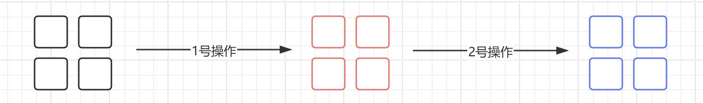

---
{
  "id": "3e75a2dd-8276-8030-979b-d6b3c24e2d6e",
  "url": "https://app.notion.com/p/Java-3e75a2dd82768030979bd6b3c24e2d6e",
  "created_time": "2026-09-26T09:09:00.000Z",
  "last_edited_time": "2026-10-14T07:53:00.000Z"
}
---

#  集合类重构（Java集合框架）

# 为什么重构
啊，柏码那里是分接口介绍的，一开始没看出来，所以写出来的文档没有可读性
现在声明：本章以不同接口分节
每节大致结构是：接口（继承关系，作用，定义的方法）➡️实现类➡️通用算法（不一定写）
旧页面扔归档页面里了
# 声明
这个文档只讲框架，不是API详情，具体使用需参考官方API
# 省流：
这章讲的是Java集合框架
什么是集合框架：Java针对“集合”做的一系列 创建/操作 的标准 方法/类/接口
什么是集合：集合是针对Java不同数据结构做的标准的 创建/操作 的 方法/类/接口
集合框架的设计分为三层：接口（定义行为），实现类（实现接口），通用算法（将实现类组合起来，做成一些常用算法）
JavaSE非常贴心的将这三层全部自带了，开发者几乎不需要自己实现任何东西
[根集合接口](根集合接口/index.md)
  Java集合框架其实就是一堆接口实现一堆类，组合成一堆算法
  **集合框架的设计分为三层：接口（定义行为），实现类（实现接口），通用算法（将实现类组合起来，做成一些常用算法）**
  Java集合框架所有集合的祖先都是集合根接口`Collection`

  
  Java 集合框架提供的 接口/类/方法 性能优良，还是很推荐使用的
  > java集合框架位于java.util包中，别忘了import导入
  # Collection 接口作用
  这个接口是所有集合框架接口的祖先，没有特别具体的作用（只是说明这是个集合框架）
  > Java不提供直接继承自Collection的类，只提供继承于的子接口
  # Collection 接口实现类
  注意⚠️：前文说Java不提供直接继承自Collection的类（因为接口只能被接口继承，不能被类继承），不代表Collection 接口不能有实现类
  如果不算子类下挂的实现类（“**直接**实现 `Collection` 接口”的类），Collection 接口只有一个实现类**`AbstractCollection`**
  **`AbstractCollection`**类实现了大部分接口的通用方法
  ### Q&A
  Q：为什么不是在接口下直接实现各种类，而是搞一个**`AbstractCollection`**类实现所有？实现一个Collection 接口有啥用啊？
  A：**`AbstractCollection`**类实现的是多数接口的通用方法，这是为了避免重复实现造成可维护性下降
[List接口](list接口/index.md)
  # List接口
  List接口直接继承自Collection接口（集合根接口）（Java21以前）或SequencedCollection（Java21+）
  List接口在**`AbstractCollection`**类及其子类实现
  它定义了列表（线性表）这种数据类型
  > 列表包含以下数据类型：动态数组，双向链表。常用的实现类有**ArrayList，LinkedList，Vector，Stack，CopyOnWriteArrayList**
  # List接口中定义的方法
  跟数组一样，列表每个元素有自己的下标
  **继承自 Collection 的基本方法**
  | **方法** | **说明** |
  | --- | --- |
  | `int size()` | 返回列表中元素的数量 |
  | `boolean isEmpty()` | 判断列表是否为空 |
  | `boolean contains(Object o)` | 判断是否包含指定元素 |
  | `boolean add(E e)` | 向末尾添加元素 |
  | `boolean remove(Object o)` | 移除第一个匹配的元素 |
  | `boolean containsAll(Collection<?> c)` | 是否包含指定集合的所有元素 |
  | `boolean addAll(Collection<? extends E> c)` | 添加指定集合的所有元素 |
  | `boolean removeAll(Collection<?> c)` | 移除指定集合中包含的元素 |
  | `boolean retainAll(Collection<?> c)` | 只保留指定集合中包含的元素（交集） |
  | `void clear()` | 清空列表 |
  | `Iterator<E> iterator()` | 返回迭代器 |
  | `Object[] toArray()` | 转换为数组 |
  | `<T> T[] toArray(T[] a)` | 转换为指定类型的数组 |
  **List 特有的索引方法**
  | **方法** | **说明** |
  | --- | --- |
  | `E get(int index)` | **获取**指定索引的元素 |
  | `E set(int index, E element)` | **替换**指定索引的元素，返回旧值 |
  | `void add(int index, E element)` | 在指定索引处**插入**元素 |
  | `E remove(int index)` | 移除指定索引的元素，返回被移除的元素 |
  | `int indexOf(Object o)` | 返回元素**第一次**出现的索引，不存在返回 -1 |
  | `int lastIndexOf(Object o)` | 返回元素**最后**出现的索引，不存在返回 -1 |
  | `boolean addAll(int index, Collection<? extends E> c)` | 在指定索引处插入集合的所有元素 |
  **List 特有的迭代方法**
  | **方法** | **说明** |
  | --- | --- |
  | `ListIterator<E> listIterator()` | 返回列表迭代器（可双向遍历） |
  | `ListIterator<E> listIterator(int index)` | 从指定索引开始迭代 |
  **Java 8+ 新增的默认方法**
  | **方法** | **说明** |
  | --- | --- |
  | `default void replaceAll(UnaryOperator<E> operator)` | 对每个元素应用操作并替换 |
  | `default void sort(Comparator<? super E> c)` | 根据比较器排序 |
  | `default Spliterator<E> spliterator()` | 返回可分割迭代器（并行处理） |
  **Java 21+ 新增（SequencedCollection）**
  | **方法** | **说明** |
  | --- | --- |
  | `void addFirst(E e)` | 在头部添加元素 |
  | `void addLast(E e)` | 在尾部添加元素 |
  | `E getFirst()` | 获取第一个元素 |
  | `E getLast()` | 获取最后一个元素 |
  | `E removeFirst()` | 移除并返回第一个元素 |
  | `E removeLast()` | 移除并返回最后一个元素 |
  | `List<E> reversed()` | 返回反转视图 |
  # 特性
  - 集合类在删除元素时，只会调用`equals`方法进行判断内容是否相等，而不是进行等号判断是否为同一对象，此时只会删除第一个元素
  - 列表中允许存在相同元素
  - 集合类支持嵌套使用，一个集合中可以存放其他集合
  ```java
public static void main(String[] args) {
    List<List<String>> list = new LinkedList<>();
    list.add(new LinkedList<>());   //集合中的每一个元素就是一个集合，这个套娃是可以一直套下去的
    System.out.println(list.get(0).isEmpty());
}
  ```
  # 常用实现类
  **ArrayList 动态数组**（线性表的一种）：更适合随机访问，因为可以直接读取某个下标的元素。插入则性能较差，因为需要移动一组元素，让出空间。
  **LinkedList 双向链表：**不适合随机访问，因为无法直接获取某个元素，只能遍历查找。插入性能较好，因为可以直接改变链表中结点的指向。
  # 列表基本操作（以ArrayList为例）
  上面说这么多下面直接演示
  <u>***用法总结：先创建列表→再添加元素→再进行各种操作***</u>
  ### 创建
  创建对象以创建列表
  ```java
List<String> list = new ArrayList<>();
  ```
  注意：需将对象引用给List而非ArrayList，方便后期更改类型
  ### 添加元素
  调用add()方法，内容作为参数传入
  ```java
list.add("张三");
  ```
  ### 查找元素
  调用相应方法
  ```java
//按照索引（下标）查找，使用get()方法
String name = list.get(0);
//按内容查找索引，使用indexOf()方法
int index = list.indexOf("李四");
//判断内容是否存在，使用contains()方法
boolean has = list.contains("王五"); 
  ```
  ### 修改元素
  调用相应方法
  ```java
// 通过索引替换
list.set(1, "新名字");  // 替换索引 1 的元素，返回旧值

// 替换所有元素（Java 8+）
list.replaceAll(s -> s + "!");
  ```
  ### 删除元素
  依旧是调用相应方法
  ```java
// 1. 按索引删除
list.remove(0);          

// 2. 按对象删除（注意 Integer 的坑）
list.remove("李四"); 
  ```
  另外还有遍历，排序等，不一一演示
[Iterator接口（迭代器）](iterator接口迭代器/index.md)
  # Iterator接口
  作用：用于遍历集合（某种数据结构）的接口，它定义了统一的遍历集合的方法，开发者无需关心底层是什么数据结构，只需调用Iterator接口的实现类即可
  注意：
  - Iterator接口定义的不是集合（不是某种数据结构），它是访问集合的工具接口
  - Java不止有一个迭代器，Iterator接口只是Java 迭代器最简单的实现，ListIterator 是 Collection API 中的接口， 它扩展了 Iterator 接口。
  - 虽然Iterator接口接口是独立于集合类的，但其实现位置与集合类中接口实现位置一致（都在**`AbstractCollection`**类及其子类实现），并不独立于集合类
  继承关系：正如上文所述，”Iterator接口定义的不是集合“ Iterator接口不在集合根接口下，它是独立的顶层接口，因此它不算集合类，它是独立的工具类

  # Iterator接口中定义的方法
  - **next()** - 返回迭代器的下一个元素，并将迭代器的指针移到下一个位置。
  - **hasNext()** - 用于判断集合中是否还有下一个元素可以访问。
  - **remove()** - 从集合中删除迭代器最后访问的元素（可选操作）
  # 注意
  - Iterator接口迭代器只能从前往后单向遍历，ListIterator 接口迭代器支持双向遍历
  - 在使用迭代器遍历集合时，不能直接修改集合中的元素（可能会导致 ConcurrentModificationException 异常），需要使用迭代器的 remove() 方法安全删除当前元素
  - 迭代器只能使用一次，如果需要再次使用，需要再次获取迭代器（创建迭代器对象）
  # 使用方法（以ArrayList+Iterator为例）
  使用方法总结：**由于迭代器的实现类就是集合类的实现类（对应数据结构的实现类），所以获取迭代器不是创建一个独立于集合类的某个类的对象，而是直接调用相应数据结构的iterator()方法，该方法会返回一个对象，将其引用给Iterator接口即可**
  Iterator 类位于 java.util 包中，使用前需要引入它
  ```java
import java.util.Iterator; // 引入 Iterator 类
  ```
  ### （前置要求）创建集合
  ```java
// 创建集合
ArrayList<String> sites = new ArrayList<String>();
sites.add("Google");
sites.add("Runoob");
sites.add("Taobao");
sites.add("Zhihu");
  ```
  ### 获取迭代器（创建迭代器）
  我们需要用到集合ArrayList（列表）下的一个方法iterator()，这个方法的作用是：返回一个迭代器对象
  然后引用给接口Iterator
  （这里写法是不是有点奇怪➡️因为迭代器的构造方法是私有的，因此无法通过new创建对象，而是需要使用静态方法iterator()来创建对象）
  ```java
// 获取迭代器
Iterator<String> it = sites.iterator();
  ```
  ### 返回下一个元素【next（）方法】
  ```java

System.out.println(it.next());
  ```
  ### 逐个返回所有元素【next()+hasNext()方法】
  以下是最简单的例子
  ```java
while(it.hasNext()) {
    System.out.println(it.next());
}
  ```
  PS：使用迭代器遍历集合时，如果在遍历过程中集合发生了修改（例如添加或删除元素），可能会导致 ConcurrentModificationException 异常，为了避免这个问题，可以使用迭代器自身的 **remove()** 方法进行安全删除
  ### 删除元素【remove() 方法】
  ```java
it.next();
//删除了最后一次访问的元素
  ```
[foreach（ for 循环）语法糖](foreach-for-循环语法糖/index.md)
  `foreach` 是一种用于遍历集合/数组的循环语法，和for循环没有本质区别
  是一种语法糖（for循环针对集合/数组的简便写法）
  ## **基本语法**
  ```plain text
for (元素类型 变量名 : 待遍历的对象) {
    // 循环体，变量代表当前元素
}
  ```
  冒号 `:` 左边是**临时变量的声明**，右边是**要遍历的目标**。
  # 示例
  ```java
// 遍历数组
int[] arr = {1, 2, 3};
for (int num : arr) {
    System.out.println(num);
}
  ```
[Queue和Deque接口](queue和deque接口/index.md)
  光看标题是不是看懵了，这啥东西？
  Queue和Deque都是接口
  下面详细介绍
  # Queue接口
  这个接口定义了队列的抽象，它定义了队列一进一出，先进先出的特性
  不必知道具体细节,只需要知道它有这几个抽象方法
  `java.util.Queue` 继承自 `Collection`，除了继承的方法外，定义了以下 6 个核心方法：
  ```java
public interface Queue<E> extends Collection<E> {
    // 插入
    boolean add(E e);      // 队列已满/受限时抛出 IllegalStateException
    boolean offer(E e);    // 插入失败返回 false，不抛异常

    // 移除
    E remove();            // 队列为空时抛出 NoSuchElementException
    E poll();              // 队列为空时返回 null

    // 检查队首（不移除）
    E element();           // 队列为空时抛出 NoSuchElementException
    E peek();              // 队列为空时返回 null
}

  ```
  # **Deque接口**
  `java.util.Deque` 继承自接口 `Queue`，它定义了针对队列**两端操作**的方法（如头插/尾插）
  一下是API列表：
  ```java
public interface Deque<E> extends Queue<E> {

    // ========== 两端插入 ==========
    void addFirst(E e);       // 头部插入，失败抛异常
    void addLast(E e);        // 尾部插入，失败抛异常
    boolean offerFirst(E e);  // 头部插入，失败返回 false
    boolean offerLast(E e);   // 尾部插入，失败返回 false

    // ========== 两端移除 ==========
    E removeFirst();          // 移除头部，为空抛异常
    E removeLast();           // 移除尾部，为空抛异常
    E pollFirst();            // 移除头部，为空返回 null
    E pollLast();             // 移除尾部，为空返回 null

    // ========== 两端检查（不移除）==========
    E getFirst();             // 查看头部，为空抛异常
    E getLast();              // 查看尾部，为空抛异常
    E peekFirst();            // 查看头部，为空返回 null
    E peekLast();             // 查看尾部，为空返回 null

    // ========== 栈操作（等价于 addFirst/removeFirst/peekFirst）==========
    void push(E e);           // 压栈 → addFirst(e)
    E pop();                  // 弹栈 → removeFirst()
    E peek();                 // 查看栈顶（继承自 Queue，但 Deque 语义指向头部）

    // ========== 元素移除（继承自 Queue 的扩展）==========
    boolean removeFirstOccurrence(Object o);  // 从头到尾删除第一个匹配元素
    boolean removeLastOccurrence(Object o);   // 从尾到头删除第一个匹配元素

    // ========== 逆序视图 ==========
    Iterator<E> descendingIterator();  // 返回反向迭代器（从尾到头）
}

  ```

  乂，我知道这东西有什么用？难道让我自己实现这些接口？
  当然不用↓
  # Queue和Deque的实现类
  ### LinkList（双向链表）
  怎么用？
  **直接创建LinkList类的对象➡️对象名.方法  调用即可**
  ### 专门的队列类
  这个有很多，不一一解释了
  | **专门类** | **底层结构** | **适用场景** |
  | --- | --- | --- |
  | **`ArrayDeque`** | 循环数组 | 通用队列/栈，**性能最好**（数组缓存友好，无节点开销） |
  | `ConcurrentLinkedQueue` | 单向链表 + CAS | 高并发无锁队列 |
  | `LinkedBlockingQueue` | 单向链表 + 锁 | 生产者-消费者模式 |
  | `ArrayBlockingQueue` | 循环数组 + 锁 | 有界队列，生产者-消费者 |
  | `PriorityQueue` | 二叉堆 | 优先级调度 |
  ### 那么有老铁问了：
  Q：乂，linkList不是双向链表么，怎么还兼职做队列？
  A：对，LinkList做双向链表的时候顺手也把队列也给实现了，但是还是建议使用专门的队列类
  # 用法
  这个用法简单：某集合类的对象.方法()
  直接用，不用创建/获取什么东西
[set接口（集合）](set接口集合/index.md)
  # set接口
  作用：set接口定义了**存储不重复的元素**的数据结构【集合】（这里的集合是数学意义上的集合，而非我们之前提到的集合类也就是Java集合框架）
  继承关系：`set`接口直接继承自集合根接口`Collection`
  实现位置：**`AbstractCollection`**及其子类
  # 注意
  数据结构“集合“
  - 不允许出现重复元素
  - 不支持随机访问（没下标）
  # Set接口定义的方法
  Set接口是从Collection中直接继承的，因此，Set支持的功能其实也就和Collection中定义的差不多
  同样是插入，删除等（需要自己查）
  # 实现类
  ### **HashSet（哈希集合）**
  - **底层结构**：基于 `HashMap` 实现
  - **特点**：无法保证顺序，允许 `null` 元素，不支持随机访问
  使用：
  ```java
public static void main(String[] args) {
		//创建哈希集合
    Set<String> set = new HashSet<>();
    //插入元素
    System.out.println(set.add("AAA"));
    //删除元素
    System.out.println(set.remove("AAA"));
    
    System.out.println(set);
}
  ```
  ### **LinkedHashSet**
  - **底层结构**：基于 `LinkedHashMap` 实现（链表 + 哈希表）
  - **特点**：维护元素的**插入顺序**
  - **性能**：略低于 HashSet，迭代性能更好
  使用：同上
  ### **TreeSet**
  - **底层结构**：基于红黑树（`TreeMap`）实现
  - **特点**：可排序，不允许 `null`
  使用：同上
[Map接口（映射）](map接口映射/index.md)
  # Map接口
  作用：Map接口定义了“映射”这种逻辑，元素两两对应，也就是“键值对”
  继承关系：和迭代器一样，Map不继承自集合根接口，但Map仍属于Java集合框架，下面引用Oracle官方的说法↓
  > Java Collections Framework 的核心接口由两棵**并列的、相互独立的**接口树构成：**Collection 分支，Map 分支**
  实现类：Map接口的实现类分为 ”一个抽象骨架”（AbstractMap） 和骨架下 “六个具体实现类”（HashMap，LinkedHashMap，Hashtable，WeakHashMap，IdentityHashMap，EnumMap），还有一堆不在抽象骨架下的类
  # Map接口定义的方法
  ```java
//Map并不是Collection体系下的接口，而是单独的一个体系，因为操作特殊
//这里需要填写两个泛型参数，其中K就是键的类型，V就是值的类型，比如上面的学生信息，ID一般是int，那么键就是Integer类型的，而值就是学生信息，所以说值是学生对象类型的
public interface Map<K,V> {
    //-------- 查询相关操作 --------
  
  	//获取当前存储的键值对数量
    int size();

    //是否为空
    boolean isEmpty();

    //查看Map中是否包含指定的键
    boolean containsKey(Object key);

    //查看Map中是否包含指定的值
    boolean containsValue(Object value);

    //通过给定的键，返回其映射的值
    V get(Object key);

    //-------- 修改相关操作 --------

    //向Map中添加新的映射关系，也就是新的键值对
    V put(K key, V value);

    //根据给定的键，移除其映射关系，也就是移除对应的键值对
    V remove(Object key);


    //-------- 批量操作 --------

    //将另一个Map中的所有键值对添加到当前Map中
    void putAll(Map<? extends K, ? extends V> m);

    //清空整个Map
    void clear();


    //-------- 其他视图操作 --------

    //返回Map中存放的所有键，以Set形式返回
    Set<K> keySet();

    //返回Map中存放的所有值
    Collection<V> values();

    //返回所有的键值对，这里用的是内部类Entry在表示
    Set<Map.Entry<K, V>> entrySet();

    //这个是内部接口Entry，表示一个键值对
    interface Entry<K,V> {
        //获取键值对的键
        K getKey();

        //获取键值对的值
        V getValue();

        //修改键值对的值
        V setValue(V value);

        //判断两个键值对是否相等
        boolean equals(Object o);

        //返回当前键值对的哈希值
        int hashCode();

        ...
    }

    ...
}
  ```
  非常多,没全列出来
  # Map接口的实现类（以HashMap为例）
  ### 创建，插入，读取
  ```java
public static void main(String[] args) {
		
		//创建哈希映射
    Map<Integer, String> map = new HashMap<>();
    
    //使用put方法添加键值对
    map.put(1, "小明");   
    map.put(2, "小红");
    
    //使用get方法根据键获取对应的值
    System.out.println(map.get(2)); 
}
  ```
  PS：映射（Map）无法添加相同的键，即使值不同。如果出现键相同的情况，那么会覆盖掉旧的，可以使用Java8新方法putIfAbsent()安全插入
  ### 默认返回值
  ```java
public static void main(String[] args) {
    Map<Integer, String> map = new HashMap<>();
    map.put(1, "小明");
    
    //get方法，找不到键值对默认返回null
    System.out.println(map.get(3));
    
    //getOrDefault方法，找不到键值对可以返回自定义的值
    System.out.println(map.getOrDefault(3, "备胎"));   //Java8新增操作，当不存在对应的键值对时，返回备选方案
}
  ```
[“比较“相关接口](比较相关接口/index.md)
  下面分成两种接口介绍：
  # `Comparable`接口
  ### 作用：
  `java.lang.Comparable` 接口，让类**自身**具备可比较的能力
  ### 工作原理：
  1. 在类定义时实现`Comparable`接口并重写`compareTo()` 方法，来使得类拥有“比较”的能力
  PS：`compareTo()` 方法用来定义比较规则
  1. 在使用时调用排序算法（sort等方法）
  1. 排序方法会在其内部调用compareTo() 方法并直接在原有对象的基础上进行排序
  示例：
  ```java
//类定义

public class Test implements Comparable<Test>{
	int a;
	
	//构造方法，用来为成员变量a赋值
	public Test(int a){
	this.a=a;
	}
	
	//在类内重写compareTo()方法以获得比较的能力
	@Override
	public int compareTo(Test o) {
      return this.a - o.a;
      //这里简化了比较的过程，仅用a-b来实现
    }

	}

  ```
  ```java
//使用，以自然排序算法sort为例
Test test1 =new Test(5);
Test test2 =new Test(4);
test1.sort(test2);
  ```
  ### 关键方法说明
  1. `compareTo()` 方法
  作用：定义比较规则（比较哪个成员变量）
  传入：被比较的元素（该数据结构**里的某个元素的引用）**
  返回：正/负/零  类型的数值
  注意：该方法只需要定义，无需手动调用，比较算法有关方法会自动在其内部调用。
  使用：定义时在参数列表创建一个与被比较对象相同类型的局部变量，用于接收比较的对象，重写时可以使用减法来实现一个最简单的正负输出逻辑，调用时由排序算法自动调用（无需手动调用）

  1. 排序算法（比较算法）
  以`sort`方法为例↓（自然排序）
  作用：直接在原对象基础上重新排序
  传入：待排序的数据结构的对象（如数组）
  返回：不会返回值，而是直接在原对象上做修改
  使用：无需重写定义，在调用时传入待排序的数据结构的对象

  # Comparator接口
  ### 作用：
  Comparator也是一个比较器，但它适用于无法在数据结构实现类中实现`Comparable`接口及重写`compareTo()`方法的情况（代码不开源，无权限等）
  这是一个外挂的比较器，而非`Comparable`接口那种将比较能力嵌入原类中
  ### 工作原理
  1. 由于无法修改原类，因此单独定义一个比较器类，该类实现Comparator接口并重写`compare()`方法
  1. 在使用时调用排序算法（sort等方法）
  1. 排序方法会在其内部调用compare() 方法并直接在原有对象的基础上进行排序
  ```java
//原始类定义
class Person {
    String name; 
    int age;
    // 注意：没实现 Comparable！
}
  ```
  ```java
// 单独写的比较器类定义
class AgeComparator implements Comparator<Person> {
    @Override
    public int compare(Person p1, Person p2) {
        return p1.age-p2.age;   
    }
}
  ```
  ```java
// 调用
Person[] persons = {...};
Arrays.sort(persons, new AgeComparator());
  ```
  ### 关键方法说明
  1. compare()方法
  作用：定义比较规则（比较哪个成员变量）（外挂版）
  传入：被比较的元素和比较的元素o1和o2（由于不能像compareTo方法嵌入原类，因此需要显示声明两个元素，且无法用“this”）
  返回：正/负/零  类型的数值
  注意：该方法只需要定义，无需手动调用，比较算法有关方法会自动在其内部调用。
  使用：定义时在参数列表创建一个与被比较对象相同类型的局部变量，用于接收比较的对象，重写时可以使用减法来实现一个最简单的正负输出逻辑，调用时由排序算法自动调用（无需手动调用）

  1. 排序算法（比较算法）
  以`sort`方法为例↓（自然排序）
  作用：直接在原对象基础上重新排序
  传入：待排序的数据结构的对象（如数组）
  返回：不会返回值，而是直接在原对象上做修改
  使用：无需重写定义，在调用时传入待排序的数据结构的对象
[Collections工具类](collections工具类/index.md)
  我们知道，集合框架的设计分为三层：接口（定义行为），实现类（实现接口），通用算法（将实现类组合起来，做成一些常用算法）
  **java.util.Collections** 就是第三层，Java集合框架的通用算法

  PS：我们前面提到的自然排序**`sort()`**方法就是由**`Collections`**类定义

  ## 常用的集合算法(方法)：
  | 算法分类 | 方法名 | 功能描述 |
  | --- | --- | --- |
  | 排序 | sort() | 对 List 进行升序排序 |
  | 混排 | shuffle() | 随机打乱 List 中元素的顺序 |
  | 反转 | reverse() | 反转 List 中元素的顺序 |
  | 二分查找 | binarySearch() | 在有序 List 中二分查找指定元素 |
  | 填充 | fill() | 用指定元素替换 List 中的所有元素 |
  | 复制 | copy() | 将一个 List 的元素复制到另一个 List |
  | 最大/最小值 | max() / min() | 返回集合中的最大或最小元素 |
  | 统计频次 | frequency() | 返回指定元素在集合中出现的次数 |
  | 不相交判断 | disjoint() | 判断两个集合是否有公共元素 |
  | 不可变集合 | unmodifiableXxx() | 返回集合的只读视图 |
  | 线程安全 | synchronizedXxx() | 返回线程安全的集合包装 |
  上一节我们已经以sort() 方法为例演示了集合框架通用算法的调用，其他方法的使用都与之类似，**作为开发者只需要关心方法传入什么，返回什么即可**
  用的时候查，不详细说了
[集合工厂方法（jdk9）](集合工厂方法jdk9/index.md)
  # 作用
  集合工厂方法是用于快速创建内容固定（不可变）且只读的数据结构
  # 特性
  - 集合工厂方法是静态方法，它们定义在`List`、`Set`、`Map` 接口内部
  - 用集合工厂方法创建的数据结构内容不可变，只能读不能写
  # 对比
  使用传统方式创建集合
  ```java
//先创建集合对象
List<String> list = new ArrayList<>();
//再调用add方法添加内容
list.add("a");
list.add("b");
list.add("c");
  ```
  使用集合工厂方法
  ```java
List<String> list = List.of("a", "b", "c");  
// 一行写完
  ```
  # 使用
  有三种工厂方法：
  ### **1️⃣ ****`List.of()`**** / ****`Set.of()`**** / ****`Map.of()`**** —— 直接创建**
  作用：直接创建不可变集合
  使用：直接调用方法即可，别忘了这几个of方法不在List/Set/Map接口的实现类里，而是作为静态方法定义在接口内，所以直接`接口.of()`调用
  传入：直接将集合元素作为参数传入
  调用：方法和普通集合一样
  ```java
List<String> list = List.of("a", "b", "c");
Set<Integer> set = Set.of(1, 2, 3);
Map<String, Integer> map = Map.of("apple", 1, "banana", 2);
  ```
  原理：为了加快创建速度，List/Set/Map 下有10个静态方法of()的重载（不用创建对象，元素直接作为参数传入）
  注意⚠️：
  - Map.of()方法最多传入10个元素，而List.of()和Set.of()则没有这个限制
  - 不能传入空元素nul
  ### **2️⃣ ****`Map.entry()`**** +**`Map.ofEntries()`**—— 构造不可变键值对**
  当Map集合超过了10个键值对就不能使用**`Map.of()`**方法，而需要使用**`Map.entry()`**** **方法
  ```java
Map<String, Integer> map = Map.ofEntries(
    Map.entry("apple", 1),
    Map.entry("banana", 2),
    Map.entry("cherry", 3),
    Map.entry("date", 4),
    Map.entry("elderberry", 5)
    // ...任意多对，没有数量上限
);

  ```
  注意⚠️：
  - 只有Map接口有**`entry()`**方法，List/Set接口没有该方法
  - **`Map.entry()`**** 和**`Map.ofEntries()` 是搭配使用的，两个方法都不能单独使用
  调用：方法和普通集合一样

  ### **3️⃣ ****`List.copyOf()`**** / ****`Set.copyOf()`**** / ****`Map.copyOf()`**** —— 拷贝转换（jdk10）**
  作用：传入一个已有集合，返回一个它的不可变的拷贝
  ```java
//已创建集合
List<String> mutable = new ArrayList<>(List.of("a", "b", "c"));
  ```
  ```java
//拷贝已有集合
List<String> snapshot = List.copyOf(mutable);
  ```
  调用：方法和普通集合一样
[有序集合功能规范（jdk21）](有序集合功能规范jdk21/index.md)
  先来解释一下什么是有序类：
  Java中的有序类指按照元素的值来决定在数据结构中的位置（如二叉树），而不是由放入的顺序决定在数据结构中的位置（如数组，队列）
  # 是什么
  **有序集合功能规范**是一系列有序集合接口及其扩展的统称（`SequencedCollection`、`SequencedSet`和`SequencedMap`这三个接口的统称）
  Java21后jdk的集合框架的接口层的继承被修改了：主要是新增了`SequencedCollection`、`SequencedSet`和`SequencedMap`接口
  在代码上的体现就是Java21后接口继承层级发生的改变
  ```mermaid
graph LR
    subgraph "改造前"
    Collection --> List
    Collection --> Deque
    Set --> SortedSet
    Map --> SortedMap
    end
    subgraph "改造后（JDK 21+）"
    Collection2[Collection] --> SequencedCollection
    SequencedCollection --> List2[List]
    SequencedCollection --> Deque2[Deque]
    Set2[Set] --> SortedSet2[SortedSet]
    SortedSet2 --> SequencedSet2["SequencedSet<br/>(也继承 SequencedCollection)"]
    Map2[Map] --> SortedMap2[SortedMap]
    SortedMap2 --> SequencedMap2[SequencedMap]
    end
  ```
  # 意义
  统一有序集合的方法
  jdk21前：各家的“首尾操作”是割裂的，`LinkedList` 有 `addFirst`（来自 Deque），`List` 却只有 `add(0, e)`；`SortedSet` 有 `first()`，`Deque` 有 `getFirst()`，`LinkedHashMap` 什么都没有（相同操作不同方法）
  jdk21后：三个接口统一了6个方法↓
  | **方法** | **契约** |
  | --- | --- |
  | `addFirst(e)` | 在顺序最前端插入 |
  | `addLast(e)` | 在顺序末尾插入 |
  | `getFirst()` | 返回首元素，**空集合抛 ****`NoSuchElementException`** |
  | `getLast()` | 返回末元素，同上 |
  | `removeFirst()` | 移除并返回首元素，同上 |
  | `removeLast()` | 移除并返回末元素，同上 |

  # 三个接口作用
  ### **SequencedCollection：统一6个方法**
  它直接继承 `Collection`，是整个规范的发起点，定义了“遇见顺序”的判定标准和 7 个核心方法
  ```java
interface SequencedCollection<E> extends Collection<E> {
    SequencedCollection<E> reversed();
    void addFirst(E e);
    void addLast(E e);
    E getFirst();
    E getLast();
    E removeFirst();
    E removeLast();
}

  ```
  ps：遇见顺序就是有序类的概念
  ### **SequencedSet：语义上的东西，不用在意**
  ### **SequencedMap：Map类型独立统一了6个方法**
  因为Map类型无法复用**SequencedCollection接口的，所以重新定义一遍**
  # 有什么影响
  没什么影响，只在集合框架的接口层修改，没有改动实现层一行代码
  但三个接口统一了原本割裂零碎的方法，解决了相同操作在不同集合下有不同方法的混乱局面
  # Q&A
  Q：那既然有序类有功能规范，像Link这样的由插入顺序而非元素决定位置的有没有功能规范
  A：很遗憾，没这东西，这也是逻辑不对称的地方，这东西其实是一个补丁，由于有序类的接口分散在各处，Java使用这个东西将他们组织起来
[(Java 8) Stream流](java-8-stream流/index.md)
  # 说在最前面
  **本节围绕“流水线”这一核心思想展开**，`Stream`也是为了引入“流水线”这一概念诞生的
  注意⚠️：Stream流不隶属于`java.io`包，而是在`java.utli`包下
  # 流水线是什么
  在Java集合框架中，想操作集合中的元素，传统的办法是：遍历所有元素后操作。如果有多步操作则需要进行多次遍历（每一步都遍历集合中所有元素）（整个集合为单位跑一遍流程）
  
  ```java
public static void main(String[] args) {
  	//定义一个集合
    List<String> list = new ArrayList<>();
    list.add("A");
    list.add("B");
    list.add("C");
  
  	//移除为B的元素（第一步）
  	Iterator<String> iterator = list.iterator();
    while (iterator.hasNext()){
        if(iterator.next().equals("B")) iterator.remove();
    }
  
  	//移除为A的元素（第二步）
   iterator = list.iterator();
    while (iterator.hasNext()){
        if(iterator.next().equals("A")) iterator.remove();
    }
    
  
	  //打印结果
	  System.out.println(list);
}
  ```
  而流水线思想是：每个元素单独跑一遍流程（中途淘汰的元素，后面的步骤不再遍历）
  ```java
                 ┌──────────────────────────────────────────────┐
   Source        │   1    2    3    4    5    6    7    8       │   List<Integer>
                 └──────────────────────┬───────────────────────┘
                                        │
                                        v
                 ┌──────────────────────────────────────────────┐
  Creation       │                 .stream()                    │   Stream<Integer>
                 └─┬────┬────┬────┬────┬────┬────┬────┬────────┘
                   │1   │2   │3   │4   │5   │6   │7   │8
                   v    v    v    v    v    v    v    v
                 ┌──────────────────────────────────────────────┐
Intermediate     │        .filter(n -> n % 2 == 0)              │   Stream<Integer>
                 └─────┬─────────┬─────────┬─────────┬──────────┘
                       │2        │4        │6        │8
                       v         v         v         v
                 ┌──────────────────────────────────────────────┐
Intermediate     │        .map(n -> n * n)                      │   Stream<Integer>
                 └─────┬─────────┬─────────┬─────────┬──────────┘
                       │4        │16       │36       │64
                       v         v         v         v
                 ┌──────────────────────────────────────────────┐
Intermediate     │        .sorted()                             │   Stream<Integer>
 (stateful)      └──────────────────────┬───────────────────────┘
                                        │4    16    36    64
                                        v
                 ┌──────────────────────────────────────────────┐
Intermediate     │        .skip(1)                              │   Stream<Integer>
 (stateful)      └──────────────────────┬───────────────────────┘
                                        │16   36    64
                                        v
                 ┌──────────────────────────────────────────────┐
  Terminal       │        .forEach(System.out::println)         │   void
                 │        打印: 16  36  64                       │
                 └──────────────────────────────────────────────┘

  ```
  ```java
public static void main(String[] args) {
  	//定义一个集合
    List<String> list = new ArrayList<>();
    list.add("A");
    list.add("B");
    list.add("C");
  
  	//使用流水线处理
    list = list     
            .stream()    //获取流
            .filter(e -> !e.equals("B"))   //只允许所有不是B的元素通过流水线
	            .filter(e -> !e.equals("A")) //只允许所有不是A的元素通过流水线
            .collect(Collectors.toList());   //将流水线中的元素重新收集起来，变回List
    System.out.println(list);
}
  ```
  # **Stream接口**
  `java.util.stream.Stream` 是一个**接口**
  实现类：各集合的实现类均实现了该接口
  作用：为Java引入流水线能力，该接口还定义了多种集合操作方法
  ### 关键方法：
  获取流**「写在链式调用的最前面」**
  - **`stream()`****方法：获取流**
  - parallelStream()方法：获取并行流「写在链式调用的最前面」
  终止流**「写在链式调用的最后」（触发执行）**
  - **`collect()`****方法：终止操作**
  - …
  中间操作
  - **`filter()`**方法：过滤掉指定元素
  - ** ****`map()`**方法：转换元素类型
  - **`sorted()`**方法：对元素排序
  - **`distinct()`**方法：去除重复元素
  - ….
  ### 使用方法
  将链式调用的结果赋值给原对象：先调用**`stream()`**方法获取流，接着调用中间操作方法操作集合，最后调用**`collect()`**方法终止流并触发执行
  例子：
  ```java
public static void main(String[] args) {
  	//定义一个集合
    List<String> list = new ArrayList<>();
    list.add("A");
    list.add("B");
    list.add("C");
  
  	//使用流水线处理
    list = list     
            .stream()    //获取流
            .filter(e -> !e.equals("B"))   //只允许所有不是B的元素通过流水线
	          .filter(e -> !e.equals("A")) //只允许所有不是A的元素通过流水线
            .collect(Collectors.toList());   //将流水线中的元素重新收集起来，变回List
    System.out.println(list);
}
  ```
  # 注意
  - 中间操作的方法允许传入Lambda表达式
  - 流水线是惰性执行，只有读到终止流的方法才会触发执行
  - 使用流水线相比于普通迭代器遍历在大量数据时更加节省内存（省去了重复遍历的内存开销）
  - 对于多线程的意义[https://www.icloud.com.cn/freeform/0b2aRciYqgZ7dF1xdfbels1Dg](https://www.icloud.com.cn/freeform/0b2aRciYqgZ7dF1xdfbels1Dg)
[(Java 9/11/16) Stream增强方法](java-91116-stream增强方法/index.md)
  由于jdk8推出的Stream流很实用，因此jdk9/11/16再次扩展了Stream流的功能
  # jdk9
  新增方法：
  ### **takeWhile() 取前缀**
  - 功能：对流进行截取
  - 传入参数：“谓词”，也就是判断条件
  - 返回：截取后的流
  - 工作原理：从流的第一个元素开始，根据传入的判断条件判断是否符合，一旦读到不符合的元素，立即截断流，并返回前面的所有元素（不包含截断处的元素）
  名词解释：
  前缀➡️就是截断位置前的所有元素
  谓词➡️就是判断条件，使用Lambda表达式
  例：
  ```java
//创建集合
List<Integer> nums = List.of(1, 2, 3, 7, 8, 4, 5, 9);

		//获取流 
nums.stream()
		//取前缀
		.takeWhile(n -> n < 3)
		//结束流
    .forEach(System.out::print);  // 输出: 12
  ```
  ### **dropWhile()** 去前缀
  - 功能：对流进行截取
  - 传入参数：“谓词”，也就是判断条件
  - 返回：截取后的流
  - 工作原理：从流的第一个元素开始，根据传入的判断条件判断是否符合，一旦读到不符合的元素，立即截断流，并返回后面的所有元素（不包含截断处的元素）
  名词解释：
  前缀➡️就是截断位置前的所有元素
  谓词➡️就是判断条件，使用Lambda表达式
  例：
  ```java
//创建集合
List<Integer> nums = List.of(1, 2, 3, 7, 8, 4, 5, 9);

		//获取流
nums.stream()
		//去前缀
		.dropWhile(n -> n < 3)
		//结束流
    .forEach(System.out::print);  // 输出: 78459

  ```
  ### **iterate() 方法扩展**
  - 功能：用来生成流的方法（不是获取流）
  - 工作原理：根据传入的种子和迭代算法，通过与上一个元素计算生成下一个元素
  - 传入（Java8）：传入两个参数（初始值，迭代函数）
  - 传入（Java9）：传入三个参数（初始值，终止条件，迭代函数）
  - 返回：生成的流
  - 注意⚠️：由于生成流时还没有流，因此链式调用中不是先调用获取流的方法，而是直接调用生成流的方法
  例：
  ```java
//Java8
			 //生成流
Stream.iterate(1, n -> n * 2)
			 //截断流（否则会无限生成）   
      .limit(5)  
       //结束流              
      .forEach(System.out::print);  // 1 2 4 8 16

  ```
  ```java
//Java9
			//生成流
Stream.iterate(1, n -> n < 100, n -> n * 2)
			//结束流
      .forEach(System.out::println);
// 1 2 4 8 16 32 64
  ```
  ### **ofNullable()**
  - 功能：**把“可能为 null 的引用”安全地转换成流（防止空指针异常）**
  - 工作原理：值为 null 时返回空流，值非 null 时返回单元素流
  - 传入：待转换成流的引用
  - 返回：流
  例：
  ```java
Stream.ofNullable("hello")  // 返回流hello
Stream.ofNullable(null)     // 返回空流
  ```
  # jdk11
  新增方法:
  ### Predicate.not()
  非 Stream 接口的方法，而是 `java.util.function.Predicate` 的静态方法
  - 功能：给传入的谓词取反
  - 工作原理：将一个谓词作为参数传入，返回它的取反谓词
  - 传入：待取反谓词
  - 返回：取反谓词
  - 存在意义：Lambda表达式可以不用这种而是直接在执行的操作前挂一个！来取反，但如果是一个写好的取反类的对象则不支持！取反，这时`Predicate.not()`就派上用场了
  例：
  ```java
// Java 11：方法引用保留，语义清晰
//可以给引用使用
list.stream().filter(Predicate.not(String::isBlank));
//也可以给Lambda表达式使用
list.removeIf(Predicate.not(s -> s.startsWith("WARN")));
  ```
  # jdk16
  新增方法:
  ### **toList()**
  - 功能：**把流中的元素直接收集为一个不可变 List**
  - 工作原理：不用传参，在链式调用中调用该方法即将流转换成List
  - 传入：不用传参，该方法是空参调用的
  - 返回：一个List
  例：
  ```java
// 直接调用即可，括号里什么都不填
List<String> result = stream.map(String::toUpperCase)
														.toList();
  ```
  ### **mapMulti()**
  - 功能：**把每个元素替换为零个或多个元素**
  - 工作原理：传入一个Lambda声明替换规则，按该规则替换后返回
  - 传入：一个Lambda表达式，该Lambda表达式有两个形参（当前流元素类型，输出类型），通过在Lambda中控制调用`输出类型.accept（替换内容）`的次数来控制入元素的数量
  例
  ```java
			//调用替换方法
stream.mapMulti((element, downstream) -> {
    downstream.accept(结果1);   // 将结果1替换全部元素
    downstream.accept(结果2);   // 将结果2替换全部元素（不覆盖结果1）
});

  ```
  可以发现这种方法可以实现所有元素多对一替换
[（Java24）流汇聚器Gatherers「暂时跳过」](java24流汇聚器gatherers暂时跳过/index.md)
  暂时跳过，这个是Java24的新特性，截止26-10-14Java24 仍是最新版，没有应用场景，兼容性不行
