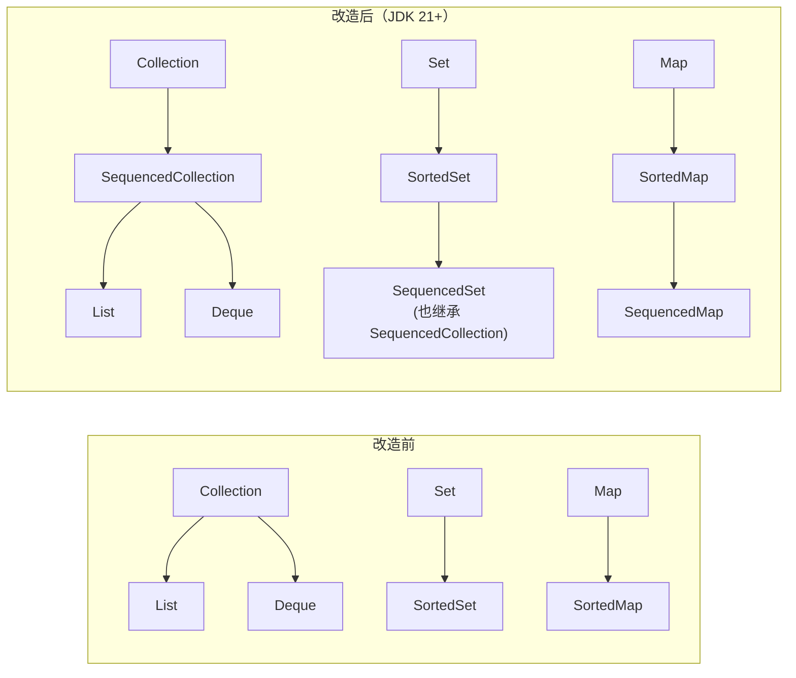

---
{
  "id": "3f65a2dd-8276-807a-a525-c6288d486d25",
  "url": "https://app.notion.com/p/jdk21-3f65a2dd8276807aa525c6288d486d25",
  "created_time": "2026-10-11T10:41:00.000Z",
  "last_edited_time": "2026-10-12T08:07:00.000Z"
}
---

#  **有序集合功能规范（jdk21）**

先来解释一下什么是有序类：
Java中的有序类指按照元素的值来决定在数据结构中的位置（如二叉树），而不是由放入的顺序决定在数据结构中的位置（如数组，队列）
# 是什么
**有序集合功能规范**是一系列有序集合接口及其扩展的统称（`SequencedCollection`、`SequencedSet`和`SequencedMap`这三个接口的统称）
Java21后jdk的集合框架的接口层的继承被修改了：主要是新增了`SequencedCollection`、`SequencedSet`和`SequencedMap`接口
在代码上的体现就是Java21后接口继承层级发生的改变

# 意义
统一有序集合的方法
jdk21前：各家的“首尾操作”是割裂的，`LinkedList` 有 `addFirst`（来自 Deque），`List` 却只有 `add(0, e)`；`SortedSet` 有 `first()`，`Deque` 有 `getFirst()`，`LinkedHashMap` 什么都没有（相同操作不同方法）
jdk21后：三个接口统一了6个方法↓
| **方法** | **契约** |
| --- | --- |
| `addFirst(e)` | 在顺序最前端插入 |
| `addLast(e)` | 在顺序末尾插入 |
| `getFirst()` | 返回首元素，**空集合抛 ****`NoSuchElementException`** |
| `getLast()` | 返回末元素，同上 |
| `removeFirst()` | 移除并返回首元素，同上 |
| `removeLast()` | 移除并返回末元素，同上 |

# 三个接口作用
### **SequencedCollection：统一6个方法**
它直接继承 `Collection`，是整个规范的发起点，定义了“遇见顺序”的判定标准和 7 个核心方法
```java
interface SequencedCollection<E> extends Collection<E> {
    SequencedCollection<E> reversed();
    void addFirst(E e);
    void addLast(E e);
    E getFirst();
    E getLast();
    E removeFirst();
    E removeLast();
}

```
ps：遇见顺序就是有序类的概念
### **SequencedSet：语义上的东西，不用在意**
### **SequencedMap：Map类型独立统一了6个方法**
因为Map类型无法复用**SequencedCollection接口的，所以重新定义一遍**
# 有什么影响
没什么影响，只在集合框架的接口层修改，没有改动实现层一行代码
但三个接口统一了原本割裂零碎的方法，解决了相同操作在不同集合下有不同方法的混乱局面
# Q&A
Q：那既然有序类有功能规范，像Link这样的由插入顺序而非元素决定位置的有没有功能规范
A：很遗憾，没这东西，这也是逻辑不对称的地方，这东西其实是一个补丁，由于有序类的接口分散在各处，Java使用这个东西将他们组织起来
