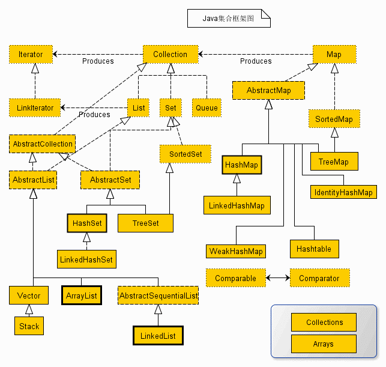

---
{
  "id": "3e75a2dd-8276-80c8-b567-d49918940935",
  "url": "https://app.notion.com/p/3e75a2dd827680c8b567d49918940935",
  "created_time": "2026-09-26T09:18:00.000Z",
  "last_edited_time": "2026-10-11T08:52:00.000Z"
}
---

#  根集合接口

Java集合框架其实就是一堆接口实现一堆类，组合成一堆算法
**集合框架的设计分为三层：接口（定义行为），实现类（实现接口），通用算法（将实现类组合起来，做成一些常用算法）**
Java集合框架所有集合的祖先都是集合根接口`Collection`

Java 集合框架提供的 接口/类/方法 性能优良，还是很推荐使用的
> java集合框架位于java.util包中，别忘了import导入
# Collection 接口作用
这个接口是所有集合框架接口的祖先，没有特别具体的作用（只是说明这是个集合框架）
> Java不提供直接继承自Collection的类，只提供继承于的子接口
# Collection 接口实现类
注意⚠️：前文说Java不提供直接继承自Collection的类（因为接口只能被接口继承，不能被类继承），不代表Collection 接口不能有实现类
如果不算子类下挂的实现类（“**直接**实现 `Collection` 接口”的类），Collection 接口只有一个实现类**`AbstractCollection`**
**`AbstractCollection`**类实现了大部分接口的通用方法
### Q&A
Q：为什么不是在接口下直接实现各种类，而是搞一个**`AbstractCollection`**类实现所有？实现一个Collection 接口有啥用啊？
A：**`AbstractCollection`**类实现的是多数接口的通用方法，这是为了避免重复实现造成可维护性下降
