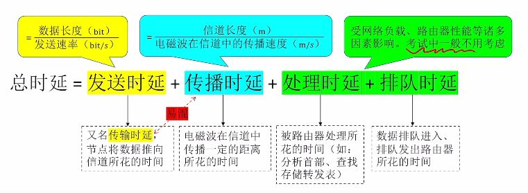

---
{
  "id": "3215a2dd-8276-808b-8214-db1c9d19a0e3",
  "url": "https://app.notion.com/p/1-1-5-3215a2dd8276808b8214db1c9d19a0e3",
  "created_time": "2026-03-12T09:02:00.000Z",
  "last_edited_time": "2026-04-07T08:46:00.000Z"
}
---

#  1.1-5计算机网络性能指标

# 速率
  **速率是节点在信道上的传输速率（速率=单向速率）**
  ### 信道
  表示某方向上的传输信息的通道（信道≠通信线路）
  一般一条通信线路逻辑上分一条发送信道和一条接收信道
  ### 速率单位
  单位：bit/s，b/s，bps 这些都是比特每秒
  **注意⚠️：B和b不是一个意思：B是字节，b是比特，1字节=8比特**
  ### 数量前缀（网络）（计网）
  K：千=bit x10³
  M：兆= K x10³
  G：吉= M x10³
  T：太= G x10³
  ### 数量前缀（存储）（计组，操作系统）
  其他一样
  倍数不一样：是1024，也就是2¹⁰
# 带宽
  某信道能传送的最大速率

  所以理论上千兆网络指的是上行千兆+下行千兆，而不是上行+下行千兆😈

  带宽受网络中最窄的那个设备决定
  ### 多含义解释
  在通信原理中：带宽指某信道允许通过的信号频段范围（光or电or电磁波）
# 吞吐量
  指单位时间某个网络（或信道，接口）的**实际数据量**
# 时延
  指数据从网络一端到另一端的时间
  总时延=发送 +传播 +处理 +排队

  
# 时延带宽积
  意义：一条链路中，已从发送端发出蛋尚未到达的最大比特数
  开个玩笑：两头同时拔网线，卡在网线里的数据量😅
  **公式：时延带宽积=****传播时延****×带宽**
  注意⚠️：是传播时延，因为要算卡在网线里的比特数
  时延带宽积主要用于设计最小帧长
# 往返时延
  往返时延RTT：指发送完数据到收到确认消息的时间
  游戏延迟就是往返延迟
  
# 信道利用率
  信道利用率=有数据通过的时间➗传输总时间
  信道利用率不能太低，浪费资源
  也不能太高，网络拥堵
