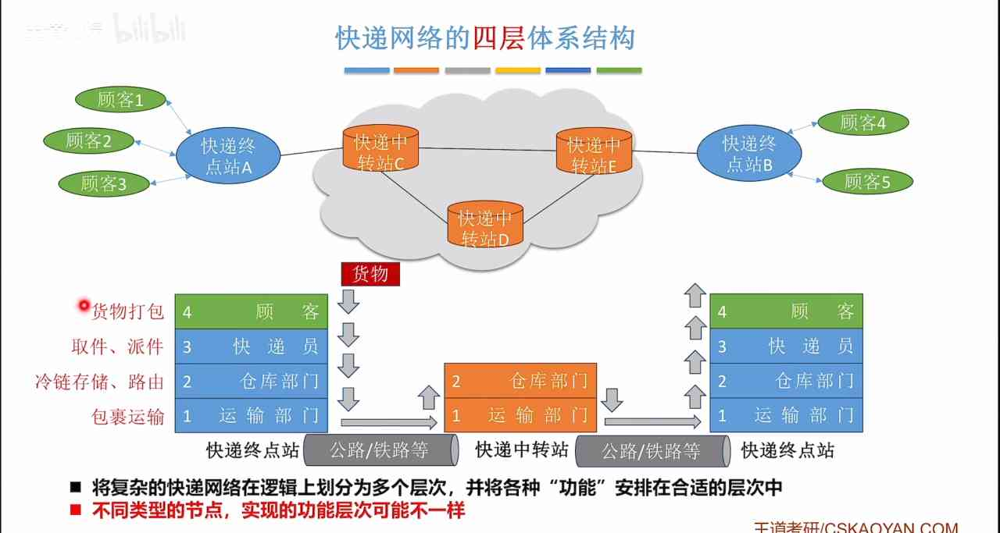
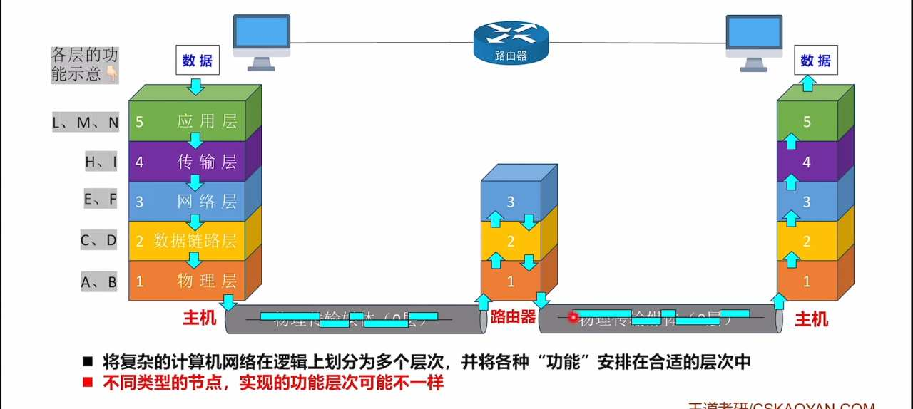
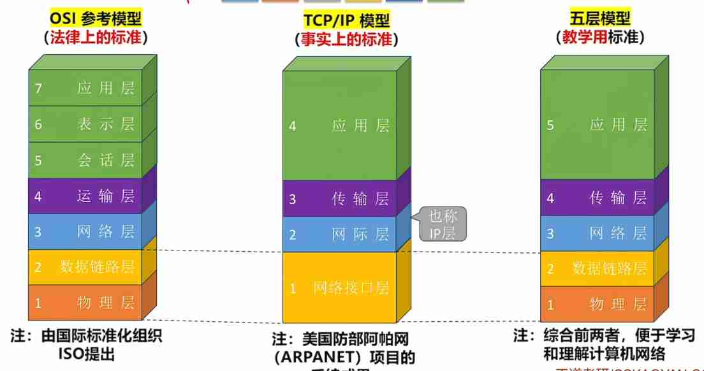

---
{
  "id": "3265a2dd-8276-8076-a467-e2aa25949169",
  "url": "https://app.notion.com/p/1-2-1-3265a2dd82768076a467e2aa25949169",
  "created_time": "2026-03-17T02:08:00.000Z",
  "last_edited_time": "2026-04-07T08:46:00.000Z"
}
---

#  1.2.1计算机网络分层（上）

像快递网络一样，计算机网络也是分层级的，如图

事实上，每一层之间功能是有可能重复的，只要合理就行（例如：顾客可以打包，快递员也可以打包）
# 计算机网络的分层
示意图

路由和链路中间节点不用处理全部层信息，它只需要得到转发相关的信息即可
这只是示意图，并非一成不变的
# 常见的三种分层结构

注意⚠️：计算机分层是个抽象概念，它只负责定义功能，不负责具体实现，具体实现交给软硬件厂商
- 实体：计算机网络中，第n层的活动元素（软件+硬件）称为第n层实体
- 不同机器上的同一层称为对等层，同一层的实体称为对等实体
- 协议：协议是控制对等实体之间通信的规则，在同一层的不同机器间，如图↓（水平上）

- 接口：同一节点内相邻两层实体交换信息的逻辑接口，又称服务访问点（SAP）（垂直上）
- 服务：服务是下层为相邻上层提供的功能调用（垂直上）

