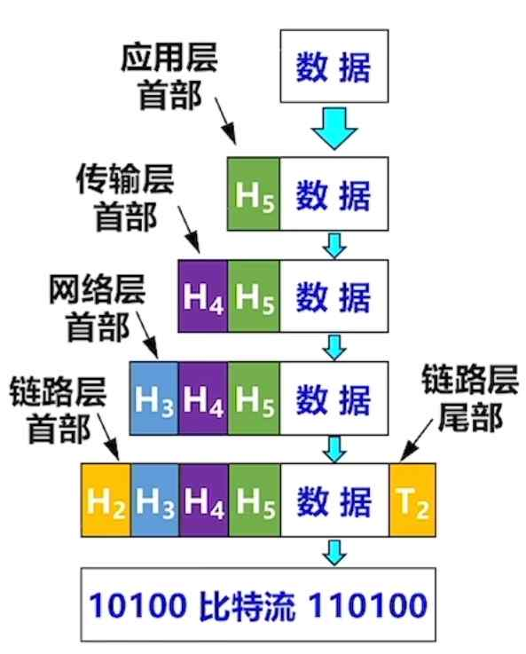
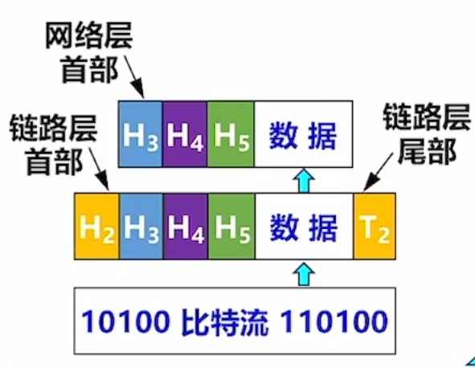

---
{
  "id": "3265a2dd-8276-8094-a7b0-fae5540c1fe7",
  "url": "https://app.notion.com/p/1-2-2-3265a2dd82768094a7b0fae5540c1fe7",
  "created_time": "2026-03-17T02:47:00.000Z",
  "last_edited_time": "2026-04-07T08:47:00.000Z"
}
---

#  1.2.2计算机网络分层（下）

# 数据在主机上的处理

# 在路由器上的处理

经过处理后

# 接受方主机
与发送方相反（图省略）
# PDU、SDU、PCI的概念
- 协议数据单元（PDU）：本层的所有数据（控制数据，用户数据）
- 服务数据单元（SDU）：上一层的所有数据
- 协议控制信息（PCI）：本层的控制数据
- 三者关系：n-SDU+n-PCI=n-PDU=(n-1)-SDU 
# 协议三要素
- 语法：规定数据和控制信息的格式
- 语义：需要发出什么控制信息，怎么应答
- 同步（时序）：规定各种操作的条件，时序关系（如：发送方10秒没收到“传输成功”应答，则重传）
