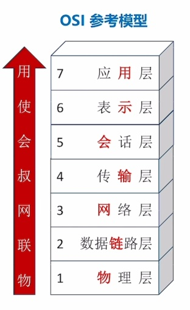

---
{
  "id": "32d5a2dd-8276-8032-9b66-c96e723bee81",
  "url": "https://app.notion.com/p/1-2-3_1-OSI-32d5a2dd827680329b66c96e723bee81",
  "created_time": "2026-03-24T06:03:00.000Z",
  "last_edited_time": "2026-04-07T08:47:00.000Z"
}
---

#  1.2.3_1 OSI参考模型

术语统一：
OSI模型的第四层叫运输层，也可以叫传输层
TCP/IP模型的第二层是网际层，也叫网络层
# osi各层的名称和顺序
  
  **口诀：物联网叔会使用**
  ## 1层：物理层
    任务：实现相邻节点之间比特（0或1）传输
    - **需定义电路接口定义**（形状，引脚）
    - **需定义传输信号的含义，电气特征**（如5v是1，1v是0）
  ## 2层：链路层
    任务：确保相邻节点间链路逻辑无差错
    - **差错控制**（数据帧）：检查+纠错 或检查+丢弃+重传
    - 流量控制：协调速率
  ## 3层：网络层
    任务：把分组从源节点转发到目的节点
    - **路由选择**：构造并维护路由表，决定分组通过的最佳路径
    - 分组转发：将分组从合适的端口转发出去
    - 拥塞控制：发现网络拥塞，并采取措施缓解
    - 网际互连：实现异构网络互联
    - 其他：差错控制（分组），流量控制，连接建立与释放，可靠传输管理
  ## 4层：传输层
    任务：实现进程与进程间通信
    - **复用和分用**：发送端几个高层实体复用低层连接，在接收端再分用
    - 其他功能：差错控制（报文段），流量控制，连接建立和释放，可靠传输管理
  ## 5，6，7层
    5层会话层：**管理进程间会话**（采用检查点机制，当通信失效时从检查点恢复通信）
    6层表示层：解决不同主机上表示信息不一致问题，**数据格式转换**（编码方式不一致）
    7层应用层：根据不同应用决定（如：http）
  ## 各层传输单位
    ### 7-5层 [应用层，表示层，会话层]：
    报文（单个文件就是一个报文）
    ### 4层传输层：
    报文段（将一个报文拆成多个段）
    ### 3层网络层
    分组（将一个报文段再次切分）
    PS：
    1. 现实中很少在网络层再次切分，这种切分叫“IP分片”，会额外吃掉路由器的性能，反而降低效率，所以一般都是直接将报文段封装成分组（直接装进去不切分）
    1. 路由器就工作在网络层
    ### 2层数据链路层
    帧（将报文封装成帧）
    PS：交换机就工作在数据链路层
    ### 1层物理层
    比特
