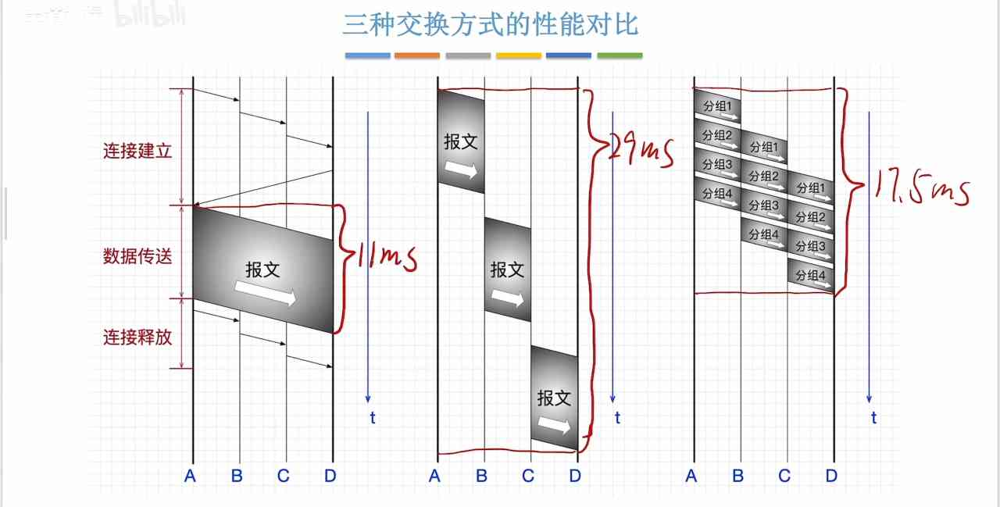
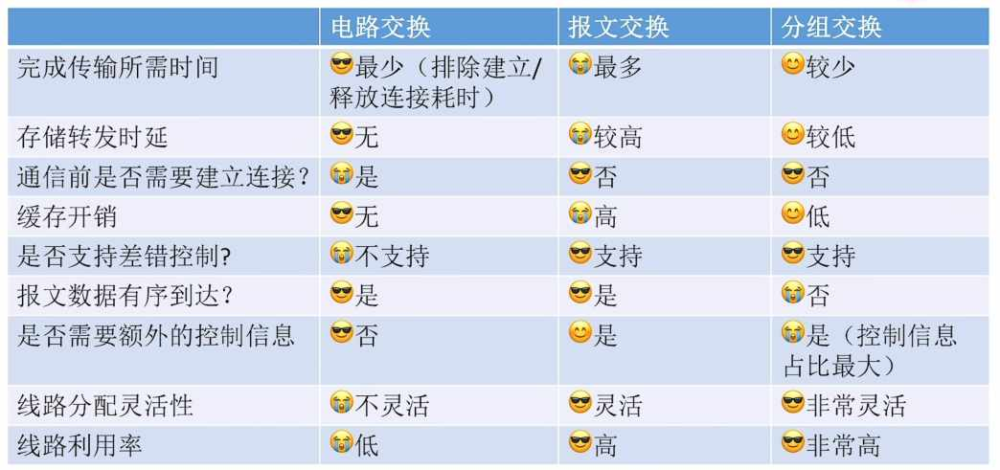
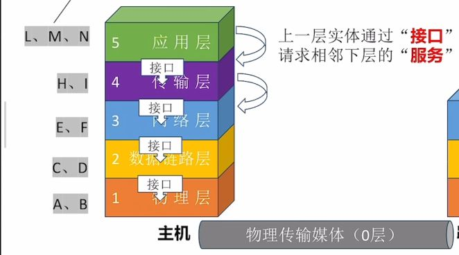
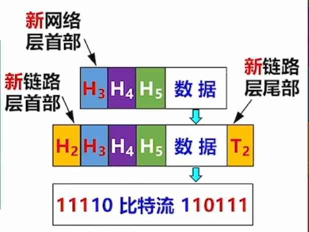
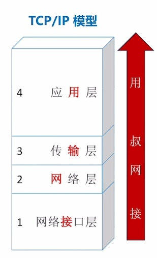
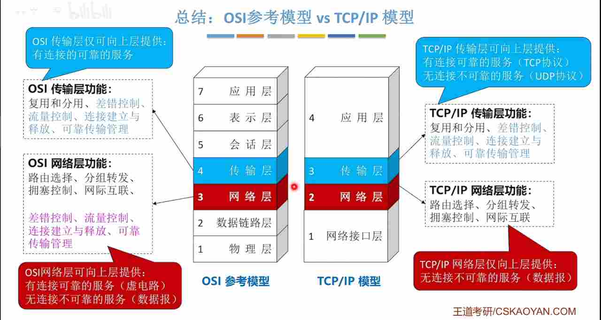

---
{
  "id": "33b5a2dd-8276-80c8-99a6-f07ae1716f8c",
  "url": "https://app.notion.com/p/1-33b5a2dd827680c899a6f07ae1716f8c",
  "created_time": "2026-04-07T08:44:00.000Z",
  "last_edited_time": "2026-06-19T09:02:00.000Z"
}
---

#  1.网络基本概念

[1.1-1计算机网络的概念](11-1计算机网络的概念/index.md)
  # 计算机网络，局域网，因特网区别
  计算机网络：网络的统称（局域网，互联网）
  局域网：支持各种协议
  因特网：只支持tcp/ip协议
  # 网络设备
  集线器：工作在一个网络下，但可能引起冲突
  交换机：工作在一个网络下，处理一个网络的数据交换工作
  路由器：将两个网络连接起来
  # 拓展
  ISP：是互联网服务提供商
  家用路由器：路由器+交换机….
[1.1-2计算机网络组成](11-2计算机网络组成/index.md)
  # 硬件-软件-协议角度
    ## 硬件
    路由器
    交换机
    集线器
    调制解调器（猫）
    网络适配器（网卡）
    线缆
    ## 软件
    客户端
    ## 协议
    各种协议
  # 工作方式角度
    ## 边缘部分
    各种终端
    ## 核心部分
    交换机等各种设施
  # 逻辑功能角度
    ## 资源子网
    负责提供各种资源，如：文件，算力，等
    例：IDC服务商内网
    ## 通信子网
    负责联通整个网络
    例：ISP核心网
  # 计算机网络功能
    数据通信：实现基本传输
    资源共享：硬件，软件，数据
    分布式处理：集群计算，边缘计算
    提高可靠性：主/备服务器
    负载均衡：多服务器负载均衡
    其他
[1.1-3-1电路交换，报文交换-分组交换](11-3-1电路交换报文交换-分组交换/index.md)
  # 电路交换
  电话网络
  连接→通信
  **优点：**传输速率高
  **缺点：**建立连接时间长，占线无法传输，被干扰无法纠错

  # 报文交换
  电报网络
  报文分两部分：控制信息，数据
  **优点：**不用连接，不用独占线路，支持干扰纠错
  **缺点：**
  报文大小不固定难以管理存储转发
  长报文需要整个发送，缓存开销大
  长报文重传代价高
  # 分组交换
  计算机网络
  由电报网络改进而来
  将报文切分成若干组，每组包含首部和报文
  **优点：**
  无需建立连接
  分组长度固定，方便缓存管理
  支持校验
  长报文无需整个发送
  **缺点：**
  控制信息占用了部分通信容量
  每个节点要处理控制信息，有延迟
  中途丢失分组导致后续处理复杂
  # 虚电路交换（现代网络）
  改进自分组交换
  需要先建立连接（虚拟电路）
  但不独占一条物理线路
[1.1-3-2三种交换方式性能分析](11-3-2三种交换方式性能分析/index.md)
  
  
  电路交换→打电话
  报文交换→大件运输
  分组交换→发多件快递，到了组装
[1.1-4计算机网络的分类](11-4计算机网络的分类/index.md)
  # 按分布范围
    ### 广域网（WAN）：
    跨省/跨国/跨洲
    技术：后面介绍
    ### 城域网（MAN）：
    跨城市
    技术：常采用以太网技术
    ### 局域网（LAN）：
    学校/企业/家庭
    技术：以太网技术
    ### 个域网（PAN）：
    家庭/智能家居网络
    技术：蓝牙/zigbee
  # 按传输技术分
    ### 广播式网络
    该广播覆盖范围内所有设备都能收到
    如：WiFi
    ### 点对点网络
    只会点对点发送
  # 按拓扑结构分
    ### 总线型
    数据“广播式”传输
    有争总线问题
    ### 环形网络
    依旧“广播式”传输
    通过令牌解决争总线问题，令牌顺环型传输，持有令牌才能使用总线
    ### 星型结构
    独立连接，点对点
    不存在争总线
    ### 网状结构
    数据通过多个节点转发
    点对点传输
  # 按使用者分
    共用网
    专用网
  # 按传输介质
    有线网络
    无线网络
[1.1-5计算机网络性能指标](11-5计算机网络性能指标/index.md)
  # 速率
    **速率是节点在信道上的传输速率（速率=单向速率）**
    ### 信道
    表示某方向上的传输信息的通道（信道≠通信线路）
    一般一条通信线路逻辑上分一条发送信道和一条接收信道
    ### 速率单位
    单位：bit/s，b/s，bps 这些都是比特每秒
    **注意⚠️：B和b不是一个意思：B是字节，b是比特，1字节=8比特**
    ### 数量前缀（网络）（计网）
    K：千=bit x10³
    M：兆= K x10³
    G：吉= M x10³
    T：太= G x10³
    ### 数量前缀（存储）（计组，操作系统）
    其他一样
    倍数不一样：是1024，也就是2¹⁰
  # 带宽
    某信道能传送的最大速率

    所以理论上千兆网络指的是上行千兆+下行千兆，而不是上行+下行千兆😈

    带宽受网络中最窄的那个设备决定
    ### 多含义解释
    在通信原理中：带宽指某信道允许通过的信号频段范围（光or电or电磁波）
  # 吞吐量
    指单位时间某个网络（或信道，接口）的**实际数据量**
  # 时延
    指数据从网络一端到另一端的时间
    总时延=发送 +传播 +处理 +排队

    
  # 时延带宽积
    意义：一条链路中，已从发送端发出蛋尚未到达的最大比特数
    开个玩笑：两头同时拔网线，卡在网线里的数据量😅
    **公式：时延带宽积=****传播时延****×带宽**
    注意⚠️：是传播时延，因为要算卡在网线里的比特数
    时延带宽积主要用于设计最小帧长
  # 往返时延
    往返时延RTT：指发送完数据到收到确认消息的时间
    游戏延迟就是往返延迟
    
  # 信道利用率
    信道利用率=有数据通过的时间➗传输总时间
    信道利用率不能太低，浪费资源
    也不能太高，网络拥堵
[1.2.1计算机网络分层（上）](121计算机网络分层上/index.md)
  像快递网络一样，计算机网络也是分层级的，如图
  
  事实上，每一层之间功能是有可能重复的，只要合理就行（例如：顾客可以打包，快递员也可以打包）
  # 计算机网络的分层
  示意图
  

  路由和链路中间节点不用处理全部层信息，它只需要得到转发相关的信息即可
  这只是示意图，并非一成不变的
  # 常见的三种分层结构
  
  注意⚠️：计算机分层是个抽象概念，它只负责定义功能，不负责具体实现，具体实现交给软硬件厂商
  - 实体：计算机网络中，第n层的活动元素（软件+硬件）称为第n层实体
  - 不同机器上的同一层称为对等层，同一层的实体称为对等实体
  - 协议：协议是控制对等实体之间通信的规则，在同一层的不同机器间，如图↓（水平上）
  
  - 接口：同一节点内相邻两层实体交换信息的逻辑接口，又称服务访问点（SAP）（垂直上）
  - 服务：服务是下层为相邻上层提供的功能调用（垂直上）

  
[1.2.2计算机网络分层（下）](122计算机网络分层下/index.md)
  # 数据在主机上的处理
  
  # 在路由器上的处理
  
  经过处理后
  
  # 接受方主机
  与发送方相反（图省略）
  # PDU、SDU、PCI的概念
  - 协议数据单元（PDU）：本层的所有数据（控制数据，用户数据）
  - 服务数据单元（SDU）：上一层的所有数据
  - 协议控制信息（PCI）：本层的控制数据
  - 三者关系：n-SDU+n-PCI=n-PDU=(n-1)-SDU 
  # 协议三要素
  - 语法：规定数据和控制信息的格式
  - 语义：需要发出什么控制信息，怎么应答
  - 同步（时序）：规定各种操作的条件，时序关系（如：发送方10秒没收到“传输成功”应答，则重传）
[1.2.3_1 OSI参考模型](123-1-osi参考模型/index.md)
  术语统一：
  OSI模型的第四层叫运输层，也可以叫传输层
  TCP/IP模型的第二层是网际层，也叫网络层
  # osi各层的名称和顺序
    
    **口诀：物联网叔会使用**
    ## 1层：物理层
      任务：实现相邻节点之间比特（0或1）传输
      - **需定义电路接口定义**（形状，引脚）
      - **需定义传输信号的含义，电气特征**（如5v是1，1v是0）
    ## 2层：链路层
      任务：确保相邻节点间链路逻辑无差错
      - **差错控制**（数据帧）：检查+纠错 或检查+丢弃+重传
      - 流量控制：协调速率
    ## 3层：网络层
      任务：把分组从源节点转发到目的节点
      - **路由选择**：构造并维护路由表，决定分组通过的最佳路径
      - 分组转发：将分组从合适的端口转发出去
      - 拥塞控制：发现网络拥塞，并采取措施缓解
      - 网际互连：实现异构网络互联
      - 其他：差错控制（分组），流量控制，连接建立与释放，可靠传输管理
    ## 4层：传输层
      任务：实现进程与进程间通信
      - **复用和分用**：发送端几个高层实体复用低层连接，在接收端再分用
      - 其他功能：差错控制（报文段），流量控制，连接建立和释放，可靠传输管理
    ## 5，6，7层
      5层会话层：**管理进程间会话**（采用检查点机制，当通信失效时从检查点恢复通信）
      6层表示层：解决不同主机上表示信息不一致问题，**数据格式转换**（编码方式不一致）
      7层应用层：根据不同应用决定（如：http）
    ## 各层传输单位
      ### 7-5层 [应用层，表示层，会话层]：
      报文（单个文件就是一个报文）
      ### 4层传输层：
      报文段（将一个报文拆成多个段）
      ### 3层网络层
      分组（将一个报文段再次切分）
      PS：
      1. 现实中很少在网络层再次切分，这种切分叫“IP分片”，会额外吃掉路由器的性能，反而降低效率，所以一般都是直接将报文段封装成分组（直接装进去不切分）
      1. 路由器就工作在网络层
      ### 2层数据链路层
      帧（将报文封装成帧）
      PS：交换机就工作在数据链路层
      ### 1层物理层
      比特
[1.2.3_2 TCP/IP模型](123-2-tcpip模型/index.md)
  # TCP/IP模型
  

  # 和osi模型区别
  1. 各层级功能与osi模型类似
  1. tcp/ip模型取消了表示层和会话层，改用应用层实现
  1. 将链路层和物理层合并为网络接口层，并减少对链路和接口形态的限制，以鼓励设备制造商创新
  1. tcp/ip模型只有一次差错控制，流量控制，连接建立与释放，可靠传输管理，它们都由传输层完成✅，传输层以下的的层级由于没有差错控制是不可靠的❌
  

  # 优缺点：
  优点：
  由于去掉了3层（网络层）及以下的差错控制，使得中间的节点（路由器）负载下降，降低了成本，提高了处理效率
  缺点：
  传输过程缺少差错控制，一旦传输出错重传代价高
  # 特性
  tcp/ip由于只有一层差错控制，因此可以提供有连接可靠服务（TCP协议），也可以提供无连接不可靠服务（UDP协议）
  
