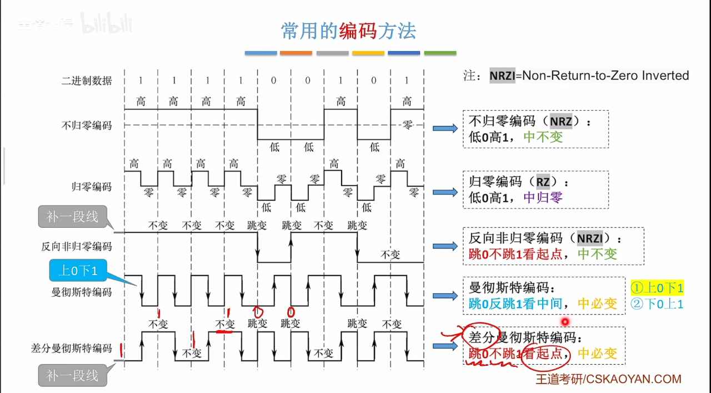
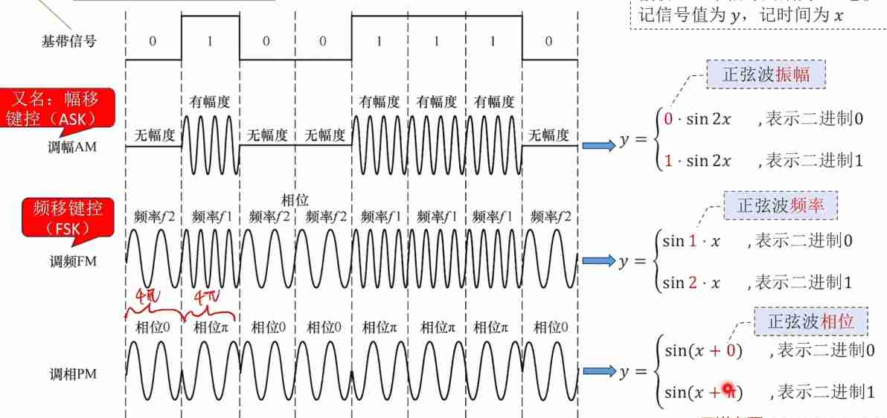

---
{
  "id": "33b5a2dd-8276-80b5-aaba-fc5b1881bf30",
  "url": "https://app.notion.com/p/2-33b5a2dd827680b5aabafc5b1881bf30",
  "created_time": "2026-04-07T08:47:00.000Z",
  "last_edited_time": "2026-04-07T08:49:00.000Z"
}
---

#  2.物理层

[2.1.1物理层](211物理层/index.md)
  # 概念
  信源：信号的来源
  数据：信息本体
  信号：数据的载体
  信道：信号的通道
  信宿：数据接收方
  PS：
  1. 一条物理线路通常包含两个信道：发送信道，接收信道
  1. 信号分模拟（连续）和数字（离散）
  **码元：在一个信号周期内，每一个信号就是一个码元，可以把“信号周期”称为“码元宽度”**
  （例：使用自然二进制编码，4位表示一种信号，那码元宽度就是4，有16种码元）
  # 码元与bit换算
  $$
1码元=log_2^K bit
$$
  K：码元种数
  码元/秒=波特率（不是比特率）
[2.1.2信道的极限容量](212信道的极限容量/index.md)
  带宽（计网）：最高数据率，单位hz
  带宽（通信）：允许通过的频带范围
  # 奈奎斯特定理（奈氏准则）（无噪声）
  **一个理想低通信道的极限波特率=2W**
  理想低通信道：没有噪声，带宽有限的信道
  W：是信道的频率带宽，单位Hz
  $$
极限比特率=2Wlog_2^K
$$
  如果波特率太高，会码间串扰，导致无法识别
  # 香农定理（有噪声）
  对于有噪声，带宽有限的信道
  $$
极限比特率=Wlog_2^{（1+S/N）}
$$
  W：信道频率带宽
  S/N：信噪比
  $$
信噪比=信号功率÷噪声功率
$$
  由于在正常通信中信号功率往往比噪声功率大很多，信噪比很大，所以引入另一种单位：分贝
  $$
1dB=10log_{10}^{S/N}
$$
  总结：提升带宽，功率，降低噪声功率，都可以提高极限比特率
[2.1.3编码与调制](213编码与调制/index.md)
  编码：二进制数据→数字信号
  解码：数字信号→二进制数据
  调制：二进制数据→模拟信号
  解调：模拟信号→二进制数据
  # 常用编码方式
    **不归零编码（NRZ）**：
    低0高1，中不变
    - 自同步（时钟同步）：无
    - 浪费带宽（每hz利用率）：不浪费
    - 抗干扰：弱👎🏻

    **归零编码（RZ）：**
    低0高1，中归零
    PS：“中”指的是两个信号之间怎么处理
    - 自同步：有
    - 浪费带宽：浪费
    - 抗干扰：弱👎🏻

    **反向非归零编码（NRZI）**：
    跳0不跳1看起点，中不变（遇到0就跳变一下）
    - 自同步：若增加冗余位，可支持
    - 浪费带宽：浪费一点（冗余位）
    - 抗干扰：弱👎🏻

    **曼彻斯特编码：**
    上跳0下跳1看中间，中必变（一定会在信号中间跳变，是0是1取决于上跳还是下跳）（默认）
    还有一种旧版曼彻斯特编码，与这个相反，上跳1下跳0
    - 自同步：有
    - 浪费带宽：浪费
    - 抗干扰：强👍🏻

    **差分曼彻斯特编码：**
    跳0不跳1，看起点，中必变
    - 自同步：有
    - 浪费带宽：浪费
    - 抗干扰：强👍🏻
    
  # 常用调制方法
  ### 调幅AM
  根据不同振幅区分不同信号
  ### 调频FM
  根据不同频率区分不同信号
  ### 调相PM
  根据每个信号周期中正弦波的相位来区分不同信号
  
  ### 正交幅度调制（QAM）
  将调幅信号与调相信号叠加起来
  可以增大信息传输密度
[2.2传输介质](22传输介质/index.md)
  # 传输介质
    ## 导向型
      ### 双绞线
      有屏蔽层（STP）
      无屏蔽层（UTP）
      - 抗干扰：较好
      ### 同轴电缆
      一根导线+屏蔽层（闭路电视线）
      - 抗干扰：好
      ### 光纤
      纤芯+包层
      有单模光纤和多模光纤
      单模光纤（直线传输）：传输一种波长的光，长距离传输
      多模光纤（全反射）：传输多种波长的光，短距传输
      - 抗干扰：非常好
    ## 非导向型
      ### 无线电波
      - 穿透强
      - 距离远
      - 指向弱
      ### 微波/短波通信
      - 指向强
      - 易窃听
      - 带宽大
      ### 其他
      红外
      激光
  # 以太网对有线传输介质的命名规则
    速度+Base+介质信息
    速度：
    纯数字，单位Mbps
    介质信息：
    - 同轴电缆：纯数字，数字×10就是传输距离
    - 光纤：F*，*可以是其他信息
    - 双绞线：T*，*可以是其他信息
  # 物理层接口特性
    - 机械特性：形状，尺寸，引脚数，固定锁定装置
    - 电气特性：电压，长度，温度等
    - 功能特性：某个信号什么含义
    - 过程特性：发生某个事件怎么处理
[2.3物理层设备](23物理层设备/index.md)
  ### 中继器
  长距离传输中，信号难免衰减变形
  中继器可以将信号整形再生
  - 只支持半双工通信
  - 中继器一端对应一个网段
  ### 集线器
  集线器真就是直接把多条线路合成一条，不做任何处理，因此集线器下的所有设备都处于一个冲突域（总线型网络）
  冲突域：一个冲突域下的设备通信会互相干扰
  - 现在都是交换机，没有用集线器的（太落后）
  缺点：
  不能隔离冲突域，通信冲突
  所以设备共享带宽（相互挤兑）
  更别说隔离广播（路由器）了
  半双工通信，效率低
