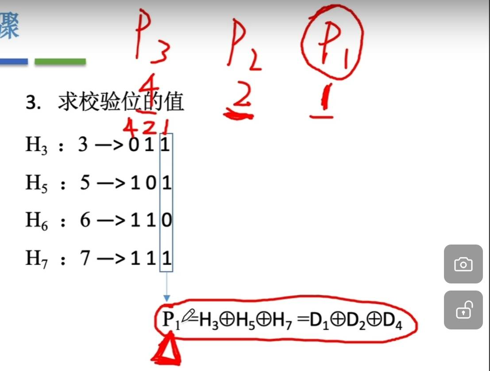
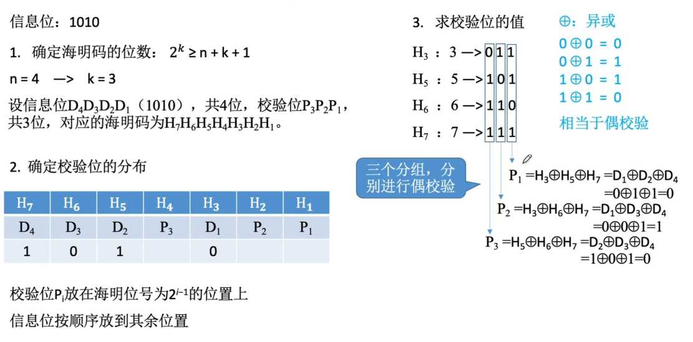

---
{
  "id": "33b5a2dd-8276-809f-acbc-f73ac1f01e30",
  "url": "https://app.notion.com/p/3-3-2-33b5a2dd8276809facbcf73ac1f01e30",
  "created_time": "2026-04-07T09:54:00.000Z",
  "last_edited_time": "2026-04-21T09:23:00.000Z"
}
---

#  3.3.2差错控制（位错）-纠错编码

# 海明校验码
思想：将信息位分组，分别进行偶校验
## 编码
步骤：
1. 确定校验位（海明码）的位数
$$
2^K≥n+K+1
$$
n：信息位    ；K：校验位
1. 确定校验位的分布
假设海明码的高位是n，低位是1
那海明位号就是从n到1的n-1个格子
- 填充校验位
校验位对应的海明位号这么计算↓
$$
H=2^{i-1}
$$
H：海明位号
i：第i个校验位

1. 求校验位的值
- 将信息位的位号写成二进制
- 校验位的位号从小到大依次对应，信息位号的二进制从低位到高位的权值
- 像这样竖着列出信息位位号的二进制↓

- 将校验位对应权值对应的信息位号二进制竖列中，为1的信息位，异或运算，即可得到该校验位的值

如图
1. 将信息位从低位到高位填充到空余部分
## 解码
将几个校验位和它对应的几个信息位进行异或运算，结果都是0则没有错误
如果不是0则，看几个校验位校验出的结果（从低位校验位到高位排序）组成的2进制结果对应的十进制是多少，该十进制代表出错的海明位号
## 特点
海明码可以纠错一位错误
可以检错两位错误
但无法区分是一位错还是两位错
因此，我们会在海明码开头加上一个全校验位（做整体的偶校验）
如果：
- 海明校验全为0，全体偶校验成功，没有错误
- 海明校验不全为0，全体偶校验失败，一位错误，纠正
- 海明校验不全为0，全体偶校验成功，两位错误，重传
