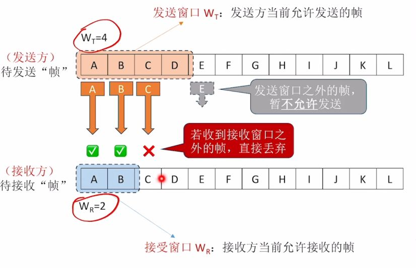

---
{
  "id": "3405a2dd-8276-80c8-9f6d-ca1835ae4c6c",
  "url": "https://app.notion.com/p/3-4-1-3405a2dd827680c89f6dca1835ae4c6c",
  "created_time": "2026-04-12T08:05:00.000Z",
  "last_edited_time": "2026-04-21T09:25:00.000Z"
}
---

#  3.4-1滑动窗口机制

# 滑动窗口机制
在链路层，接收和发送都受滑动窗口控制
有两种滑动窗口：
- 发送窗口W_T
发送方当前允许发送的帧数
- 接收窗口W_R
接收方当前允许接收的帧数

PS：
接收方会使用“确认机制”控制发送方的窗口滑动，从而实现流量控制
若接收到接收窗口外的帧，则会直接丢弃
