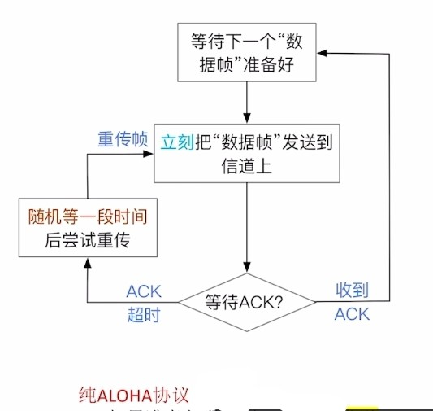
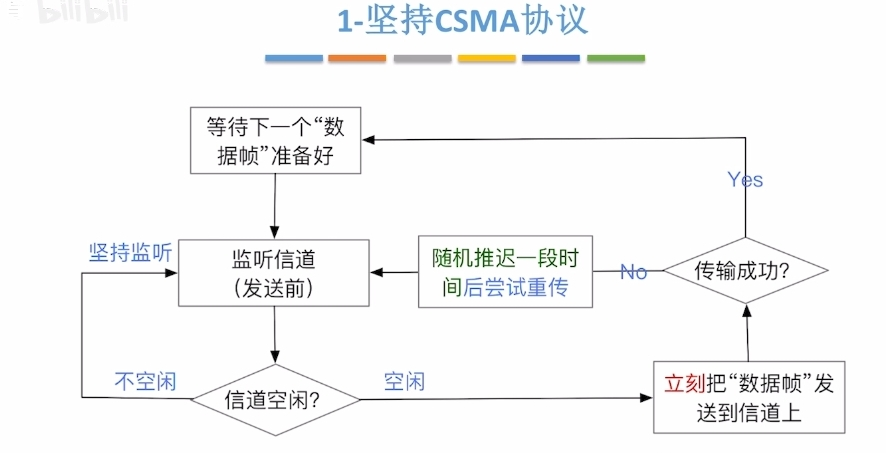

---
{
  "id": "3495a2dd-8276-80dc-8cff-e3ad2af38973",
  "url": "https://app.notion.com/p/3-5-3495a2dd827680dc8cffe3ad2af38973",
  "created_time": "2026-04-21T09:27:00.000Z",
  "last_edited_time": "2026-07-01T07:40:00.000Z"
}
---

#  3.5介质访问控制

[3.5.1介质访问控制-信道划分](351介质访问控制-信道划分/index.md)
  **介质访问控制**：多节点共享总线，广播信道时，避免可能的信号冲突（研究介质的复用）
  # 信道划分介质访问控制（同介质复用技术）
  ## 时分复用（TDM）
    将时间分为等长的“TDM帧” ，每个“TDM帧”又分为等长的m个“时隙”， 将m个时隙分配给m对用户（节点）使用
    缺点：
    - 某节点不通信时，给其分配的时隙也不会收回，浪费带宽
    - 每节点最多只能分到1/m的带宽，速度慢
  ## 统计时分复用（STDM）
    在时分复用的基础上增加动态统计，动态分配时隙
    优点：解决了上述TDM的两个问题
  ## 频分复用（FDM）
    将信道的总频带划分为多个子频带，每个子频带作为一个子信道，每对用户使用一个子信道进行通信
    优点：各节点可同时发送信号，充分利用带宽
    缺点：只能用于模拟信号
  ## 波分复用（WDM）
    与频分复用一样，只不过这个是光信号，那个是电信号
  ## 码分复用（CDM）
    各发送方发送数字信号，接收方再将不同的数字信号从混合信号中分离
    ### 1. 给各节点分配专属“码片序列”（向量）
    
    码片序列”包含m个码片(信号值），可看作“m维向量” （m维向量的分量通常取1或-1）
    PS：
    相互通信的各节点知道彼此的码片序列
    各节点的码片序列必须相互正交（向量相乘为0）
    ### 2.发送方如何发送数据
    节点发出m个信号值与“码片序列”相同，表示比特1
    节点发出m个信号值与“码片序列”相反，表示比特0
    ### 3.信号会在传输中叠加
    当多个发送方同时发送数据时，信号在传输过程中“叠加”
     (注：本质是多个m维向量的加法) 
    ### 4.接收方如何接收数据
    叠加信号与发送方的码片序列作“规格化内积” 
    结果为1，表示比特1
    结果为-1，表示比特0
    **规格化内积：**
    $$
\frac{1}{m}·码片序列·叠加信号
$$
[3.5.2介质访问控制-随机访问](352介质访问控制-随机访问/index.md)
  介质访问控制随机访问：研究信道的复用
  # ALOHA协议（随机接入协议）
    ### 纯ALOHA协议
    原理：
    **数据帧准备好立刻发送到信道上**，引入ack协议（停止等待协议）如果**传输失败，随机等一段时间后重传**
    缺点：
    同时发送会冲突
    

    ### 时隙ALOHA协议
    原理：
    使用固定大小的时隙，数据准备好了，在最近一个时隙开始发送，冲突了随机等一段时间，引入ack协议
    - 时隙大小=传输一个帧最长时间
    - 只能在时隙开始时发送
    优点：
    降低了ALOHA的冲突概率
    缺点：
    仍然会冲突
    
  # csma协议（载波监听多路访问协议）
    原理：
    **在ALOHA协议上改进，发送数据前监听信道是否空闲，空闲才会发送（其他与ALOHA一样）**
    有以下几种csma协议
    ### 1-坚持CSMA协议
    要点：**帧准备好后如果信道不空闲，则持续监听（其他与csma一样）**
    优点：信道利用率高
    缺点：多节点准备完成后同时监听，一旦空闲多节点同时发送，易冲突
    
    ### 非坚持CSMA协议
    要点：是1-坚持csma的改进，**帧准备好后如果信道不空闲，则随机推迟一段时间后监听**
    优点：冲突概率更低
    缺点：信道空闲后可能不会立刻被使用，利用率较低
    

    ### p-坚持CSMA协议
    要点：非坚持csma的改进，帧准备好后如果**信道不空闲，则持续监听**，如果**空闲，则有p的概率立即发送，有1-p的概率推迟一段时间发送**
    优点：结合了1-坚持csma和非坚持csma的优点
    
  # CSMA/CD协议（冲突检测）
    本协议被用于早期的有线以太网
    早期以太网↓
    总线型（争用介质）
    使用集线器（信号会广播给所有设备）
    
    ### 协议要点
    **先听后发，边听边发，冲突停发，随机重发**
    ### 发送方原理
    发前监听是否空闲，空闲立即发送，发送中检测到冲突立即停发，并统计冲突次数，冲突次数K=16，传输失败，并报告网络层
    ### 随机等待时间（二进制指数退避算法）
    随机等待时间=r倍争用期
    - r：随机数
    - 如果k≤10，r在[0，2^k-1]中取
    - 如果k＞10，r在[0，2^{10}-1]中取
    - 争用期=2x最大单向传播时延
    - 最大单向传播时延：信道上最远的两个节点的传播时延
    ### 最短帧长
    最短帧长=2x最大单向传播时延x信道带宽
    短于最短帧长的帧会被视为无效帧（防止发送后才检测到冲突）
    ### 最长帧长
    防止某些节点一直占用信道
    ### 接收方原理
    收到帧→是否小于最短帧长→是不是发给自己的→crc校验→交给网络层
    任意一步不过都会直接丢弃该帧
    ### 注意
    csma/cd协议中没有ack协议，发送中没检查到冲突默认成功
    以太网规定：最短帧长=64B，最长帧长=1518B
  # CSMA/CA协议（冲突避免）
    这个是无线网络协议，比较复杂，只讲重点
    协议背景：
    - 无线信号难以实现边听边发（会干扰）
    - 因距离限制，部分设备不能接收到全部设备的信号（隐蔽站）
    ### 协议要点
    发送方：
    - 先听后发，忙则退避
    - 若信道空闲，间隔DIFS后，发送帧
    - 不空闲，随机退避
    退避原理：
    - 用二进制指数退避算法确定随机退避时间（倒计时）
    - 发送方保持监听，空闲后才开始扣除倒计时，倒计时结束立即发送
    接收方：
    停止等待协议，间隔SIFS后，发送ack，发送方超时未收到ack，则进行随机退避
    PS：
    - DIFS：固定的时间，防止信道释放后多设备立马同时发送造成冲突
    - SIFS：固定的时间，用于等待设备差错控制和CRC校验
    信道预约机制：（可选开启）
    - 预约机制解决了隐藏站问题
    - RTS控制帧：预约请求，包含源地址，目标地址，持续时间
    - CTS控制帧：允许发送广播，包含源地址，目标地址，持续时间
    - 其他设备接收到AP的CTS广播后会静默指定的时间
    - 设备发送的RTS预约有超时机制，超时未收到CTS广播说明预约失败
[轮询访问-令牌传递协议](轮询访问-令牌传递协议/index.md)
  特点：环形拓扑，各节点轮询访问，不存在冲突
  # 协议要点
  ### 令牌帧
  - 需指明当前获得令牌的节点编号
  - 只有获得令牌才能发送数据帧
  - 如果获得令牌的节点没有数据发送，就将令牌传给下一个节点
  ### 数据帧
  - 需指明源地址，目的地址，是否被接收，获得令牌的节点编号
  - 数据帧从源节点发出，传递一圈后回到源节点
  - 数据传递到目的节点后会被复制一份，并标记为已接收
  - 数据帧回到源节点后如有异常，尝试重发
  ### 其他
  - 无论是令牌还是数据帧，只能单向传输
  - 获得令牌的节点，只能发一帧，发完释放令牌
  - 需要专用设备MAU集中控制
  - 令牌环网适合负载高的网络（不冲突）
