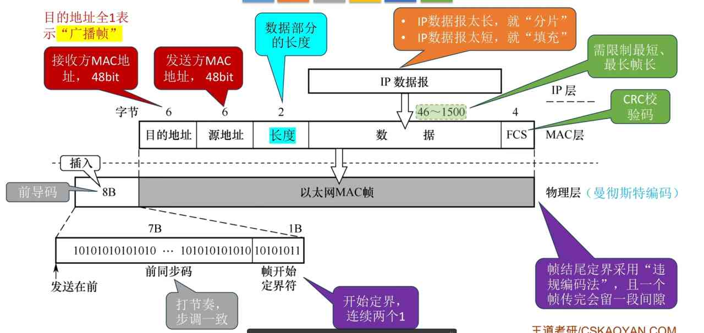

---
{
  "id": "36d5a2dd-8276-8071-a78f-ffb88d423cab",
  "url": "https://app.notion.com/p/3-6-2-802-3-36d5a2dd82768071a78fffb88d423cab",
  "created_time": "2026-05-27T07:41:00.000Z",
  "last_edited_time": "2026-05-27T08:34:00.000Z"
}
---

#  3.6.2以太网和802.3（有线网）

# 物理层标准
### 命名
速率+Base+介质信息
前面物理层笔记说过，不重复了
### PS：
- 一个网段工作在半双工下，才需要csma/cd协议
- 同轴线：只支持半双工
- 双绞线：连集线器支持半双工，连交换机支持全双工
- 物理层使用曼彻斯特编码
# mac层标准
### v2标准（主流）
口诀：**662n4（收发协数验）**
解释：

### IEEE802.3标准
口诀：662n4（收发长数验）
解释：

