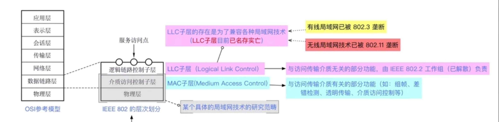

---
{
  "id": "3655a2dd-8276-807b-849f-d18eeeb662f9",
  "url": "https://app.notion.com/p/IEEE802-3655a2dd8276807b849fd18eeeb662f9",
  "created_time": "2026-05-19T01:45:00.000Z",
  "last_edited_time": "2026-05-26T00:24:00.000Z"
}
---

#  以太网和IEEE802

## IEEE802委员会下辖4个工作组：
~~802.8工作组（FDDI光纤分布数字接口）~~
~~802.5工作组（令牌环网）~~
802.3工作组（以太网）（有线网络）
802.11工作组（无线网络）
PS：划线代表工作组已解散
## 802.11
802.11b：WiFi1（2.4GHz，11Mbps）
802.11a：WiFi2（5GHz，54Mbps）
802.11g：WiFi3（2.4GHz，54Mbps，向后兼容b）
802.11n：WiFi4（2.4/5GHz，MIMO，最高600Mbps）
802.11ac：WiFi5（5GHz，MU-MIMO，最高数Gbps）
802.11ax：WiFi6/6E（OFDMA，BSS Coloring；6E增加6GHz频段）
802.11be：WiFi7（更宽信道与更高并发，进一步提升吞吐与时延表现）

## 802层次划分

