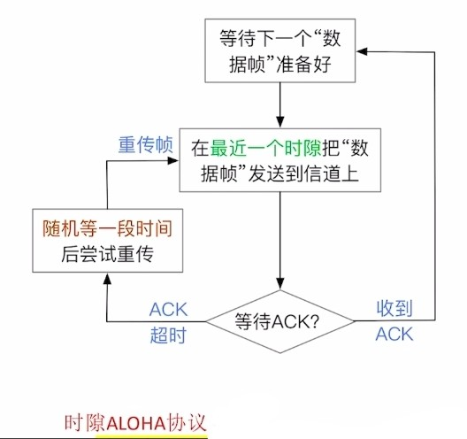
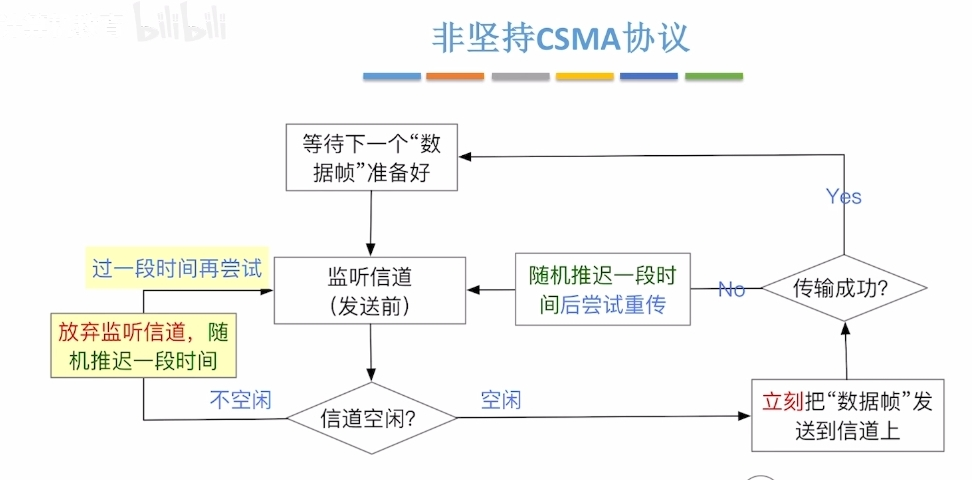
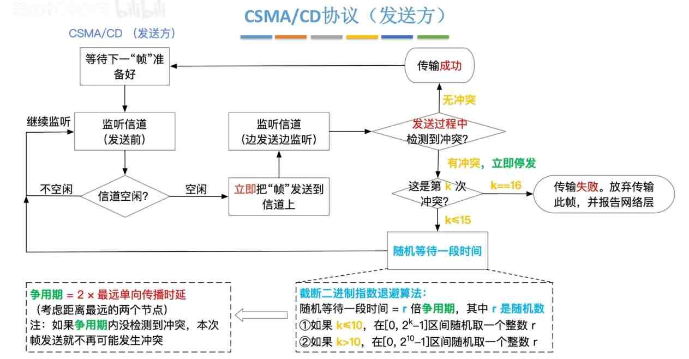
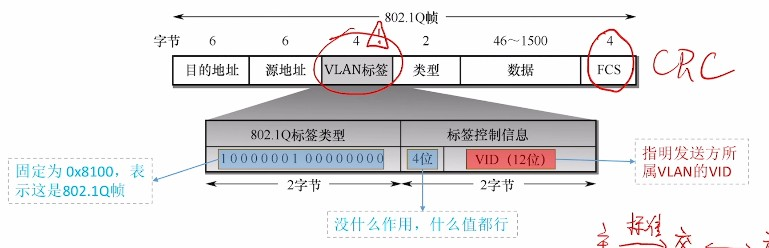
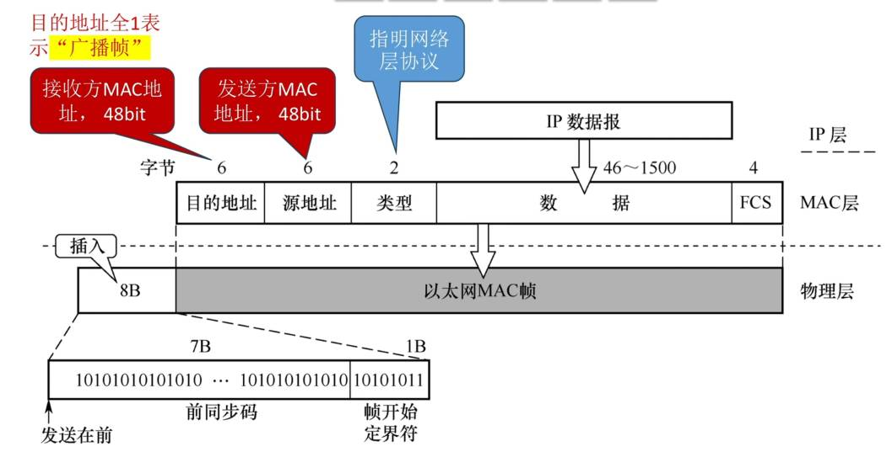
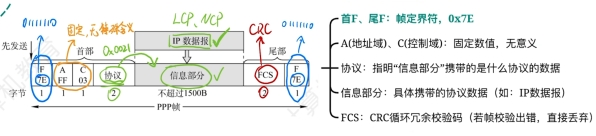

---
{
  "id": "33b5a2dd-8276-80d1-975a-c26759345d63",
  "url": "https://app.notion.com/p/3-33b5a2dd827680d1975ac26759345d63",
  "created_time": "2026-04-07T08:49:00.000Z",
  "last_edited_time": "2026-07-05T09:55:00.000Z"
}
---

#  3.链路层

[3.1数据链路层的功能](31数据链路层的功能/index.md)
  **链路层将网络层的ip数据报封装成“帧”，发送给下一个节点**
  接下来的几节将逐一讲解
  MTU：最大传输单元，表示一条链路一次能够承载的最大网络层数据包大小
  专有名词翻译：
  以太网：就是局域网
[3.2组帧](32组帧/index.md)
  组帧就是把来自网络层的数据封装成帧
  **链路层对网络层是透明传输的**
  透明传输：下层的处理不影响上层的内容，对上层来说就是透明的
  # 帧定界（确定两帧之间的界限）
  有四种方法
  ### 字符计数法
    **原理：在每个帧开头加一个定长的计数字段表示该帧长度**
    PS：帧长=计数字段+帧数据
    缺点：任何计数字段出错，后续所有帧都无法定界
  ### 字节填充法
    **原理：在帧的头和尾添加特殊的字符SOH和EOT，分别区分头尾**
    - 为了防止数据部分包含SOH和EOT扰乱传输，发送方会在数据部分的SOH和EOT前插入转义字符ESC，接收时会删掉ESC
    - 为了防止数据部分包含转义字符ESC被接收方删掉，发送方会在ESC前面再加一个ESC
    转义字符接收方处理规则：删转义字符，保留后一个字符（无论后一个是不是ESC）
  ### 零比特填充法
    **原理：与字节填充相似，在帧的头尾添加特殊比特串，分别区分头和尾**
    为了防止数据部分包含特殊比特串：
    - 发送方：检查数据，当连续出现5个1，就填充1个0
    - 接收方：逆处理，连续出现5个1，就删掉后面的0
  ### 违规编码法
    原理：违规编码法基于曼彻斯特编码，将数据以曼彻斯特编码发送（中必变），在帧的头尾各插入一个违规编码（中不变），用来区分头尾
    曼彻斯特编码要求：上跳0下跳1看中间，中必变
    违规信号：周期中间不跳变
[3.3差错控制](33差错控制/index.md)
  3.3.1_1 差错控制（位错）-检错编码（奇偶校验码）
    对于链路层来说有这几种出错可能：帧内错误（差错控制），帧间错误（可靠传输）
    **本节讨论的是帧内错误的处理（差错控制）**
    # 数据链路层的差错控制（位错）
      为了修复帧内的位错，有两种方式
      - 使用检错编码检测，发现错误后丢帧重传
      - 使用纠错编码检测，发现错误后修正
    # 数据链路层的可靠传输（帧错）（后面说）
      要注意区分差错控制（位错）和可靠传输（帧错）
      在可靠传输问题上有三种可能的错误：帧丢失，帧重复，帧乱序
      后面介绍
    # 奇偶校验
    奇偶校验是两种校验模式：奇校验，偶校验
    **奇校验：通过控制校验位，令算上校验位，一共有奇数个1**
    **偶校验：通过控制校验位，令算上校验位，一共有偶数个1**
    **现实中更常用偶校验，因为偶校验的硬件实现简单：只需将每位异或运算即可**
    例：
    规定第一位是校验位，那么100经过
    奇校验后：0100
    偶校验后：1100
    （给第一位前添加了一个校验位）
    **优点：**
    **需求算力低，易实现**
    **缺点：**
    **同时偶数个位出错就检测不出来了**
  3.3.1_2差错控制（位错）-检错编码（循环冗余校验）
    # 循环冗余校验码（CRC码）
    思想：发送，接收方约定一个”除数”，检查余数是否都为0
    原理：
    **发送：K个信息位+R个校验位，作为被除数，约定一个除数，通过控制校验位，确保余数为0**
    **接收：通过约定的除数，检查余数是否为0**
    例：
    生成多项式为G（X）=x^3+x^2+1，信息码为101001，求CRC码？
    解答：
    1. **生成多项式是x从n次方一直加到0次方的式子，依次查看从n次到0次的x的系数，即可得到”除数”**
    1. **生成多项式最高次幂是校验位的位数，即可确定R**
    1. **被除数与除数进行“模2除”，余数就是校验位（模2除与正常除不一样，有点麻烦，用到再查吧）**

    所以除数为1101
    校验位是3位
    校验码是001
    **接收方：用crc码与除数进行模2除，余数为0则没错**
    ### 纠错能力
    crc校验码有一定的纠错能力，只要：
    $$
2^R≥K+R+1
$$
    就可以纠错一位错误
    ### 特点：
    优点：CRC码广泛用于链路层检错，它可以比较完善的检测出错误，
    缺点：但较少使用它的纠错功能（只能纠正单比特错误）
  3.3.2差错控制（位错）-纠错编码
    # 海明校验码
    思想：将信息位分组，分别进行偶校验
    ## 编码
    步骤：
    1. 确定校验位（海明码）的位数
    $$
2^K≥n+K+1
$$
    n：信息位    ；K：校验位
    1. 确定校验位的分布
    假设海明码的高位是n，低位是1
    那海明位号就是从n到1的n-1个格子
    - 填充校验位
    校验位对应的海明位号这么计算↓
    $$
H=2^{i-1}
$$
    H：海明位号
    i：第i个校验位

    1. 求校验位的值
    - 将信息位的位号写成二进制
    - 校验位的位号从小到大依次对应，信息位号的二进制从低位到高位的权值
    - 像这样竖着列出信息位位号的二进制↓
    
    - 将校验位对应权值对应的信息位号二进制竖列中，为1的信息位，异或运算，即可得到该校验位的值
    
    如图
    1. 将信息位从低位到高位填充到空余部分
    ## 解码
    将几个校验位和它对应的几个信息位进行异或运算，结果都是0则没有错误
    如果不是0则，看几个校验位校验出的结果（从低位校验位到高位排序）组成的2进制结果对应的十进制是多少，该十进制代表出错的海明位号
    ## 特点
    海明码可以纠错一位错误
    可以检错两位错误
    但无法区分是一位错还是两位错
    因此，我们会在海明码开头加上一个全校验位（做整体的偶校验）
    如果：
    - 海明校验全为0，全体偶校验成功，没有错误
    - 海明校验不全为0，全体偶校验失败，一位错误，纠正
    - 海明校验不全为0，全体偶校验成功，两位错误，重传
[3.4流量控制与可靠传输机制](34流量控制与可靠传输机制/index.md)
  3.4-1滑动窗口机制
    # 滑动窗口机制
    在链路层，接收和发送都受滑动窗口控制
    有两种滑动窗口：
    - 发送窗口W_T
    发送方当前允许发送的帧数
    - 接收窗口W_R
    接收方当前允许接收的帧数
    
    PS：
    接收方会使用“确认机制”控制发送方的窗口滑动，从而实现流量控制
    若接收到接收窗口外的帧，则会直接丢弃
  3.4-2停止等待协议
    # 帧编号
    $$
W_T+W_R≤2^n
$$
    n：帧编号的比特数
    最少可以用一个比特编号（01交替）
    如果不满足这个规则，当接收窗口内的确认帧全部丢失时，发送方会重传，但由于接收窗口已滑动，且滑动后窗口内帧编号与滑动前窗口编号相同，会把重传的帧当成新的帧，导致帧重复
    # 数据帧，确认帧概念
    帧分不同类型
    数据帧（Data i）：用于发送数据
    确认帧（ACK i）：用来确认收到某帧
    帧的首尾存放着：帧类型，帧序号，校验码，帧定界信息等控制信息
    # 重传机制
    超时重传：发送方超时未收到ACK i（确认帧），则重传i号帧
    如果确认帧丢失：发送方超时后重传，接收方收到重复帧会丢弃该帧，并返回该帧确认帧
    如果数据帧有错误：接收方丢弃该帧，不返回ACK，等待发送方超时重传
  3.4-3后退n帧协议GBN
    后退n帧协议针对的是发送窗口>接收窗口的情况（发了3帧只接收1帧，就要后退发送窗口）
    # 帧序号
    与上节一致
    # 累积确认机制
    后退n帧协议规定：
    接收方可以连续收到多个数据帧后，只返回最后一个帧的ACK
    # 帧丢失
    当利用累计确认机制一次性接收多个帧时，丢失了一个帧
    接收方：继续接收下一个帧→发现不是预期的帧编号→直接丢弃→返回已成功接收的最后一个帧的ACK
    接收方：接收到的ACK不是预期值→将发送窗口滑动到成功接收的帧的下一帧→继续发送
    后退n帧协议：不是指发送窗口后退，而是发送进度后退（因为只支持顺序传输）
    # 确认帧丢失
    发送方：发送窗口内帧计时器全部超时，触发重传
    接收方：接收到“非法帧”，丢帧，返回最后一个成功接收的帧的ACK，以提醒发送方“后退”i+1号帧重新发送
    # 缺点
    如果误码率很高，或接收方接收帧的速度很慢，发送方就要经常回退，效率很低
  3.4-4选择重传协议SR
    # 滑动窗口机制
    发送窗口W_T＞1，接收窗口W_R＞1
    W_R≤W_T
    接收窗口不能大于发送窗口
    # 帧编号
    $$
W_T+W_R≤2^n
$$
    # 确认机制
    SR不支持累积确认，必须一帧一帧确认
    # 重传机制
    超时重传
    # SR的特殊规则
    否认帧NAK_i ：若接收到第 i 帧有错误，则丢弃该帧，并返回否认帧NAK_i
    请求重传：发送方接收到NAK_i，则重传第i帧
    # 确认帧丢失
    与前面相同
    # Q＆A
    Q：为什么接收窗口要≤发送窗口？
    A：如果接收窗口＞发送窗口，比发送窗口大的部分会长期空闲，影响效率
    Q：SR协议如何解决丢帧/错帧
    A：只要发送窗口移动不会导致需要重传的帧被移动到发送窗口外，就继续移动发送窗口
  3.4-5三种协议的信道利用率
    信道利用率：
    $$
U=\frac{T_D}{T_D+RTT+T_A}
$$
    T_D：数据帧传输时延
    RTT：2倍单向传播时延
    T_A：确认帧传输时延
    # S-W确认等待协议
    
    有时候会说：确认帧传输时延很短，则忽略确认帧T_A
    # GBN（后退n帧协议），SR（选择重传协议）
    计算公式
    $$
U=\frac{NT_D}{T_D+RTT+T_A}
$$
    N：一次性发送的帧数
    PS：如果信道利用率大于1，则取1
    # 术语补充：滑动窗口机制
    在使用术语上：停止-等待协议不属于滑动窗口协议
    滑动窗口协议指：后退n帧协议，选择重重传协议
    |  | 停止等待协议 | 后退n帧协议 | 选择重传协议 |
    | --- | --- | --- | --- |
    | ARQ协议（自动重传） | ✓ | ✓ | ✓ |
    | 连续ARQ（自动重传多个帧） | X | ✓ | ✓ |
    | 滑动窗口协议 | X | ✓ | ✓ |
[3.5介质访问控制](35介质访问控制/index.md)

  3.5.1介质访问控制-信道划分
    **介质访问控制**：多节点共享总线，广播信道时，避免可能的信号冲突（研究介质的复用）
    # 信道划分介质访问控制（同介质复用技术）
    ## 时分复用（TDM）
      将时间分为等长的“TDM帧” ，每个“TDM帧”又分为等长的m个“时隙”， 将m个时隙分配给m对用户（节点）使用
      缺点：
      - 某节点不通信时，给其分配的时隙也不会收回，浪费带宽
      - 每节点最多只能分到1/m的带宽，速度慢
    ## 统计时分复用（STDM）
      在时分复用的基础上增加动态统计，动态分配时隙
      优点：解决了上述TDM的两个问题
    ## 频分复用（FDM）
      将信道的总频带划分为多个子频带，每个子频带作为一个子信道，每对用户使用一个子信道进行通信
      优点：各节点可同时发送信号，充分利用带宽
      缺点：只能用于模拟信号
    ## 波分复用（WDM）
      与频分复用一样，只不过这个是光信号，那个是电信号
    ## 码分复用（CDM）
      各发送方发送数字信号，接收方再将不同的数字信号从混合信号中分离
      ### 1. 给各节点分配专属“码片序列”（向量）
      
      码片序列”包含m个码片(信号值），可看作“m维向量” （m维向量的分量通常取1或-1）
      PS：
      相互通信的各节点知道彼此的码片序列
      各节点的码片序列必须相互正交（向量相乘为0）
      ### 2.发送方如何发送数据
      节点发出m个信号值与“码片序列”相同，表示比特1
      节点发出m个信号值与“码片序列”相反，表示比特0
      ### 3.信号会在传输中叠加
      当多个发送方同时发送数据时，信号在传输过程中“叠加”
       (注：本质是多个m维向量的加法) 
      ### 4.接收方如何接收数据
      叠加信号与发送方的码片序列作“规格化内积” 
      结果为1，表示比特1
      结果为-1，表示比特0
      **规格化内积：**
      $$
\frac{1}{m}·码片序列·叠加信号
$$
  3.5.2介质访问控制-随机访问
    介质访问控制随机访问：研究信道的复用
    # ALOHA协议（随机接入协议）
      ### 纯ALOHA协议
      原理：
      **数据帧准备好立刻发送到信道上**，引入ack协议（停止等待协议）如果**传输失败，随机等一段时间后重传**
      缺点：
      同时发送会冲突
      

      ### 时隙ALOHA协议
      原理：
      使用固定大小的时隙，数据准备好了，在最近一个时隙开始发送，冲突了随机等一段时间，引入ack协议
      - 时隙大小=传输一个帧最长时间
      - 只能在时隙开始时发送
      优点：
      降低了ALOHA的冲突概率
      缺点：
      仍然会冲突
      
    # csma协议（载波监听多路访问协议）
      原理：
      **在ALOHA协议上改进，发送数据前监听信道是否空闲，空闲才会发送（其他与ALOHA一样）**
      有以下几种csma协议
      ### 1-坚持CSMA协议
      要点：**帧准备好后如果信道不空闲，则持续监听（其他与csma一样）**
      优点：信道利用率高
      缺点：多节点准备完成后同时监听，一旦空闲多节点同时发送，易冲突
      
      ### 非坚持CSMA协议
      要点：是1-坚持csma的改进，**帧准备好后如果信道不空闲，则随机推迟一段时间后监听**
      优点：冲突概率更低
      缺点：信道空闲后可能不会立刻被使用，利用率较低
      

      ### p-坚持CSMA协议
      要点：非坚持csma的改进，帧准备好后如果**信道不空闲，则持续监听**，如果**空闲，则有p的概率立即发送，有1-p的概率推迟一段时间发送**
      优点：结合了1-坚持csma和非坚持csma的优点
      
    # CSMA/CD协议（冲突检测）
      本协议被用于早期的有线以太网
      早期以太网↓
      总线型（争用介质）
      使用集线器（信号会广播给所有设备）
      
      ### 协议要点
      **先听后发，边听边发，冲突停发，随机重发**
      ### 发送方原理
      发前监听是否空闲，空闲立即发送，发送中检测到冲突立即停发，并统计冲突次数，冲突次数K=16，传输失败，并报告网络层
      ### 随机等待时间（二进制指数退避算法）
      随机等待时间=r倍争用期
      - r：随机数
      - 如果k≤10，r在[0，2^k-1]中取
      - 如果k＞10，r在[0，2^{10}-1]中取
      - 争用期=2x最大单向传播时延
      - 最大单向传播时延：信道上最远的两个节点的传播时延
      ### 最短帧长
      最短帧长=2x最大单向传播时延x信道带宽
      短于最短帧长的帧会被视为无效帧（防止发送后才检测到冲突）
      ### 最长帧长
      防止某些节点一直占用信道
      ### 接收方原理
      收到帧→是否小于最短帧长→是不是发给自己的→crc校验→交给网络层
      任意一步不过都会直接丢弃该帧
      ### 注意
      csma/cd协议中没有ack协议，发送中没检查到冲突默认成功
      以太网规定：最短帧长=64B，最长帧长=1518B
    # CSMA/CA协议（冲突避免）
      这个是无线网络协议，比较复杂，只讲重点
      协议背景：
      - 无线信号难以实现边听边发（会干扰）
      - 因距离限制，部分设备不能接收到全部设备的信号（隐蔽站）
      ### 协议要点
      发送方：
      - 先听后发，忙则退避
      - 若信道空闲，间隔DIFS后，发送帧
      - 不空闲，随机退避
      退避原理：
      - 用二进制指数退避算法确定随机退避时间（倒计时）
      - 发送方保持监听，空闲后才开始扣除倒计时，倒计时结束立即发送
      接收方：
      停止等待协议，间隔SIFS后，发送ack，发送方超时未收到ack，则进行随机退避
      PS：
      - DIFS：固定的时间，防止信道释放后多设备立马同时发送造成冲突
      - SIFS：固定的时间，用于等待设备差错控制和CRC校验
      信道预约机制：（可选开启）
      - 预约机制解决了隐藏站问题
      - RTS控制帧：预约请求，包含源地址，目标地址，持续时间
      - CTS控制帧：允许发送广播，包含源地址，目标地址，持续时间
      - 其他设备接收到AP的CTS广播后会静默指定的时间
      - 设备发送的RTS预约有超时机制，超时未收到CTS广播说明预约失败
  轮询访问-令牌传递协议
    特点：环形拓扑，各节点轮询访问，不存在冲突
    # 协议要点
    ### 令牌帧
    - 需指明当前获得令牌的节点编号
    - 只有获得令牌才能发送数据帧
    - 如果获得令牌的节点没有数据发送，就将令牌传给下一个节点
    ### 数据帧
    - 需指明源地址，目的地址，是否被接收，获得令牌的节点编号
    - 数据帧从源节点发出，传递一圈后回到源节点
    - 数据传递到目的节点后会被复制一份，并标记为已接收
    - 数据帧回到源节点后如有异常，尝试重发
    ### 其他
    - 无论是令牌还是数据帧，只能单向传输
    - 获得令牌的节点，只能发一帧，发完释放令牌
    - 需要专用设备MAU集中控制
    - 令牌环网适合负载高的网络（不冲突）
[3.6局域网](36局域网/index.md)

  以太网和IEEE802
    ## IEEE802委员会下辖4个工作组：
    ~~802.8工作组（FDDI光纤分布数字接口）~~
    ~~802.5工作组（令牌环网）~~
    802.3工作组（以太网）（有线网络）
    802.11工作组（无线网络）
    PS：划线代表工作组已解散
    ## 802.11
    802.11b：WiFi1（2.4GHz，11Mbps）
    802.11a：WiFi2（5GHz，54Mbps）
    802.11g：WiFi3（2.4GHz，54Mbps，向后兼容b）
    802.11n：WiFi4（2.4/5GHz，MIMO，最高600Mbps）
    802.11ac：WiFi5（5GHz，MU-MIMO，最高数Gbps）
    802.11ax：WiFi6/6E（OFDMA，BSS Coloring；6E增加6GHz频段）
    802.11be：WiFi7（更宽信道与更高并发，进一步提升吞吐与时延表现）

    ## 802层次划分
    
  3.6.1局域网的体系结构
    # 特点
    1. 覆盖范围较小
    1. 较低时延和误码率
    1. 局域网内各节点以帧传输
    1. 支持单播（一对一），广播（一对全部），多播（一对多）
    # 有线局域网
      ## ~~同轴电缆以太网~~（已淘汰）
        - 总线型
        - 使用同轴电缆
        - 使用csma/cd协议
      ## 双绞线以太网
        ### ~~用集线器连接（已淘汰）~~
        - 物理上是星型网络，逻辑上仍是总线型
        - 使用双绞线+集线器
        - 使用csma/cd协议
        ### 用交换机连接
        - 星型网络
        - 使用双绞线+交换机
        - 使用csma/cd协议（半双工）或不进行介质访问控制（全双工）
      ## 光纤以太网
        - 用于中间节点间通信，不直接连接终端
        - 使用光纤传输
        - 不进行介质访问控制（使用两根光纤实现全双工）
    # 无线局域网
      - 星型网络（1AP+n设备）
      - 电磁波传输
      - 使用CSMA/CA协议
    # 硬件架构
      
      - 网卡负责帧的收发
      - 网卡需要支持帧缓冲（存待放收发的帧）
      - 需要完成串并行转换（网线串行，主机内并行）
  3.6.3 VLAN虚拟局域网基本原理
    ## 虚拟局域网（VLAN）
    - 一个大型局域网可划分成多个VLAN
    - 每个VLAN是独立的广播域
    - 每个VLAN对应一个VID
    ## 划分VLAN好处
    - 防止设备过多导致广播包占用过多网络资源
    - 安全
    # VLAN划分方式
      ### 1. 基于接口
      设备连接固定的接口，交换机将广播帧广播到对应接口上就行了
      缺点：设备不能改变接口
      ### 2. 基于mac地址
      设备随便连接接口，交换机将广播帧转发到固定的mac地址的设备上
      缺点：设备不能开随机mac
      ### 3. 基于ip地址
      设备随便连接接口，交换机将广播帧转发到固定的IP地址的设备上
      缺点：需要网络层支持
    # 802.1Q帧
      - 主机之间，主机与交换机之间使用标准以太网帧
      - 交换机之间，使用802.1Q帧
      区别：802.1Q帧在以太网帧的基础上增加了4位VID信息（VLAN编号）
      
  3.6.2以太网和802.3（有线网）
    # 物理层标准
    ### 命名
    速率+Base+介质信息
    前面物理层笔记说过，不重复了
    ### PS：
    - 一个网段工作在半双工下，才需要csma/cd协议
    - 同轴线：只支持半双工
    - 双绞线：连集线器支持半双工，连交换机支持全双工
    - 物理层使用曼彻斯特编码
    # mac层标准
    ### v2标准（主流）
    口诀：**662n4（收发协数验）**
    解释：
    
    ### IEEE802.3标准
    口诀：662n4（收发长数验）
    解释：
    
  3.6.4 IEEE802.11无线网
    ## portal（门户）
    门户是将802.3（有线网）和802.11（无线网）连接成一个局域网的设备
    ## 802.11基本概念
    - 802.11是星星拓扑，中心是AP（接入点）或叫wap
    - 基本服务集BBS：一个基站（AP）+多个移动站（终端）
    - 服务集标识符SSID（WiFi名字）：不能超过32字节
    - 基本服务区BSA：WiFi物理覆盖范围
    - 扩展服务集：就是子路由（工作在AP模式）
    - 漫游：从一个基本服务集连到另一个基本服务集（自动切换AP）
    ## 802.11帧分类
    1. 数据帧
    1. 控制帧：ack（确认帧），rts（预约帧），cts（同意预约帧）
    1. 管理帧：信标帧（AP周期性广播），探测响应（AP回应探测），探测请求（终端主动探测AP，针对AP隐藏ssid）
    ## 802.11数据帧格式
    

    口诀：
    1. **30 n 4首数验**
    （前30位是mac首部，n位数据，4位校验）
    1. **九十比特表去来，帧的中转靠AP**
    （mac首部第9，10位表示帧去往AP还是来自AP）
    1. **去往AP中起止，来自AP止中起**
    （去往AP的帧的地址1，2，3分别表示中转，起点，目的mac，同样，来自AP的代表地址1，2，3是目的，中转，起点）

    PS：
    在802.11中终端间不能直接通信（要AP转发）
    数据部分字节大小范围n：0~2312
[3.7 广域网](37-广域网/index.md)
  3.7.1 广域网基本概念
    局域网：家庭网，校园网，企业内网
    广域网：ISP间的网络
    （对，就是覆盖范围区别）
    PS：广域网交换机功能更多，更像路由器
  3.7.2 ppp协议（点对点协议）
    链路层除了802.11，802.3还有ppp协议
    ppp协议常用于宽带拨号，路由器间直联（ppp原生支持认证，而且不需要mac地址那些东西，协议简单）
    # ppp协议帧格式
    
    # 如何透明传输
    人话：当数据部分出现帧定界符如何处理？
    ### 方案a：字节填充（转义）
    - 用于异步传输（没有时钟信号）
    - 方案：将0x7E（帧定界符）转义为0x7D
    ### 方案b：零比特填充
    - 用于同步传输（有时钟信号）
    - 方案：防止数据部分出现01111110（帧定界符），给连续5个1后插一个0

    # ppp协议特点
    - ppp是链路层协议
    - ppp只支持全双工
    - ppp不是可靠连接（没有ack），但保证无差错（crc校验）
    - ppp支持多种网络层协议（ipv4/6，AppleTalk）
    - ppp帧是字节的整数倍（8的倍数）（规定）
  3.7.2-2ppp协议工作流程
    ppp协议有两个子协议lcp和ncp
    ## 链路控制协议lcp
    作用：ppp协议不会建立逻辑连接，lcp协议是用来建立逻辑连接的（建立连接+认证）
    ## 网络控制协议ncp
    作用：NCP负责兼容网络层的各种协议
    如：给IP协议分配IP地址，给AppleTalk协议（不基于IP地址）分配网络号和区域信息
    # ppp工作流程
    1. 建立物理连接
    1. 由ppp协议承载，建立lcp连接（ppp协议是无连接协议）
    1. 鉴权（通过lcp协议认证）
    1. NCP协议给网络层分配资源
    # 注意
    ppp协议后来演变成了PPPoE协议（802.3/11里套了个ppp协议）
[3.8以太网交换机](38以太网交换机/index.md)
  交换机=多端口网桥
  以太网=局域网
  # 自学习功能
  - 交换维护一个交换表（记录mac+端口）
  - 交换表初始为空
  - 每收到一个帧就将发送方mac地址记录到交换表
  - 如果交换机不知道接收方端口，就把帧广播到除入口外的其他端口
  - 如果知道接收方端口，就转发到对应端口
  - 交换表中每个项都有“有效时间”，过期作废（防止端口改变导致错误）
  # 两种交换方式
  ### 直通交换
  检查帧的目的地址后，直接转发给目标
  优点：时延低
  缺点：不适用需要速率匹配，协议转换，差错检查的线路
  ### 存储转发交换
  交换机先将帧接收到内部的缓存中，进行差错检查后，再发给对应端口
  优点：适用于需要速率匹配，协议转换，差错检查的线路
  缺点：时延高

[明确一些概念](明确一些概念/index.md)
  - 以太网=局域网
  - 链路层传输的是mac帧，以太网交换机工作在这层
  - ARP是路由表，在网络层
  - 每台电脑都会存储ARP表，但不会存储mac表
  - mac表由交换机维护
  - 交换机通过识别mac来工作
  - 电脑通过子网掩码+ip判断目标是否处于同一网络
  - 目标不在同一网络，主机会将接收方mac填为网关mac
  - 当接收方mac不在mac表中，交换机会“洪泛”查询（PS：就是王道说的在局域网内广播，他的说法不太标准）
