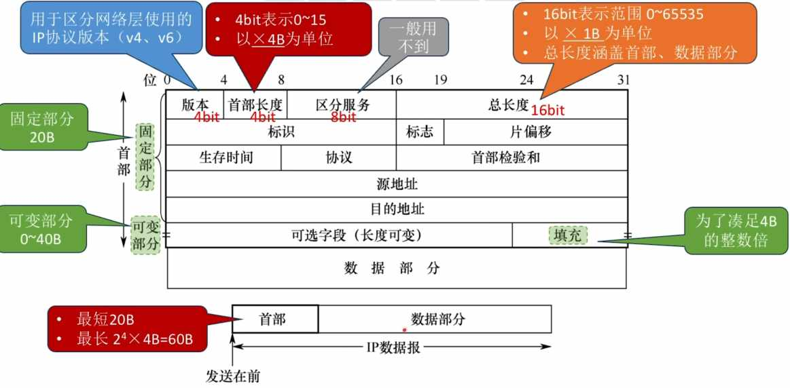

---
{
  "id": "3735a2dd-8276-804f-9b68-ee5fbfed4629",
  "url": "https://app.notion.com/p/4-2-1-IPv4-3735a2dd8276804f9b68ee5fbfed4629",
  "created_time": "2026-06-02T00:42:00.000Z",
  "last_edited_time": "2026-06-02T01:43:00.000Z"
}
---

#  4.2.1 IPv4分组

IP分组就是IP数据报

PS：链路层数据帧能承载的最大数据量称为最大传送单元MTU，它限制了网络层的IP数据报的长度（这东西不固定）
# 区域划分
IP数据报分两个部分：数据部分，首部
数据部分分两个部分：固定部分，可变部分
# 字段解释：
**基础信息↓**
- 版本：标识IP数据报版本（v4/v6）
- 首部长度：IP数据报分首部和数据部分，标识首部长度
- 总长度：IP数据报总长

**分片相关↓**
- 标识：一个IP数据报在传输时可能被分片，标识用来指示分片属于哪个源IP数据报
- 标志：标记是否允许分片，后面还有没有分片
MF=1 后面还有分片
MF=0后面没有分片
DF=1不允许分片
DF=0允许分片
- 片偏移：表示该片的有效数据距离源IP数据报的有效数据偏移了多少（8字节）（标记当前是第几个分片）

**其他↓**
- 生存时间：就是TTL，代表最大数据包的最大跳数
- 协议：如果是TCP协议设为6，如果是UDP协议设为17
- 首部校验和：每个路由器仅校验首部,而不校验数据部分。如果该字段设为全0,表示不用校验

注意⚠️
- IP数据报的“分片”可能在源主机、 或任何一个路由器中发生
- 只有目的主机才会对分片进行“重组”
- 各分片有可能乱序到达目的主机
- 由于首部的“片偏移”字段是以X8B为单位，因此，除了最后一个分片外，其他每个分片的数据部分必须是8B的整数倍

