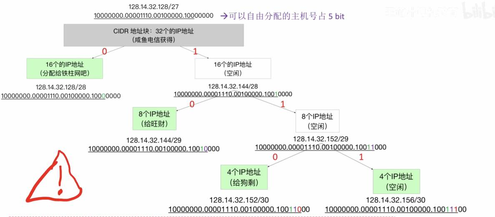

---
{
  "id": "37b5a2dd-8276-80e6-99bf-e1797413d96d",
  "url": "https://app.notion.com/p/4-2-4-CIDR-37b5a2dd827680e699bfe1797413d96d",
  "created_time": "2026-06-10T09:39:00.000Z",
  "last_edited_time": "2026-06-10T10:02:00.000Z"
}
---

#  4.2.4无分类编址CIDR

# 无分类编址CIDR
CIDR不再按 A/B/C 类固定分网络，而是用“任意长度的网络前缀”来划分网络
用`IP地址/n`来表示，其中n表示网络前缀位数（二进制）
# 定长子网划分
每个子网的IP地址数量一样多
# 变长子网划分
每个子网的IP地址数量可随意规定

CIDR地址块的子网划分技巧：
- 可以利用类似于二叉树的方法划分
- 原始CIDR地址作为根节点
- 每个分支必须同时拥有左右孩子
- 每个叶子节点对应一个子网
- 整颗树不超过h-1层（h：可分配的位数）（最少要保留2bit做主机号）
