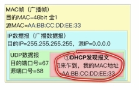
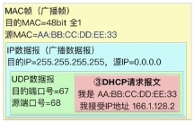
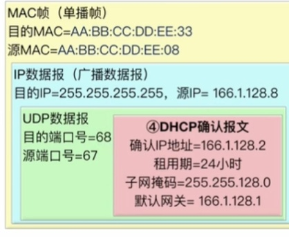

---
{
  "id": "37c5a2dd-8276-80a6-8fc7-f89e86c7cfb0",
  "url": "https://app.notion.com/p/4-2-8-DHCP-37c5a2dd827680a68fc7f89e86c7cfb0",
  "created_time": "2026-06-11T01:41:00.000Z",
  "last_edited_time": "2026-06-11T07:37:00.000Z"
}
---

#  4.2.8动态主机配置DHCP（应用层）

DHCP是应用层的，但它为网络层提供配置，所以放在这里讲

# 步骤
从DHCP服务器获取配置要发送4个报文，分别是：discover（发现报文），offer（提供报文），request（请求报文），acknowledge（确认报文）

### 发现报文（广播自身mac）
携带信息：客户机mac地址
链路层：广播帧
网络层：广播数据报

### 提供报文（分配IP）
携带信息：给分配的IP，租期，子网掩码，默认网关
链路层：单播帧
网络层：广播数据报

### 请求报文（广播自己的IP）
由于同一局域网允许有多台DHCP服务器，他们会同时给新设备分配IP，为了确认新设备选用了哪个IP，设备需要广播发送请求报文
携带信息：客户机被分到的IP
链路层：广播帧
网络层：广播IP数据报

### 确认报文（确认使用某个IP）
为了防止在DHCP通信期间IP地址池发生改变，导致原有IP被占用，DHCP服务器需要发送确认报文，认定IP有效
携带信息：给分配的IP，租期，子网掩码，默认网关
链路层：单播帧
网络层：广播数据报

### PS：
- 客户端在收到DHCP确认报文前，都不能使用被分配的IP
- IP有租期，客户端可以续租
- 局域网允许有多个DHCP服务器
- 可以发现，链路层通信靠mac地址，网络层通信靠IP地址
