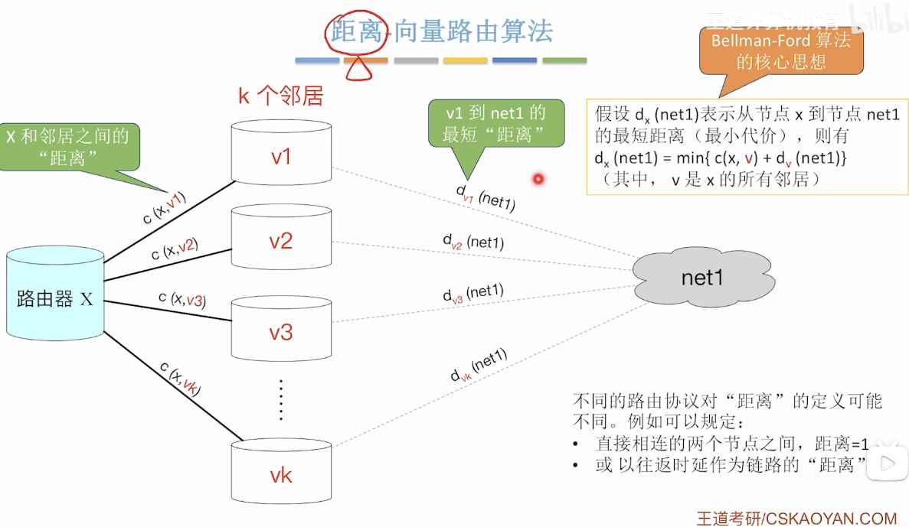

---
{
  "id": "37f5a2dd-8276-80d1-a8fa-edc54db509f6",
  "url": "https://app.notion.com/p/4-4-1-37f5a2dd827680d1a8faedc54db509f6",
  "created_time": "2026-06-14T08:32:00.000Z",
  "last_edited_time": "2026-06-15T08:59:00.000Z"
}
---

#  4.4.1路由算法

# 路由算法分类
- 静态路由算法：管理员手动配置
- 动态路由算法：路由器根据网络负载动态调节路由表

# 距离-向量路由算法（RIP协议基于此）
用c（x，v）表示直连路由器的各路径
其中x代表距离（不同协议定义不同）
v代表路由器的邻居
核心思想：
> 每个路由器只知道自己到各个目的网络的距离，以及下一跳是谁，并定期把这些信息告诉邻居。

### 距离：
通常表示到目标网络的代价
可以是：
跳数
延迟
带宽代价
综合权值

### 向量（Vector）：
指的是一个路由器保存的一张"距离表"，记录到各网络的距离，每条记录就是一个向量
# 链路状态路由算法（OSPF协议基于此）
核心：
> 每个路由器先获取整个网络的拓扑结构，然后在本地计算从自己到所有目的地的最短路径。
# 小结

