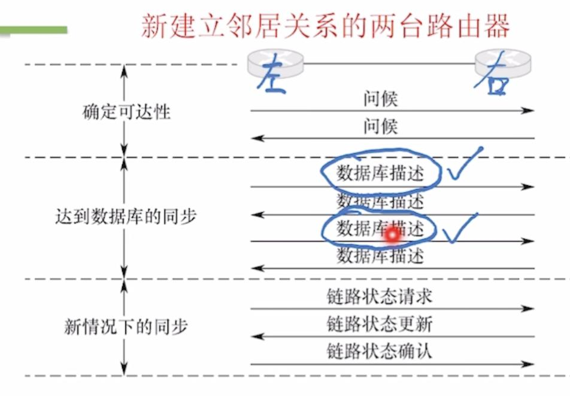

---
{
  "id": "3815a2dd-8276-8087-8044-e707ff2b9be6",
  "url": "https://app.notion.com/p/4-4-4-OSPF-3815a2dd827680878044e707ff2b9be6",
  "created_time": "2026-06-16T07:51:00.000Z",
  "last_edited_time": "2026-06-18T07:11:00.000Z"
}
---

#  4.4.4 OSPF分组类型

# Hello Packet 问候分组
建立或维持邻居关系
- 每隔10秒发一次
- 40秒超时
# DD分组（数据库描述分组）
- 两台路由器建立邻居关系时，通过数据库描述分组，互相给出LSDB摘要（LSA头信息）

# LSR分组（链路状态请求分组）
- 通过LSR分组，向邻居请求确实的LSA（头信息）
# LSU分组（链路状态更新分组）
- 路由器通过LSU分组，向邻居传输具体LSA（可能引发全网洪泛）
注：即使重复收到LSU分组也要返回LSAcK

# LSAcK分组（链路状态确认分组）
- 路由器收到了邻居发来的LSU后，返回LSAcK分组，确认收到了哪些LSA

# 新路由器入网流程

