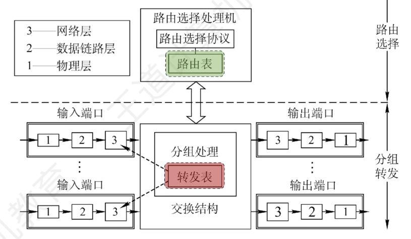

---
{
  "id": "3845a2dd-8276-800b-8be3-d9f6fd4fe9e5",
  "url": "https://app.notion.com/p/4-7-3845a2dd8276800b8be3d9f6fd4fe9e5",
  "created_time": "2026-06-19T08:46:00.000Z",
  "last_edited_time": "2026-06-19T09:02:00.000Z"
}
---

#  4.7网络层设备

# 路由器的组成
### 控制层面（路由选择）
见下图
### 数据层面（分组转发）
见下图

转发表是路由表的精简，如果不特殊说明则认为他们等价
另外的看图吧

