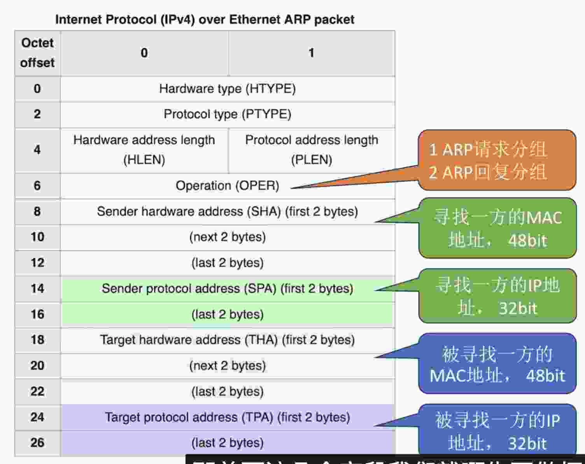
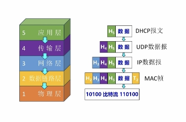
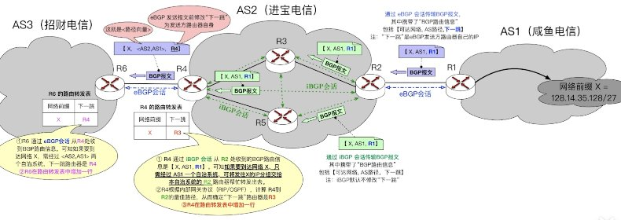
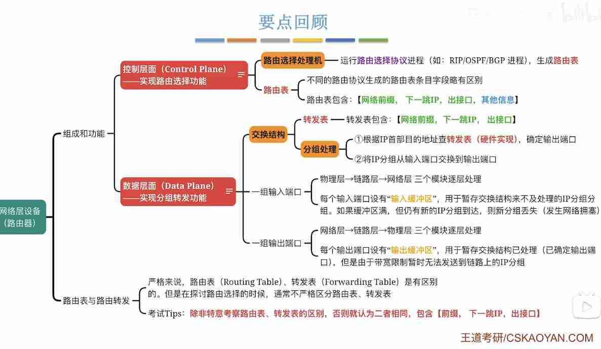

---
{
  "id": "3735a2dd-8276-80eb-8611-ed133df79d17",
  "url": "https://app.notion.com/p/4-3735a2dd827680eb8611ed133df79d17",
  "created_time": "2026-06-02T00:25:00.000Z",
  "last_edited_time": "2026-07-05T10:07:00.000Z"
}
---

#  4.网络层


[4.1网络层功能](41网络层功能/index.md)
  # 异构网络互联
  每个网络物理层，链路层实现不同，网络层负责屏蔽这些差异，让各种网络实现互联
  设备：路由器
  注：在TCP/IP文献中，路由器也叫网关gateway
  # 路由与转发
  ### 路由
  路由器通过路由协议，规划IP数据报的最佳转发路径
  PS：各路由器运行路由协议，生成各自的路由表
  ### 转发
  路由器根据自己的转发表，将IP数据报转发到对应的接口
  PS：转发表是路由表的精简
  # 拥塞控制
  ### 开环控制（静态）
  在部署网络时预设的缓解拥塞的方法，部署完成不再修改
  ### 闭环控制（动态）
  动态监视网络状态，发现拥塞后将拥塞信息传递给对应路由器（ICMP协议）
  路由器会自动调整路由表和策略缓解拥塞
  # 注意⚠️
  网络层的IP协议不提供可靠传输
  可靠传输靠链路层的TCP协议或其他协议
[4.2.1 IPv4分组](421-ipv4分组/index.md)
  IP分组就是IP数据报
  
  PS：链路层数据帧能承载的最大数据量称为最大传送单元MTU，它限制了网络层的IP数据报的长度（这东西不固定）
  # 区域划分
  IP数据报分两个部分：数据部分，首部
  数据部分分两个部分：固定部分，可变部分
  # 字段解释：
  **基础信息↓**
  - 版本：标识IP数据报版本（v4/v6）
  - 首部长度：IP数据报分首部和数据部分，标识首部长度
  - 总长度：IP数据报总长

  **分片相关↓**
  - 标识：一个IP数据报在传输时可能被分片，标识用来指示分片属于哪个源IP数据报
  - 标志：标记是否允许分片，后面还有没有分片
  MF=1 后面还有分片
  MF=0后面没有分片
  DF=1不允许分片
  DF=0允许分片
  - 片偏移：表示该片的有效数据距离源IP数据报的有效数据偏移了多少（8字节）（标记当前是第几个分片）
  
**其他↓**
  - 生存时间：就是TTL，代表最大数据包的最大跳数
  - 协议：如果是TCP协议设为6，如果是UDP协议设为17
  - 首部校验和：每个路由器仅校验首部,而不校验数据部分。如果该字段设为全0,表示不用校验

  注意⚠️
  - IP数据报的“分片”可能在源主机、 或任何一个路由器中发生
  - 只有目的主机才会对分片进行“重组”
  - 各分片有可能乱序到达目的主机
  - 由于首部的“片偏移”字段是以X8B为单位，因此，除了最后一个分片外，其他每个分片的数据部分必须是8B的整数倍
  
[4.2.2 IP地址](422-ip地址/index.md)
  # 最初的IP地址分类方案
  ICANN将IP地址划分为ABCDE五类
  其中ABC类是单播地址
  D类是多播地址
  E类暂时保留
  ### IP结构
  ICANN将IP分为两个部分：
  `<网络号><主机号>`
  网络号不定长，通过前几个比特判断是几类地址
  ### PS
  - 路由器和路由器连接可以不分配IP地址
  - 同一个网络下的设备网络号要相同
  - 电脑新接入时要分配IP地址和默认网关
  ### 特殊IP地址
  | 网络号 | 主机号 | 做源地址 | 做目的地址 | 含义 |
  | --- | --- | --- | --- | --- |
  | Y | 全0 | x | x | 表示整个网络本身（只能用于路由表，转发表） |
  | Y | 全1 | x | ✓ | 在网络号为Y的网络中广播 |
  | 全0 | Y | ✓ | x | 表示本网络中的Y主机 |
  | 全0 | 全0 | ✓ | x | 表示本网络是的本主机（DHCP中用） |
  | 全1 | 全1 | x | ✓ | 向本网络广播 |
  | 127 | 非全0 | ✓ | ✓ | 本地环回，用于测试 |
  注意⚠️：以上特殊地址不能分配给主机
  重要结论：一个网络中主机号占N bit，最多支持2^N-2台设备
[4.2.3子网划分](423子网划分/index.md)
  子网划分可以将一个网络划分成多个子网
  # 子网划分
  原理：将IP地址的主机号（二进制）前n bit借走作为子网号，剩余部分做主机号
  - 最多可划分2^n个子网
  ### IP地址结构（二进制）
  ```plain text
<网络号，子网号，主机号>
  ```
  ### PS：
  - 需要给主机配置默认网关和子网掩码
  - 子网号：从主机号借的n bit
  - IP地址和子网掩码做与运算可得到子网地址
  - 需要给路由器各接口配置子网掩码
  注意⚠️：有的教程会混淆子网号和子网地址，这俩不是一个意思
  # 子网掩码
  - IP地址和子网掩码做与运算可得到子网地址
  - 子网掩码（二进制）1的个数代表网络前缀的长度（二进制）
  - 网络前缀：网络号+子网号（CIDR表示法：`IP地址/n` n代表网络前缀有多少位）
  - 网络前缀/子网地址相同的IP属于同一个网络
  - 转发逻辑：匹配相同网络前缀/子网地址的网络
  ### 路由表
  支持子网划分的路由器转发表是这样的
  ```plain text
<网络号，子网掩码，转发接口>
  ```
  ### Q&A
  Q：网络前缀和子网地址都可以用来判断是否同一网络，那实际用哪个？
  A：实际转发根据子网掩码1的个数，得出网络前缀长度，对比网络前缀即可。子网地址只用于教学演示
  Q：如果目的地址和源地址属于同一网络，怎么处理？
  A：将数据封装成帧，并在帧中标注目的mac（别问我怎么知道mac，ARP相关还没学）
  Q：如果目的地址和源地址不属于同一网络，怎么处理？
  A：将数据封装成帧，并在帧中标注网关地址
  # 默认子网掩码
  没进行子网划分的默认子网掩码
  | IP类别 | 默认子网掩码 | 前缀长度 |
  | --- | --- | --- |
  | A类 | 255.0.0.0 | /8 |
  | B类 | 255.255.0.0 | /16 |
  | C类 | 255.255.255.0 | /24 |
  # 默认路由
  默认路由的IP：0.0.0.0/0
  行为：转发给上层路由（什么？你问我顶层怎么办？丢包！）
  # 主机发送IP数据报过程
  1. 判断是否属于同一个网络：（与运算或对比网络前缀）
  1. 将IP数据报封装成mac帧发送（帧内部标注目的/路由的mac）（通过ARP协议查找mac）
  # 路由器转发过程
  1. 接收IP数据报
  1. 对IP数据报进行首部校验，找到目的IP
  1. 查转发表（与运算或对比网络前缀）
  1. 转发到对应端口（来源和目的相同的直接丢包）
  # 算子网掩码
  别听教程的，用这个方法
  （二进制）网络部分全写1，主机部分全写0→然后二进制化十进制就行了
  # 掩码含义
  掩码只表示网络部分长度
[4.2.4无分类编址CIDR](424无分类编址cidr/index.md)
  # 无分类编址CIDR
  CIDR不再按 A/B/C 类固定分网络，而是用“任意长度的网络前缀”来划分网络
  用`IP地址/n`来表示，其中n表示网络前缀位数（二进制）
  # 定长子网划分
  每个子网的IP地址数量一样多
  # 变长子网划分
  每个子网的IP地址数量可随意规定
  
  CIDR地址块的子网划分技巧：
  - 可以利用类似于二叉树的方法划分
  - 原始CIDR地址作为根节点
  - 每个分支必须同时拥有左右孩子
  - 每个叶子节点对应一个子网
  - 整颗树不超过h-1层（h：可分配的位数）（最少要保留2bit做主机号）
[4.2.5路由聚合](425路由聚合/index.md)
  # 路由聚合/构成超网
  对于转发接口相同，部分网络前缀也相同的多条路由表项，可以合并成一条
  - 路由聚合可以加快路由表查找
  - 路由聚合可能引入一些无效地址（但不影响工作）
  # 最长前缀匹配原则
  当有多条路由都能匹配目的地址时，谁的子网掩码最长（/xx 数字最大），就优先选谁。
  原因：掩码越长，匹配得越“精确”，优先级越高。
[4.2.6网络地址转换NAT](426网络地址转换nat/index.md)
  # 传输层“端口号”概念
  同一个IP地址可以对应多个端口（软件层面），`IP+端口`可以实现发送到指定进程
  # NAT技术
  核心：利用`IP+端口号`实现公网IP和局域网IP的转换
  ### 私有IP地址
  互联网技术工作组规定以下IP段是局域网IP↓（不能用于公网）
  10.0.0.0～10.255.255.255
  172.16.0.0～172.31.255.255
  192.168.0.0～192.168.255.255
  - 私有IP在局域网内可随意分配
  - 私有IP可复用
  ### 全球IP（公网IP）
  - 全球唯一
  - 局域网与外界使用公网IP通讯
  

  ### NAT路由器
  - 作用：转发IP数据报时，进行内网IP，外网IP的相互转换
  - NAT表：记录`内网IP+端口`与`公网IP+端口`的映射关系
  - 一个IP数据报从内网发到公网会更改源IP地址和端口号
  - 一个IP数据报从外网发到内网会更改目的IP地址和端口号
  - NAT路由器包含传输层的功能（端口是传输层概念）
[4.2.7地址解析协议ARP](427地址解析协议arp/index.md)
  ARP协议和IP协议上同级别的，它们都会交给链路层，通过修改以太网mac帧的类型字段来做区分（0x0806代表数据部分是ARP分组）（0下0800代表数据部分是IP数据报）
  # 回顾
  - mac地址出厂自带，全球唯一
  - 一台主机至少有一个mac
  - 一个路由器一个端口有一个mac
  # ARP协议
  ## **作用：**
  ARP协议用来查询IP和mac的对应关系
  ## **ARP表：**（ARP缓存）
  - 记录mac和IP的映射关系
  - 每台主机/路由器都有自己的ARP表
  - 需要定期更新ARP表
  ## ARP请求
  内容：源IP，源mac，目的IP
  发送方式：将ARP请求封装进mac帧，帧目的地址设为全1（广播帧）
  ## ARP响应
  内容：源IP，源mac
  发送方式：将ARP请求封装进mac帧，单播发送
  ## 拓展（ARP结构）
  
[4.2.8动态主机配置DHCP（应用层）](428动态主机配置dhcp应用层/index.md)
  DHCP是应用层的，但它为网络层提供配置，所以放在这里讲
  
  # 步骤
  从DHCP服务器获取配置要发送4个报文，分别是：discover（发现报文），offer（提供报文），request（请求报文），acknowledge（确认报文）
  
  ### 发现报文（广播自身mac）
  携带信息：客户机mac地址
  链路层：广播帧
  网络层：广播数据报
  
  ### 提供报文（分配IP）
  携带信息：给分配的IP，租期，子网掩码，默认网关
  链路层：单播帧
  网络层：广播数据报
  
  ### 请求报文（广播自己的IP）
  由于同一局域网允许有多台DHCP服务器，他们会同时给新设备分配IP，为了确认新设备选用了哪个IP，设备需要广播发送请求报文
  携带信息：客户机被分到的IP
  链路层：广播帧
  网络层：广播IP数据报
  
  ### 确认报文（确认使用某个IP）
  为了防止在DHCP通信期间IP地址池发生改变，导致原有IP被占用，DHCP服务器需要发送确认报文，认定IP有效
  携带信息：给分配的IP，租期，子网掩码，默认网关
  链路层：单播帧
  网络层：广播数据报
  
  ### PS：
  - 客户端在收到DHCP确认报文前，都不能使用被分配的IP
  - IP有租期，客户端可以续租
  - 局域网允许有多个DHCP服务器
  - 可以发现，链路层通信靠mac地址，网络层通信靠IP地址
[4.2.9ICMP网际控制报文协议](429icmp网际控制报文协议/index.md)
  和ARP协议不同，ICMP协议不是直接封装在mac帧中，而是封装在IP数据报中，虽然但是，它仍属于网络层
  典型应用：
  路由追踪↓
  IP数据报有一个TTL计数，每经过一次路由就会减1，当减到0时，路由器会将其丢弃，并返回ICMP报文
  # ICMP报文与IP数据报的关系
  
  # ICMP报文常见类型
  ### 差错报告报文
  - 终点不可达：目的IP不可达/目的端口不存在
  - 超时：TTL=0（路程太远）/丢包
  - 参数问题：参数不合法/首部校验出错
  - 改变路由：网络层重定向（让源主机下次换条路线）
  ### 询问报文
  - 回送请求：探测目标主机（ping）
  - 回送回答：回应探测请求
  - 时间戳请求：请求当前时间
  - 时间戳回答：回应当前时间
  ### 不必反馈ICMP差错报文的情况
  - ICMP差错报文本身出错
  - IP数据报被分片，分片出错，只返回一次ICMP
  - 目的地址是多播地址
  - 源地址是特殊地址
[4.3.1IPv6](431ipv6/index.md)
  # IPv6地址的冒号十六进制记法
  IPv6总共128bit，16bit为一段，记为16进制，以冒号隔开
  # IPv6的压缩记法
  1. 省去前导0
  1. 用双冒号表示多个连续的0（连续但不在一个段里也行）
  PS：不允许出现1个以上的双冒号
  # IPv6地址的分配
  和IPv4类似分：网络地址前缀，和接口标识符
  运营商可以分配标识符给用户
  - IPv6支持即插即用（支持用户给自己分配IP地址而不经过DHCP服务器）
  - IPv6可以不用DHCP服务器分配，也可以使用DHCP服务器分配
  # IPv6的分类
  | 地址类型 | 二进制 | 含义 |
  | --- | --- | --- |
  | 未指明地址 | 全0，记做
::/128 | 无地址，类型IPv4的0.0.0.0 |
  | 环回地址 | 全0，最后一位1,记作
::1/128 | 类似IPv4的127.0.0.1
（和自己通信） |
  | 多播地址 | 前八位全1，记做
FF00::/8 | 数据同时发送到多个主机 |
  | 本地链路单播地址 | 1111111010（10位），记做
FE80::/10 | 局域网内通信，不会被路由器转发 |
  | 全球单播地址 | 除了上面4种的其他地址 |  |
  ### IPv6数据报的目的地址类型：
  - 单播：点对点通信
  - 多播：一对多
  - 任播：IPv6特有，任播终点是一组计算机，但数据报只交给其中一台计算机，通常是距离最近的
[4.4.1路由算法](441路由算法/index.md)
  # 路由算法分类
  - 静态路由算法：管理员手动配置
  - 动态路由算法：路由器根据网络负载动态调节路由表
  

  # 距离-向量路由算法（RIP协议基于此）
  用c（x，v）表示直连路由器的各路径
  其中x代表距离（不同协议定义不同）
  v代表路由器的邻居
  核心思想：
  > 每个路由器只知道自己到各个目的网络的距离，以及下一跳是谁，并定期把这些信息告诉邻居。
  
  ### 距离：
  通常表示到目标网络的代价
可以是：
跳数
延迟
带宽代价
综合权值

  ### 向量（Vector）：
  指的是一个路由器保存的一张"距离表"，记录到各网络的距离，每条记录就是一个向量
  # 链路状态路由算法（OSPF协议基于此）
  核心：
  > 每个路由器先获取整个网络的拓扑结构，然后在本地计算从自己到所有目的地的最短路径。
  # 小结
  
[4.4.2分层路由协议](442分层路由协议/index.md)
  # 存在的问题
  - RIP路由协议缺点：基于距离-向量路由算法，连接全世界，需要的距离向量过多（存不下）
  - OSPF协议缺点：基于链路状态路由算法，连接全世界，需要的网络拓扑巨大（不现实）
  # 解决方案
  - 将全世界的网络分成多个独立的自治系统AS
  - AS可以决定在其网络中使用什么路由协议
  - 每个AS通过至少一个自治系统边界路由器与其他自治系统连接
  - 边界路由器间使用统一的协议：BGP协议
  - 自治系统内的路由选择称为域内路由选择
  - 自治系统间的路由选择称为域间路由选择 
  ### PS：
  - 自治系统间是平级关系，不存在包含
  - 每个自治系统都有唯一AS编号
  - 每个自治系统内有一个或多个CIDR地址块
  ### 互联网把路由协议分两大类：
  1. 内部网关协议IGP：RIP，OSPF
  1. 外部网关协议EGP：BGP
[4.4.3RIP协议概念](443rip协议概念/index.md)
  # RIP协议在协议栈的位置
    RIP属于应用层协议，它使用UDP传输数据
    ### RIP的两种报文
    - Request报文：请求邻居发生路由表
    - Response报文：响应请求，携带部分或完整路由表
  # RIP规定
    ### RIP如何定义路径长度
    1. RIP使用跳数衡量路径长度
    1. 跳数最少的路径最好
    1. RIP规定最大路径长度不能>15（只适用于小型自治系统）
    ### RIP如何定义路由表格式
    1. 每个路由器都要维护自己的路由表，路由表有三个字段↓
    ```plain text
<目的网络N，距离d，下一跳路由器地址X>
    ```
    1. 每个路由器都会维护距离向量（从路由器到每个目的网络的距离记录）
  # RIP如何在路由器间交换信息
  - 和谁：只和邻居交换信息
  - 什么信息：自己的全部路由表
  - 什么时候：通常按固定时间交换，也可以引入触发更新机制（立即交换）
[4.3.3RIP工作过程](433rip工作过程/index.md)
  刚开始各路由器只知道与自己相邻的网络距离为1。若干次交换后，所有路由器都会知道自治系统内的到所有网络的最短距离和下一跳，称为收敛
  

  PS：
  - 先修改收到的RIP报文
  - 只记录更短路径
  - 如果180秒还没有收到相邻路由器的更新路由表，则将此路由器设备不可达，把距离设为16
  # 缺点
  - 限制了网络规模，最大可使用距离为15
  - 交换完整路由表，网络规模越大，开销越大
  - **慢收敛**：有节点故障，需要反复多次交换信息才能完成收敛
  （某些节点损坏会导致一些路由器环路，直到15跳后才会丢包）
  （由于每个节点只关心到各网络的跳数和下一跳，某些节点损坏导致某些网络不可达时，路由器无法直接得知，而是需要多轮交换）
  ### Q&A：
  Q：为什么需要多轮交换，一轮不行吗？
  A：由于RIP不关心网络拓扑，某一网络离线后路由器还会误以为该网络可通过其他路由器访问，直到多轮交换路由表后，该网络的距离变为16
  # 优点
  - 快收敛：新节点入网，收敛快
  - 实现简单开销小
[4.4.4 OSPF开放最短路径优先协议](444-ospf开放最短路径优先协议/index.md)
  # 在协议栈中的位置
  - ospf属于网络层
  - ospf使用IP协议封装，IP首部字段=89
  ### OSPF的5种分组
  1. 问候分组
  1. 数据库描述分组
  1. 链路状态请求分组
  1. 链路状态更新分组
  1. 链路状态确认分组
  # 大致原理
  每台路由器都会探测与自己直连的节点
  ### what说什么：
  与自己直连的所有链路状态
  ### How怎么说：
  用洪泛法转发探测的信息给邻居
  - 下级会将上一级的洪泛信息传递给再下一级
  - 洪泛信息不能发回给信源
  - 如果收到重复的链路信息不用重复转发
  ### when什么时候说：
  - 探测到与自己直连的链路变化时，立即洪泛最新链路信息

  # OSPF其他特点
  1. ospf允许对每条路由设置不同的代价（不同业务可以计算出不同路由）（默认以带宽为代价）
  1. 一段链路的两个方向可能权值不同
  1. 直连网络→路由器：方向上的权值通常是0（规定）
  1. ospf会选择代价最低的线路转发
  1. 存在代价相同的两条线路，两条线路都会用于转发（负载均衡）
  1. ospf分组具有鉴别功能，确保只在可信路由器间交换信息
  1. ospf支持可变长子网划分和无类编址CIDR
  1. 每个链路状态都会带上一个32位的序号，用于标记链路状态新旧
[4.4.4OSPF基本工作原理](444ospf基本工作原理/index.md)
  LSDB（链路状态数据库）：路由器中用临接表存储相邻节点，存储在路由器中所有的临接表就是链路状态数据库
  # 根据Dijkstra算法结果，构造路由表
  - 虽然Dijkstra算法能算出完整最优路径，但路由表不会存储完整路径，只存储下一跳
  - 网络拓扑发生变化，立即引起洪泛，触发各路由器的lsdb改变
  # OSPF的区域划分
  由于OSPF需要发送洪泛信息和存储LSDB链路状态数据库，如果网络很大，那洪泛信息会花费许多开销，LSDB也巨大
  因此
  - OSPF支持将一个自治系统再划分为若干区域
  - 划分区域后，洪泛信息只会在各区域内传递，而不是整个AS
  - 用“主干区域”将各区域相连
  # 主干区域，非主干区域
  一个OSPF自治系统中，只有一个主干区域（骨干区域）
  - 主干区域用于联通其他区域（非主干区域只能与主干区域直连）
  - 主干区域的标识符Area ID=0
  - 主干区域内至少有一个“`自治系统边界路由器`”与其他自治系统连接
  每个非主干区域至少有一台“`区域边界路由器`”与主干区域相连

  `区域内部路由器`也叫非边界路由器，在各区域内部
  PS：区域边界路由器需要知道区域内和主干区域的拓扑
[4.4.4 OSPF分组类型](444-ospf分组类型/index.md)
  # Hello Packet 问候分组
  建立或维持邻居关系
  - 每隔10秒发一次
  - 40秒超时
  # DD分组（数据库描述分组）
  - 两台路由器建立邻居关系时，通过数据库描述分组，互相给出LSDB摘要（LSA头信息）

  # LSR分组（链路状态请求分组）
  - 通过LSR分组，向邻居请求确实的LSA（头信息）
  # LSU分组（链路状态更新分组）
  - 路由器通过LSU分组，向邻居传输具体LSA（可能引发全网洪泛）
  注：即使重复收到LSU分组也要返回LSAcK

  # LSAcK分组（链路状态确认分组）
  - 路由器收到了邻居发来的LSU后，返回LSAcK分组，确认收到了哪些LSA

  # 新路由器入网流程
  
[4.4.5BGP协议（边界路由协议）](445bgp协议边界路由协议/index.md)
  # BGP特点
  - BGP只求找到AS较好的路由（不求最好）
  - BGP协议用于各AS间通信
  - BGP需要考虑政治/经济问题（如：C国不希望数据转发经过A国）
  - BGP采用路径向量路由算法（路由器之间通报bgp路由信息时，不仅告知目的地，还告知完整路径）
  - BGP是应用层协议
  # 哪些路由器要运行BGP协议
  各AS边界路由器
  部分核心路由器
  # BGP会话
  运行BGP的路由器间会建立BGP会话
  其中
  - 两AS的边界路由器间使用直连线路，建立eBGP会话
  - AS内部的各BGP路由器间要建立全连通的iBGP会话（不一定直连）
[4.5.5BGP路由信息/原理](455bgp路由信息原理/index.md)
  # BGP路由信息
  ### CIDR前缀
  指向目的网络
  ### BGP属性
  AS-PATH（自治系统路径）：描述到达目的网络需要经过哪些自治系统
  NEXT-HOP（下一跳）
  - 对eBGP：下一跳，是eBGP发送方路由器自己的IP（给隔壁发自己的IP）
  - 对iBGP：默认不修改下一跳（隔壁AS的IP）
  # BGP关键规则
  - iBGP学到的路由不能再通过iBGP传播给其他邻居（边界路由器只会直接发给各BGP路由器，各路由器不会二次转发）
  - 由于各路由器不会二次转发，所以需要在逻辑上确保所有路由器全联通
  
[4.4.5BGP路由选择](445bgp路由选择/index.md)
  # 选择本地偏好值最高的路径
  - 本地偏好由系统管理员设置，相当于优先级
  - 通常考虑安全，成本
  # 选择AS跳数最少的路线
  如果本地偏好级别一致则需要使用该方法
  AS跳数少不一定路由跳数少
  # 使用热土豆路由算法
  如果多条线路AS跳数一致则需要使用热土豆算法
  理念：数据在本AS内是烫手的土豆，要尽快丢出去
  - 根据内部网关协议（RIP/OSPF），找到最快离开本AS的路径
  - RIP以跳数为代价，OSPF以路径总长度为代价
  # 选择BGP标识最小的路由
  如果各路径跳数/代价也一致，则用该方法
  - 每台BGP路由器都有唯一标识符
  - 选择标识符小的路由器发送
[4.4.5BGP的四种报文](445bgp的四种报文/index.md)
  # Open打开报文
  用来与相邻的另一个BGP对等方建立BGP会话，初始化通信
  # Update更新报文
  用来通知某路由信息，列出要新增/撤销的路由
  # Keepalive保活报文
  周期性通知BGP对等方“我还在线”
  # Notification通知报文
  用来发送检查到的错误，并立即关闭BGP会话
[4.5IP多播](45ip多播/index.md)
  # 多播概念
  ### IP多播（组播）
  最早将IP地址分为ABCDE类，其中D类就是多播地址，ABC是单播地址
  - 各设备只需加入某个多播地址就可以实现组播
  - 源主机发送一个IP多播分组（仅目的IP与单播分组不同），再由路由器多口转发
  ### 多播路由器
  需要支持
  - IGMP协议
  - 多播路由协议
  ### IGMP协议
  管理主机和路由器间的多播（控制加入/离开）
  IGMP基于网络层，使用IP协议，IP首部字段=2
  ### 多播路由协议
  用来在路由器间通报哪些接口有多播组成员
  # 多播地址
  范围224.0.0.0～239.255.255.255（即二进制前四位是1110）
  # 特点
  - 多播IP数据报不提供可靠传输（IP协议就不提供可靠传输）
  - **多播只能作为目的地址不能作为源地址（你可以主动访问多播，多播不能主动访问你）**
  - 多播数据报出错不返回ICMP差错控制报文
[4.6移动IP](46移动ip/index.md)
  手机等设备移动到异地可能造成子网改变，如何处理这种改变
  4/5G不适用
  # 通信过程
    ## 移动站在本地网络
      和正常有线通信一样
    ## 移动站在外地网络
      - 移动站要向外地代理登记，获得临时的转交地址
      - 外地代理向本地代理登记该主机的转交地址
      移动站接收IP分组
      ```plain text
发送方
↓
本地代理
↓
外地代理
↓
移动站
      ```
      本地代理收到IP数据报后，会再套一层IP封装，目的地址写转交地址，发给外地代理
      移动站发送IP分组
      ```plain text
移动站
↓
外地代理
↓
直接转发到目的网络
      ```
  # 注意⚠️
  这节指的是传统移动IP的原理：
  对于漫游设备，接收的数据要先回归属地，再由归属地转发，发送的数据可以直接发送
  后来引入了改进：
  如果收发同城，即使漫游数据也不用回归属地
  移动IP难以和nat兼容
[4.7网络层设备](47网络层设备/index.md)
  # 路由器的组成
  ### 控制层面（路由选择）
  见下图
  ### 数据层面（分组转发）
  见下图
  
  转发表是路由表的精简，如果不特殊说明则认为他们等价
  另外的看图吧
  
[明确一些概念](明确一些概念/index.md)
  - 网络ID：就是ip和掩码按位与的结果（一般不常用这个）（一般是这个网段的第一个ip）
  - 子网掩码：表示网络号长度（将十进制转换成2进制，1的个数就是网络号位数）（只允许连续的1，有间隔的0则掩码不合法）
