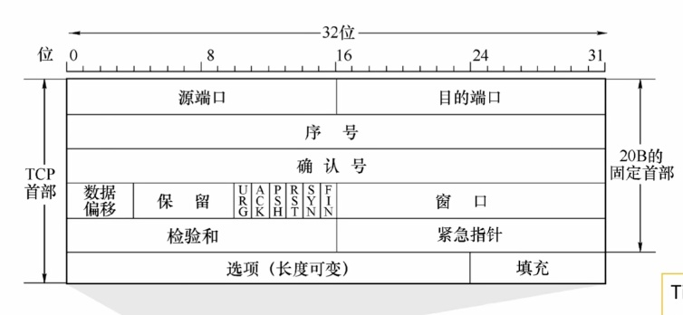

---
{
  "id": "3845a2dd-8276-80af-b94e-e968724eca4c",
  "url": "https://app.notion.com/p/5-3845a2dd827680afb94ee968724eca4c",
  "created_time": "2026-06-19T09:02:00.000Z",
  "last_edited_time": "2026-06-20T09:40:00.000Z"
}
---

#  5.传输层


[5.1传输层提供的服务](51传输层提供的服务/index.md)
  # 端口的作用
  - 通过“端口号”标识本主机的一个特定进程。
  - 可以通过 Socket 套接字（IP 地址 + 端口号）避免程序员手动构造tcp/udp协议头
  **注意⚠️**：TCP、UDP 两种协议的端口号是相互独立的；每台主机的端口号是相互独立的。
  ### 端口号的分类
  服务器使用的端口号
  - 熟知端口号：0~1023 —— 用于被熟知的重要应用程序（如 HTTP 用 80、HTTPS 用 443 ）
  - 登记端口号：1024~49151 —— 供用户自行登记的普通应用程序使用
  客户端使用的端口号
  - 短暂端口号：49152~65535 —— 客户端发起通信时临时分配的端口号，通信结束后释放。
  

  # 功能
  ### 实现端到端（进程到进程）的通信
  ### 复用和分用
  - 复用（从上到下）：发送时，多个进程共享一个传输层协议
  - 分用（从下到上）：接收时，传输层可以把数据正确交付到不同进程
  ### 差错检测
  - TCP：检测出差错后丢弃数据，并通知发送方重传（保障可靠性）。
  - UDP：检测出差错后直接丢弃数据，且不通知发送方（不保障可靠性）。
  ### 向应用层提供两种服务
  - 有连接、可靠传输（TCP）
  - 无连接、不可靠传输（UDP）
[5.2.1UDP数据报](521udp数据报/index.md)
  - UDP首部很小，只有8b
  - UDP不支持报文拆分
  - UDP无连接，不可靠，不支持拥塞控制
  - UDP支持一对一（封装到单播IP数据报）和多对一（封装到多播IP数据报）
  # UDP数据报格式
  
[5.2.2UDP校验](522udp校验/index.md)
  # 发送方
  1. 添加伪首部：在计算检验和之前，先在 UDP 数据报前临时添加 12 字节的伪首部。
  1. 分组：将伪首部、UDP 首部和数据部分按 16 bit（2 字节）为一组进行划分。如果数据长度为奇数，需在末尾补一个字节的 0。
  1. **二进制求和：对所有 16 bit 组二进制相加。注意：最高位产生的进位需要回卷加到最低位（加到最低位）**
  1. **取反：将最终的加法结果逐位取反，得到 16 bit 的检验和。**
  1. 填入首部：将计算出的检验和填入 UDP 首部的“检验和”字段。
  1. 去除伪首部：去掉临时添加的伪首部，将完整的 UDP 数据报交给网络层封装成 IP 数据报进行发送。
  # 接收方
  1. 接收UDP报文，添加伪首部
  1. 把UDP首部，伪首部，数据，以16bit一组，进行二进制加法（最高位进位要回卷）
  1. 如果结果全为1，则无差错，否则有差错
[5.3.1TCP协议框架](531tcp协议框架/index.md)
  - TCP首部较大，24b
  - TCP支持报文拆分
  - TCP有连接，可靠传输，支持拥塞控制
  - TCP只支持一对一，不支持多对一
  # TCP协议的三大阶段
  ### 建立连接（三次握手）
  发送三个TCP报文段
  ### 数据传输
  全双工通信
  ### 释放连接（四次挥手）
  前两次挥手断开一方连接
  后两次挥手断开另一方连接
[5.3.2TCP报文段](532tcp报文段/index.md)
  
  - 序号（seq）：标记数据部分的第一个字节在字节流中的位置（TCP只关心字节流顺序，不关心这是第几个数据报）
  - 确认号（ack/ack_seq）：会写一串数字，表示该字节前的所有字节以正确接收
  - ACK：为0时，ack_seq无效；为1时，ack_seq有效（只有第一个握手包的ACK=0）
  - 数据偏移：4bit，表示tcp首部长度
  - 保留：暂时没用
  - URG：紧急位，为1表示紧急指针有效，为0无效
  - 紧急指针：标记需要紧急发送的数据的字节流位置
  - PSH：为1表示希望尽快收到回复
  - RST：为1时强制释放TCP连接
  - SYN：同步位，只有第1，2次握手的值为1（标志连接请求/响应报文）
  - FIN：终止位，只有第1，3次挥手的值为1
  - 窗口（rwnd，rcvwnd）：协商接收窗口（接收缓冲区），表示当前本机的接收缓冲区还有多少（流量控制）
  - 校验和：和UDP校验一模一样
  - 选项：协商MSS（最大段长，决定单个tcp报文大小）
  PS：
  TCP首部不记录tcp数据部分长度和总长度，实际是通过IP首部-TCP首部算出来的
[5.3.3TCP连接管理（建立连接）](533tcp连接管理建立连接/index.md)
  前提：我们将主动发起连接的叫客户端，被动响应的叫服务器
  # 三次握手（标记值）
  握手1：客户端→服务器（客户端发起连接）
  SYN=1；ACK=0；FIN=0；seq=xx(客户端自定义的值)；ack=无效

  握手2：服务器→客户端（服务器确认并回应）
  SYN=1；ACK=1；FIN=0；seq=xx(服务器自定义的值)；ack=客户端发来的seq+1

  握手3：客户端→服务器（客户端确认）
  SYN=0；ACK=1；FIN=0；seq=不变/+n；ack=服务器seq+1
  注意⚠️
  - 只有握手1，2的SYN=1
  - 只有握手1的ACK=0
  - 握手1，2不能携带数据，但仍要消耗一个序号（seq+1）
  - 握手3可以带数据（带几个字节，消耗几个序号），也可以不带数据（不消耗序号）
  # 三次握手（状态转换）
  ### 客户端
  ```plain text
连接关闭CLOSED
↓（发送握手1）
同步已发送SYS-SENT
↓（收到握手2&发出握手3）
已建立连接ESTABLISHED
  ```
  ### 服务器
  ```plain text
连接关闭CLOSED&监听LISTEN
↓（收到握手1&发出握手2）
同步已收到SYS-RCVD
↓（收到握手3）
已建立连接ESTABLISHED
  ```
  
  # 建立连接耗时分析
  用（RTT：往返时延）计算
  不用死记
[5.3.3 TCP连接管理（释放连接）](533-tcp连接管理释放连接/index.md)
  前提：仍把主动发起关闭的一方叫客户端，被动响应的一方叫服务器（双方都可能发起关闭）
  # 四次挥手（标记值）
  挥手1：客户端→服务器（客户端申请关闭）
  FIN=1；ACK=1；SYN=0；seq=xx(客户端当前序号)；ack=服务器当前seq+1（若之前已收数据则为期望的下一个序号）

  挥手2：服务器→客户端（服务器确认）
  FIN=0；ACK=1；SYN=0；seq=xx(服务器当前序号)；ack=客户端seq+1

  挥手3：服务器→客户端（服务器准备好关闭并发起关闭）
  FIN=1；ACK=1；SYN=0；seq=xx(服务器当前序号)；ack=客户端seq+1（客户端后续若有数据则相应变化）

  挥手4：客户端→服务器（客户端确认关闭）
  FIN=0；ACK=1；SYN=0；seq=客户端seq+1（若挥手1只发FIN则+1；若中间还发了数据则累计增加）；ack=服务器seq+1
  注意⚠️
  - 只有挥手1，3的FIN=1
  - 挥手1，3的FIN 即使不携带数据也会消耗一个序号（seq+1）
  - 挥手2可以携带数据，挥手4不能携带数据

  # 四次挥手（状态转换）
  ### 客户端
  ```plain text
已建立连接ESTABLISHED
↓（发送挥手1 FIN）
终止等待1FIN-WAIT-1
↓（收到挥手2 ACK）
终止等待2FIN-WAIT-2
↓（收到挥手3 FIN）
时间等待TIME-WAIT
↓（等待2MSL后）
连接关闭CLOSED
  ```
  ### 服务器
  ```plain text
已建立连接ESTABLISHED
↓（收到挥手1 FIN，发送挥手2 ACK）
关闭等待CLOSE-WAIT
↓（发送挥手3 FIN）
最后确认LAST-ACK
↓（收到挥手4 ACK）
连接关闭CLOSED
  ```
  

  # TIME-WAIT（为什么要等2MSL）
  - **保证挥手4的ACK可靠到达**：若ACK丢失，服务器会重传挥手3（FIN），客户端仍在TIME-WAIT才能再次发送ACK
  - **防止旧连接报文干扰新连接**：等待足够时间让网络中属于旧连接的报文都消失（2MSL）
  - 经验记忆：TIME-WAIT 在 **主动关闭方** 出现，时间为 **2MSL**
  # 释放连接耗时分析
  用（RTT：往返时延）计算
  通常至少需要：挥手1→挥手2（1RTT） + 挥手3→挥手4（1RTT） + 2MSL（TIME-WAIT）
  不用死记
  - 客户端收到挥手3后，至少要到计时2SML才能关闭
  - 服务器可以连续发出挥手2，3（这算1RTT）
  - MSL（最大报文段寿命）是TCP协议规定的固定时间
[5.3.4TCP可靠传输，流量控制](534tcp可靠传输流量控制/index.md)
  # 可靠传输
    可靠传输基于tcp首部的序号seq实现
    - 通过TCP头部的ack来确定接收到了多少字节（收到的序号数）
    - 通过TCP头部的seq序号标记当前数据部分第一个字节在字节流中的位置
    ## 确认机制
      累积确认
      收到多个连续报文段，只需要返回一个ACK（只需要返回最大的ack值）
      推迟确认
      收到tcp报文不立即确认，而是等待多个报文一起确认
      - 最长等待0.5秒
      - 如果当前有要发送的数据则不会等待
      - 连续收到两个最大长度的报文要立即确认
      捎带确认
      在返回ACK时可以捎带数据
    ## 重传机制
      超时重传
      在tcp报文发出后会启动超时计时器，超时未收到ack会重发报文
      快重传
      使用立即确认的方式，当发送方收到4个相同的ACK（3个冗余ack）时，说明该数据报大概率丢失了，则立即重传该数据报，而不是等计时器超时（和推迟确认冲突）（不会全部重传）
      PS：为什么是3个，怎么不是2个：3个是经验值，数据报失序也会导致多个ack，因此不能太少
  # 流量控制（滑动窗口）
  通过在TCP数据报头部携带rwnd来报告自己当前接收窗口大小
  发送方根据接收方的rwnd信息和ack信息动态调整发送窗口（发送窗口不能大于接收窗口大小）
  PS：这里的发送/接收窗口不是链路层的那个，是在传输层实现的

  # 注意⚠️
  - TCP一个端口可以同时与多个设备通信（IP不同）
  - 接收缓冲区是边接收边交付（只要数据按序就可以交付）
  - **tcp的接收/发送窗口限制的是一次性能发几个tcp数据报，MSS限制的是tcp单个数据报大小，别搞混了**
[5.3.6拥塞控制](536拥塞控制/index.md)
  流量控制：管端到端间收发控制
  拥塞控制：管整个网络的收发控制
  因此，引入了一个拥塞窗口cwnd来限制同时发送tcp数据报的数量
  规定
  拥塞窗口＜发送窗口＜接收窗口
  当网络发生拥塞时，拥塞窗口就会减小，从而限制各设备收发能力
  ### 判断网络拥塞的方法
  - 不拥塞：每个报文都能正常接收到ack
  - 一般拥塞：收到冗余ack，触发快重传
  - 严重拥塞：大量报文段都不能按时收到ack，触发超时重传
  

  # 慢开始算法
  前提：拥塞窗口cwnd<慢开始门限ssthresh（拥塞控制阈值）
  方法：发送方每收到一个ack就会将拥塞窗口+1（发送方每RTT cwnd翻倍）
  # 拥塞避免算法
  前提：拥塞窗口cwnd≥慢开始门限ssthresh（拥塞控制阈值）且没发生超时重传
  方法：发送方即使收到多个ack，cwnd+1（发送方每RTT cwnd+1）
  当发生超时重传时会大幅降低cwnd，并将ssthresh设为cwdn÷2
  # 快恢复算法
  前提：发生快重传（一般拥塞），还没发生ack超时
  方法：将cwnd，阈值，都设为当前cwnd的一半，让其切换回拥塞避免算法
  目的：避免拥塞窗口大幅缩小，导致落回慢开始算法
  
  PS：图中TCP Tahoe版本就是未加入快恢复算法的早期版本，TCP Reno是现代版本
