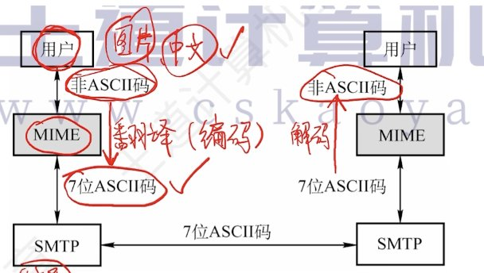

---
{
  "id": "3865a2dd-8276-80ab-a0fd-ce13452bd4f3",
  "url": "https://app.notion.com/p/6-4-3865a2dd827680aba0fdce13452bd4f3",
  "created_time": "2026-06-21T08:57:00.000Z",
  "last_edited_time": "2026-06-21T09:34:00.000Z"
}
---

#  6.4电子邮件

# 电子邮件系统的组成
由三大部分组成：用户代理，邮件服务器，电子邮件协议

# 电子邮件格式和MIME
- 邮件=信封+内容
- 内容=首部+主体
- 首部由To（收件人），From（发件人），Subject（主体）组成，其中to，from必填
- 信封是给SMTP协议准备的数据结构，由首部自动生成
SMTP的局限性：只支持传输7bitASCII码（只支持纯英文）

### MIME

mime不是协议，只是格式规范，它让邮件可以在SMTP的基础上可以发送更多格式
mime规定了以下三部分：
- 定义了5个新的邮件首部字段（如mime版本）
- 定义了许多邮件主体格式（如文本，图片）
- 定义了传送编码（如base64）
# SMTP与POP3

- HELO：相当于打招呼
- MAIL FROM：指明“谁发的”
- RCPT TO：指明“发给谁”，服务器会检查收件人是否存在，并给出回应
- DATA：相当于告诉服务器“接下来要开始发邮件内容了”
- QUIT：相当于告诉服务器“邮件发完了”
PS：
SMTP为push推通信方式（负责发邮件）
POP3为pull拉通信方式（负载收邮件）
