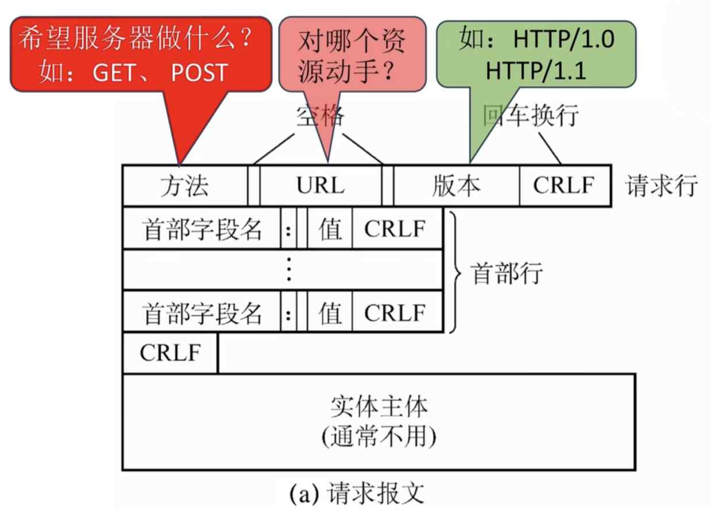
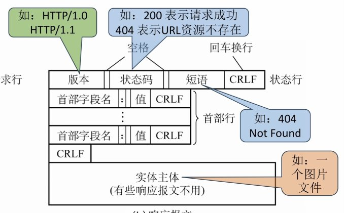

---
{
  "id": "3865a2dd-8276-80cb-bc66-e43a8c0dea64",
  "url": "https://app.notion.com/p/6-5http-3865a2dd827680cbbc66e43a8c0dea64",
  "created_time": "2026-06-21T10:13:00.000Z",
  "last_edited_time": "2026-06-21T10:32:00.000Z"
}
---

#  6.5http协议

# http请求

### 常见请求方法
- get：请求读取URL标识的信息
- head：请求读取URL标识的信息的首部
- post：请求给服务器发送信息
- connect：用于代理服务器
# http响应

### 状态码
- 1xx：信息
- 2xx：成功
- 3xx：重定向
- 4xx：客户端错误
- 5xx：服务端错误
# cookie字段
cookie由服务器分配给客户端，相当于临时身份证，用于识别客户端
# connection字段
用于标记使用何种连接方式
- close：非持续连接
- keep-alive：持续连接
