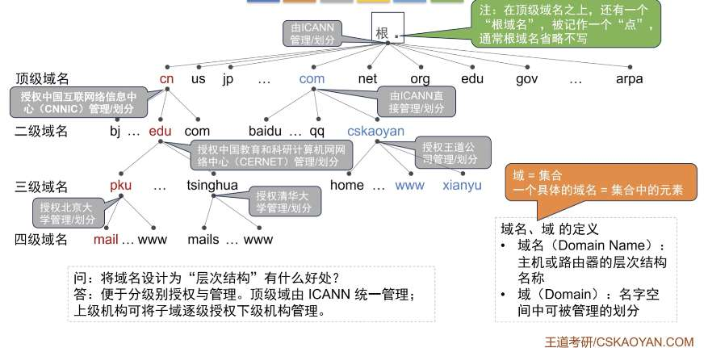
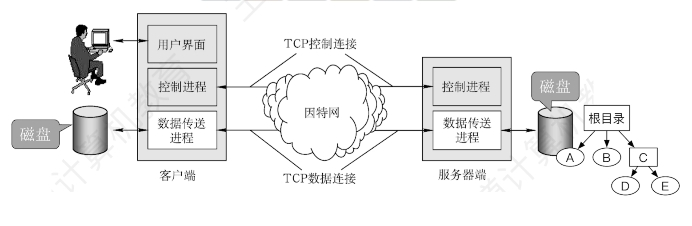
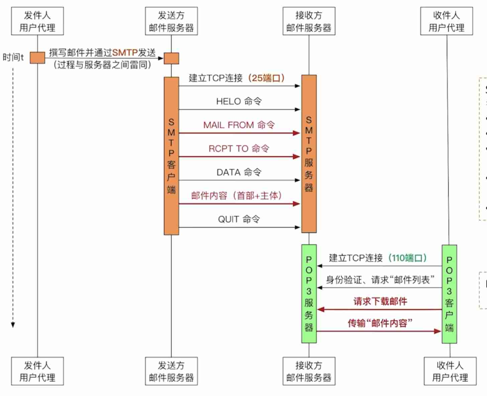

---
{
  "id": "3865a2dd-8276-80b7-8209-c99621dede3e",
  "url": "https://app.notion.com/p/6-3865a2dd827680b78209c99621dede3e",
  "created_time": "2026-06-21T06:55:00.000Z",
  "last_edited_time": "2026-06-21T10:13:00.000Z"
}
---

#  6.应用层

[6.1网络应用模型](61网络应用模型/index.md)
  # 客户/服务器模型（C/S模型）
  ### 工作流程：
  1. 服务器长期运行
  1. 客户端主动向服务器发出请求
  1. 服务器被动处理请求
  ### 特点：
  - 客户进程间不直接通信
  - 客户服务器地位不平等，服务器处于中心
  优点：
  便于集中管理
  缺点：
  服务器故障影响全局
  服务器负载大
  # P2P模型
  ### 特点：
  去中心化，主机间地位平等
  主机间直接通信
  优点：
  单节点损坏不影响全局
  各结点可以分摊负载
  缺点：
  主机负载大
  可能导致网络拥塞
[6.2 DNS概述](62-dns概述/index.md)
  网址=域名
  ### 域名结构
  ```plain text
www.w3.com
www：三级域
w3：二级域
com：顶级域
  ```
  ### DNS作用
  保存各域名IP信息，将域名转换为IP
  ### DNS基本特点
  - DNS采用C/S（客户端/服务器）工作方式
  - DNS是应用层协议，通常基于UDP（53端口）
  - DNS是分布式系统，即使单个计算机出来故障，也不会妨碍整个DNS运行
[6.2DNS层次域名空间](62dns层次域名空间/index.md)
  ### 域名书写规则
  - 低级域名在左，高级域名在右
  - 域名由标号组成，标号间用“.”分隔
  - 标号：主要由英文（不区分大小写）、数字组成；允许用连字符“-”（其他标点不行）
  - 单标号≤63字符，全域名总长（含点）≤255字符
  ### 域名层次结构
  
  ### 顶级域的分类
  - 国家顶级域名
  - 通用顶级域名
  - 基础结构域名（.arpa）（反向域名解析：将IP转换为域名）
[6.2DNS域名服务器，域名解析](62dns域名服务器域名解析/index.md)
  # 四类域名服务器
  根域名服务器：保存了所有的顶级域名服务器的IP
  顶级域名服务器：保存了所有二级域名服务器的IP
  权限域名服务器：保存了所有三级域名服务器IP
  本地域名服务器：用于加速
  - 通过：根→顶级→权限逐层查询
  - 全世界有13组根域名服务器，每组分配至少1个IP，提升稳定性
  - 每组根域名服务器并非单台主机，而是世界各地分散部署，支持任播，可就近访问，他们共用一个IP
  # 本地域名服务器
  各ISP和某些企业会在本地部署域名服务器
  本地域名服务器会缓存DNS查询记录，下次直接从本地返回IP
  用户主机和某些浏览器会实现一个DNS解析器，用于解析DNS报文，解析器也会缓存DNS信息
  # 域名解析过程
  ### 递归查询
  > DNS 客户端向 DNS 服务器发起查询，并要求该服务器代表客户端完成名称解析过程，返回最终结果（或明确的错误）。
  ### 迭代查询
  > DNS 服务器在无法直接回答时，不代替查询者继续查询，而是返回自己已知的最佳信息（通常是下一步应查询的 DNS 服务器）。
  无论是迭代还是递归，用户主机只和本地域名服务器请求一次（迭代/递归都是由本地域名服务器代为完成的）
[6.3FTP文件传输协议](63ftp文件传输协议/index.md)
  # ftp协议功能
  1. 提供不同类型主机系统间文件传输
  1. 以用户权限管理的方式提供远程FTP服务器上的文件管理能力
  1. 以匿名FTP的方式共享文件
  # FTP工作原理
  - ftp是应用层协议，采用C/S模型，基于TCP建立可靠传输
  - 控制连接：持久连接，FTP会话期间，保持TCP连接
  - 数据连接：非持久连接，文件传输时建立连接，结束关闭连接
  - 有一个主进程和多个从属进程，从属进程包括控制进程，数据传送进程
  

  # 数据传输
  ### 主动模式
  服务器端的数据传送进程主动向客户端发起数据连接。适用于客户端有公网IP且防火墙允许入站连接的场景。
  ### 被动模式
  服务器端被动等待客户端发起数据连接。更适用于客户端位于NAT或防火墙后、无法被外部直接访问的情况。
  ### PS
  在数据传输前，客户端需要发送port/pasv指令指定模式
  # FTP特性
  - ftp文件修改效率低，需要整体下载再上传
  - ftp分离控制与数据，控制不会因数据传输阻塞（带外传输）
  - 客户端可通过“控制连接”请求服务器返回文件列表，服务器通过“数据连接”传输文件列表
  - 主动模式无法穿透NAT
[6.4电子邮件](64电子邮件/index.md)
  # 电子邮件系统的组成
  由三大部分组成：用户代理，邮件服务器，电子邮件协议
  

  # 电子邮件格式和MIME
  - 邮件=信封+内容
  - 内容=首部+主体
  - 首部由To（收件人），From（发件人），Subject（主体）组成，其中to，from必填
  - 信封是给SMTP协议准备的数据结构，由首部自动生成
  SMTP的局限性：只支持传输7bitASCII码（只支持纯英文）

  ### MIME
  

  mime不是协议，只是格式规范，它让邮件可以在SMTP的基础上可以发送更多格式
  mime规定了以下三部分：
  - 定义了5个新的邮件首部字段（如mime版本）
  - 定义了许多邮件主体格式（如文本，图片）
  - 定义了传送编码（如base64）
  # SMTP与POP3
  

  - HELO：相当于打招呼
  - MAIL FROM：指明“谁发的”
  - RCPT TO：指明“发给谁”，服务器会检查收件人是否存在，并给出回应
  - DATA：相当于告诉服务器“接下来要开始发邮件内容了”
  - QUIT：相当于告诉服务器“邮件发完了”
  PS：
  SMTP为push推通信方式（负责发邮件）
  POP3为pull拉通信方式（负载收邮件）
[6.4万维网](64万维网/index.md)
  # 浏览器访问一个网页的过程
  1. 用户输入网址
  1. 浏览器通过DNS服务器查询IP
  1. 浏览器与<Web服务器IP地址:80端口>建立TCP连接
  1. 浏览器在握手③中携带HTTP请求报文（指明要访问哪个html网页）
  1. 服务器返回HTTP响应报文（携带html文件）
  1. 如果html用了其他n个元素，还需要n组HTTP请求&响应（持续、非持续工作方式有所区别）
  # http的工作方式
  ## 持续连接
  ### 非流水线
  一个TCP连接可以处理多个HTTP请求-响应对（一次连接），但必须等待前一个请求的响应返回后，才能发送下一个请求（不能并发）
  ### 流水线
  一个TCP连接可以处理多个HTTP请求-响应对（一次连接），允许同时发送多个请求（无需等待前一个响应），服务器按顺序返回响应（可以并发）
  ## 非持续连接
  每个TCP连接仅处理一个HTTP请求-响应对，请求完成后立即关闭连接（因此访问一个网页需要多次tcp连接和释放）
  但可以通过并发多个连接来提速
  # 统一资源定位符URL
  格式：
  ```plain text
<协议>://<主机>:<端口>/<路径>
  ```
  PS：
  - URL指向万维网上的某个特定资源
  - 端口，路径可省略（有默认值）
  # http协议
  是应用层协议，基于tcp，定义了http请求报文&http响应报文两种数据结构
[6.5http协议](65http协议/index.md)
  # http请求
  
  ### 常见请求方法
  - get：请求读取URL标识的信息
  - head：请求读取URL标识的信息的首部
  - post：请求给服务器发送信息
  - connect：用于代理服务器
  # http响应
  
  ### 状态码
  - 1xx：信息
  - 2xx：成功
  - 3xx：重定向
  - 4xx：客户端错误
  - 5xx：服务端错误
  # cookie字段
  cookie由服务器分配给客户端，相当于临时身份证，用于识别客户端
  # connection字段
  用于标记使用何种连接方式
  - close：非持续连接
  - keep-alive：持续连接
