---
{
  "id": "3215a2dd-8276-804d-8889-e741d0261b7d",
  "url": "https://app.notion.com/p/3215a2dd8276804d8889e741d0261b7d",
  "created_time": "2026-03-12T07:16:00.000Z",
  "last_edited_time": "2026-10-20T03:06:00.000Z"
}
---

# 🌐 计算机网络


[1.网络基本概念](1网络基本概念/index.md)
  1.1-1计算机网络的概念
    # 计算机网络，局域网，因特网区别
    计算机网络：网络的统称（局域网，互联网）
    局域网：支持各种协议
    因特网：只支持tcp/ip协议
    # 网络设备
    集线器：工作在一个网络下，但可能引起冲突
    交换机：工作在一个网络下，处理一个网络的数据交换工作
    路由器：将两个网络连接起来
    # 拓展
    ISP：是互联网服务提供商
    家用路由器：路由器+交换机….
  1.1-2计算机网络组成
    # 硬件-软件-协议角度
      ## 硬件
      路由器
      交换机
      集线器
      调制解调器（猫）
      网络适配器（网卡）
      线缆
      ## 软件
      客户端
      ## 协议
      各种协议
    # 工作方式角度
      ## 边缘部分
      各种终端
      ## 核心部分
      交换机等各种设施
    # 逻辑功能角度
      ## 资源子网
      负责提供各种资源，如：文件，算力，等
      例：IDC服务商内网
      ## 通信子网
      负责联通整个网络
      例：ISP核心网
    # 计算机网络功能
      数据通信：实现基本传输
      资源共享：硬件，软件，数据
      分布式处理：集群计算，边缘计算
      提高可靠性：主/备服务器
      负载均衡：多服务器负载均衡
      其他
  1.1-3-1电路交换，报文交换-分组交换
    # 电路交换
    电话网络
    连接→通信
    **优点：**传输速率高
    **缺点：**建立连接时间长，占线无法传输，被干扰无法纠错

    # 报文交换
    电报网络
    报文分两部分：控制信息，数据
    **优点：**不用连接，不用独占线路，支持干扰纠错
    **缺点：**
    报文大小不固定难以管理存储转发
    长报文需要整个发送，缓存开销大
    长报文重传代价高
    # 分组交换
    计算机网络
    由电报网络改进而来
    将报文切分成若干组，每组包含首部和报文
    **优点：**
    无需建立连接
    分组长度固定，方便缓存管理
    支持校验
    长报文无需整个发送
    **缺点：**
    控制信息占用了部分通信容量
    每个节点要处理控制信息，有延迟
    中途丢失分组导致后续处理复杂
    # 虚电路交换（现代网络）
    改进自分组交换
    需要先建立连接（虚拟电路）
    但不独占一条物理线路
  1.1-3-2三种交换方式性能分析
    
    
    电路交换→打电话
    报文交换→大件运输
    分组交换→发多件快递，到了组装
  1.1-4计算机网络的分类
    # 按分布范围
      ### 广域网（WAN）：
      跨省/跨国/跨洲
      技术：后面介绍
      ### 城域网（MAN）：
      跨城市
      技术：常采用以太网技术
      ### 局域网（LAN）：
      学校/企业/家庭
      技术：以太网技术
      ### 个域网（PAN）：
      家庭/智能家居网络
      技术：蓝牙/zigbee
    # 按传输技术分
      ### 广播式网络
      该广播覆盖范围内所有设备都能收到
      如：WiFi
      ### 点对点网络
      只会点对点发送
    # 按拓扑结构分
      ### 总线型
      数据“广播式”传输
      有争总线问题
      ### 环形网络
      依旧“广播式”传输
      通过令牌解决争总线问题，令牌顺环型传输，持有令牌才能使用总线
      ### 星型结构
      独立连接，点对点
      不存在争总线
      ### 网状结构
      数据通过多个节点转发
      点对点传输
    # 按使用者分
      共用网
      专用网
    # 按传输介质
      有线网络
      无线网络
  1.1-5计算机网络性能指标
    # 速率
      **速率是节点在信道上的传输速率（速率=单向速率）**
      ### 信道
      表示某方向上的传输信息的通道（信道≠通信线路）
      一般一条通信线路逻辑上分一条发送信道和一条接收信道
      ### 速率单位
      单位：bit/s，b/s，bps 这些都是比特每秒
      **注意⚠️：B和b不是一个意思：B是字节，b是比特，1字节=8比特**
      ### 数量前缀（网络）（计网）
      K：千=bit x10³
      M：兆= K x10³
      G：吉= M x10³
      T：太= G x10³
      ### 数量前缀（存储）（计组，操作系统）
      其他一样
      倍数不一样：是1024，也就是2¹⁰
    # 带宽
      某信道能传送的最大速率

      所以理论上千兆网络指的是上行千兆+下行千兆，而不是上行+下行千兆😈

      带宽受网络中最窄的那个设备决定
      ### 多含义解释
      在通信原理中：带宽指某信道允许通过的信号频段范围（光or电or电磁波）
    # 吞吐量
      指单位时间某个网络（或信道，接口）的**实际数据量**
    # 时延
      指数据从网络一端到另一端的时间
      总时延=发送 +传播 +处理 +排队

      
    # 时延带宽积
      意义：一条链路中，已从发送端发出蛋尚未到达的最大比特数
      开个玩笑：两头同时拔网线，卡在网线里的数据量😅
      **公式：时延带宽积=****传播时延****×带宽**
      注意⚠️：是传播时延，因为要算卡在网线里的比特数
      时延带宽积主要用于设计最小帧长
    # 往返时延
      往返时延RTT：指发送完数据到收到确认消息的时间
      游戏延迟就是往返延迟
      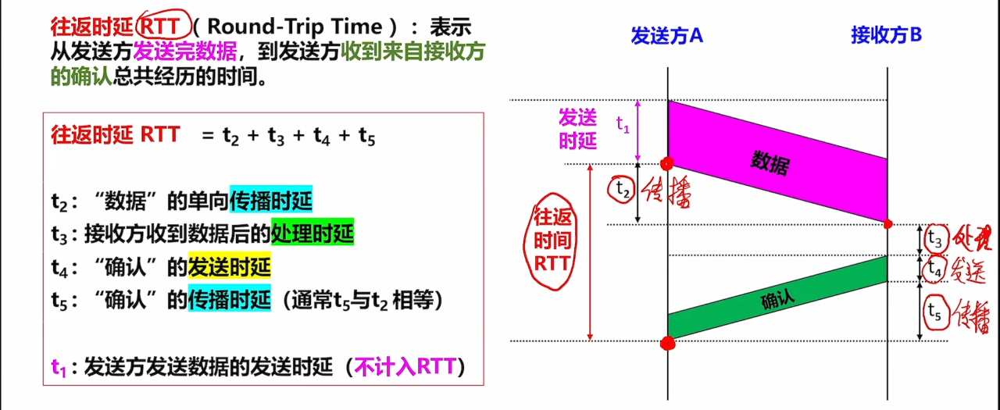
    # 信道利用率
      信道利用率=有数据通过的时间➗传输总时间
      信道利用率不能太低，浪费资源
      也不能太高，网络拥堵
  1.2.1计算机网络分层（上）
    像快递网络一样，计算机网络也是分层级的，如图
    
    事实上，每一层之间功能是有可能重复的，只要合理就行（例如：顾客可以打包，快递员也可以打包）
    # 计算机网络的分层
    示意图
    

    路由和链路中间节点不用处理全部层信息，它只需要得到转发相关的信息即可
    这只是示意图，并非一成不变的
    # 常见的三种分层结构
    
    注意⚠️：计算机分层是个抽象概念，它只负责定义功能，不负责具体实现，具体实现交给软硬件厂商
    - 实体：计算机网络中，第n层的活动元素（软件+硬件）称为第n层实体
    - 不同机器上的同一层称为对等层，同一层的实体称为对等实体
    - 协议：协议是控制对等实体之间通信的规则，在同一层的不同机器间，如图↓（水平上）
    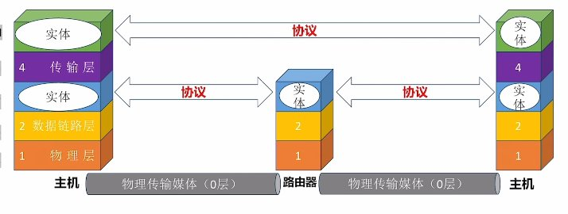
    - 接口：同一节点内相邻两层实体交换信息的逻辑接口，又称服务访问点（SAP）（垂直上）
    - 服务：服务是下层为相邻上层提供的功能调用（垂直上）

    
  1.2.2计算机网络分层（下）
    # 数据在主机上的处理
    
    # 在路由器上的处理
    
    经过处理后
    
    # 接受方主机
    与发送方相反（图省略）
    # PDU、SDU、PCI的概念
    - 协议数据单元（PDU）：本层的所有数据（控制数据，用户数据）
    - 服务数据单元（SDU）：上一层的所有数据
    - 协议控制信息（PCI）：本层的控制数据
    - 三者关系：n-SDU+n-PCI=n-PDU=(n-1)-SDU 
    # 协议三要素
    - 语法：规定数据和控制信息的格式
    - 语义：需要发出什么控制信息，怎么应答
    - 同步（时序）：规定各种操作的条件，时序关系（如：发送方10秒没收到“传输成功”应答，则重传）
  1.2.3_1 OSI参考模型
    术语统一：
    OSI模型的第四层叫运输层，也可以叫传输层
    TCP/IP模型的第二层是网际层，也叫网络层
    # osi各层的名称和顺序
      
      **口诀：物联网叔会使用**
      ## 1层：物理层
        任务：实现相邻节点之间比特（0或1）传输
        - **需定义电路接口定义**（形状，引脚）
        - **需定义传输信号的含义，电气特征**（如5v是1，1v是0）
      ## 2层：链路层
        任务：确保相邻节点间链路逻辑无差错
        - **差错控制**（数据帧）：检查+纠错 或检查+丢弃+重传
        - 流量控制：协调速率
      ## 3层：网络层
        任务：把分组从源节点转发到目的节点
        - **路由选择**：构造并维护路由表，决定分组通过的最佳路径
        - 分组转发：将分组从合适的端口转发出去
        - 拥塞控制：发现网络拥塞，并采取措施缓解
        - 网际互连：实现异构网络互联
        - 其他：差错控制（分组），流量控制，连接建立与释放，可靠传输管理
      ## 4层：传输层
        任务：实现进程与进程间通信
        - **复用和分用**：发送端几个高层实体复用低层连接，在接收端再分用
        - 其他功能：差错控制（报文段），流量控制，连接建立和释放，可靠传输管理
      ## 5，6，7层
        5层会话层：**管理进程间会话**（采用检查点机制，当通信失效时从检查点恢复通信）
        6层表示层：解决不同主机上表示信息不一致问题，**数据格式转换**（编码方式不一致）
        7层应用层：根据不同应用决定（如：http）
      ## 各层传输单位
        ### 7-5层 [应用层，表示层，会话层]：
        报文（单个文件就是一个报文）
        ### 4层传输层：
        报文段（将一个报文拆成多个段）
        ### 3层网络层
        分组（将一个报文段再次切分）
        PS：
        1. 现实中很少在网络层再次切分，这种切分叫“IP分片”，会额外吃掉路由器的性能，反而降低效率，所以一般都是直接将报文段封装成分组（直接装进去不切分）
        1. 路由器就工作在网络层
        ### 2层数据链路层
        帧（将报文封装成帧）
        PS：交换机就工作在数据链路层
        ### 1层物理层
        比特
  1.2.3_2 TCP/IP模型
    # TCP/IP模型
    

    # 和osi模型区别
    1. 各层级功能与osi模型类似
    1. tcp/ip模型取消了表示层和会话层，改用应用层实现
    1. 将链路层和物理层合并为网络接口层，并减少对链路和接口形态的限制，以鼓励设备制造商创新
    1. tcp/ip模型只有一次差错控制，流量控制，连接建立与释放，可靠传输管理，它们都由传输层完成✅，传输层以下的的层级由于没有差错控制是不可靠的❌
    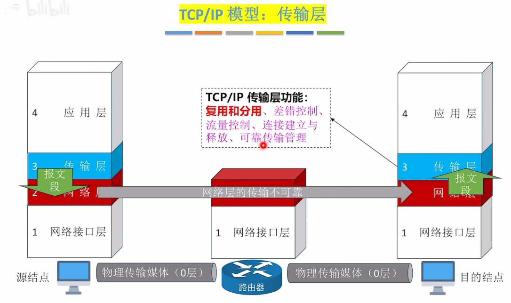

    # 优缺点：
    优点：
    由于去掉了3层（网络层）及以下的差错控制，使得中间的节点（路由器）负载下降，降低了成本，提高了处理效率
    缺点：
    传输过程缺少差错控制，一旦传输出错重传代价高
    # 特性
    tcp/ip由于只有一层差错控制，因此可以提供有连接可靠服务（TCP协议），也可以提供无连接不可靠服务（UDP协议）
    
[2.物理层](2物理层/index.md)
  2.1.1物理层
    # 概念
    信源：信号的来源
    数据：信息本体
    信号：数据的载体
    信道：信号的通道
    信宿：数据接收方
    PS：
    1. 一条物理线路通常包含两个信道：发送信道，接收信道
    1. 信号分模拟（连续）和数字（离散）
    **码元：在一个信号周期内，每一个信号就是一个码元，可以把“信号周期”称为“码元宽度”**
    （例：使用自然二进制编码，4位表示一种信号，那码元宽度就是4，有16种码元）
    # 码元与bit换算
    $$
1码元=log_2^K bit
$$
    K：码元种数
    码元/秒=波特率（不是比特率）
  2.1.2信道的极限容量
    带宽（计网）：最高数据率，单位hz
    带宽（通信）：允许通过的频带范围
    # 奈奎斯特定理（奈氏准则）（无噪声）
    **一个理想低通信道的极限波特率=2W**
    理想低通信道：没有噪声，带宽有限的信道
    W：是信道的频率带宽，单位Hz
    $$
极限比特率=2Wlog_2^K
$$
    如果波特率太高，会码间串扰，导致无法识别
    # 香农定理（有噪声）
    对于有噪声，带宽有限的信道
    $$
极限比特率=Wlog_2^{（1+S/N）}
$$
    W：信道频率带宽
    S/N：信噪比
    $$
信噪比=信号功率÷噪声功率
$$
    由于在正常通信中信号功率往往比噪声功率大很多，信噪比很大，所以引入另一种单位：分贝
    $$
1dB=10log_{10}^{S/N}
$$
    总结：提升带宽，功率，降低噪声功率，都可以提高极限比特率
  2.1.3编码与调制
    编码：二进制数据→数字信号
    解码：数字信号→二进制数据
    调制：二进制数据→模拟信号
    解调：模拟信号→二进制数据
    # 常用编码方式
      **不归零编码（NRZ）**：
      低0高1，中不变
      - 自同步（时钟同步）：无
      - 浪费带宽（每hz利用率）：不浪费
      - 抗干扰：弱👎🏻

      **归零编码（RZ）：**
      低0高1，中归零
      PS：“中”指的是两个信号之间怎么处理
      - 自同步：有
      - 浪费带宽：浪费
      - 抗干扰：弱👎🏻

      **反向非归零编码（NRZI）**：
      跳0不跳1看起点，中不变（遇到0就跳变一下）
      - 自同步：若增加冗余位，可支持
      - 浪费带宽：浪费一点（冗余位）
      - 抗干扰：弱👎🏻

      **曼彻斯特编码：**
      上跳0下跳1看中间，中必变（一定会在信号中间跳变，是0是1取决于上跳还是下跳）（默认）
      还有一种旧版曼彻斯特编码，与这个相反，上跳1下跳0
      - 自同步：有
      - 浪费带宽：浪费
      - 抗干扰：强👍🏻

      **差分曼彻斯特编码：**
      跳0不跳1，看起点，中必变
      - 自同步：有
      - 浪费带宽：浪费
      - 抗干扰：强👍🏻
      
    # 常用调制方法
    ### 调幅AM
    根据不同振幅区分不同信号
    ### 调频FM
    根据不同频率区分不同信号
    ### 调相PM
    根据每个信号周期中正弦波的相位来区分不同信号
    
    ### 正交幅度调制（QAM）
    将调幅信号与调相信号叠加起来
    可以增大信息传输密度
  2.2传输介质
    # 传输介质
      ## 导向型
        ### 双绞线
        有屏蔽层（STP）
        无屏蔽层（UTP）
        - 抗干扰：较好
        ### 同轴电缆
        一根导线+屏蔽层（闭路电视线）
        - 抗干扰：好
        ### 光纤
        纤芯+包层
        有单模光纤和多模光纤
        单模光纤（直线传输）：传输一种波长的光，长距离传输
        多模光纤（全反射）：传输多种波长的光，短距传输
        - 抗干扰：非常好
      ## 非导向型
        ### 无线电波
        - 穿透强
        - 距离远
        - 指向弱
        ### 微波/短波通信
        - 指向强
        - 易窃听
        - 带宽大
        ### 其他
        红外
        激光
    # 以太网对有线传输介质的命名规则
      速度+Base+介质信息
      速度：
      纯数字，单位Mbps
      介质信息：
      - 同轴电缆：纯数字，数字×10就是传输距离
      - 光纤：F*，*可以是其他信息
      - 双绞线：T*，*可以是其他信息
    # 物理层接口特性
      - 机械特性：形状，尺寸，引脚数，固定锁定装置
      - 电气特性：电压，长度，温度等
      - 功能特性：某个信号什么含义
      - 过程特性：发生某个事件怎么处理
  2.3物理层设备
    ### 中继器
    长距离传输中，信号难免衰减变形
    中继器可以将信号整形再生
    - 只支持半双工通信
    - 中继器一端对应一个网段
    ### 集线器
    集线器真就是直接把多条线路合成一条，不做任何处理，因此集线器下的所有设备都处于一个冲突域（总线型网络）
    冲突域：一个冲突域下的设备通信会互相干扰
    - 现在都是交换机，没有用集线器的（太落后）
    缺点：
    不能隔离冲突域，通信冲突
    所以设备共享带宽（相互挤兑）
    更别说隔离广播（路由器）了
    半双工通信，效率低
[3.链路层](3链路层/index.md)
  3.1数据链路层的功能
    **链路层将网络层的ip数据报封装成“帧”，发送给下一个节点**
    接下来的几节将逐一讲解
    MTU：最大传输单元，表示一条链路一次能够承载的最大网络层数据包大小
    专有名词翻译：
    以太网：就是局域网
  3.2组帧
    组帧就是把来自网络层的数据封装成帧
    **链路层对网络层是透明传输的**
    透明传输：下层的处理不影响上层的内容，对上层来说就是透明的
    # 帧定界（确定两帧之间的界限）
    有四种方法
    ### 字符计数法
      **原理：在每个帧开头加一个定长的计数字段表示该帧长度**
      PS：帧长=计数字段+帧数据
      缺点：任何计数字段出错，后续所有帧都无法定界
    ### 字节填充法
      **原理：在帧的头和尾添加特殊的字符SOH和EOT，分别区分头尾**
      - 为了防止数据部分包含SOH和EOT扰乱传输，发送方会在数据部分的SOH和EOT前插入转义字符ESC，接收时会删掉ESC
      - 为了防止数据部分包含转义字符ESC被接收方删掉，发送方会在ESC前面再加一个ESC
      转义字符接收方处理规则：删转义字符，保留后一个字符（无论后一个是不是ESC）
    ### 零比特填充法
      **原理：与字节填充相似，在帧的头尾添加特殊比特串，分别区分头和尾**
      为了防止数据部分包含特殊比特串：
      - 发送方：检查数据，当连续出现5个1，就填充1个0
      - 接收方：逆处理，连续出现5个1，就删掉后面的0
    ### 违规编码法
      原理：违规编码法基于曼彻斯特编码，将数据以曼彻斯特编码发送（中必变），在帧的头尾各插入一个违规编码（中不变），用来区分头尾
      曼彻斯特编码要求：上跳0下跳1看中间，中必变
      违规信号：周期中间不跳变
  3.3差错控制
    3.3.1_1 差错控制（位错）-检错编码（奇偶校验码）
      对于链路层来说有这几种出错可能：帧内错误（差错控制），帧间错误（可靠传输）
      **本节讨论的是帧内错误的处理（差错控制）**
      # 数据链路层的差错控制（位错）
        为了修复帧内的位错，有两种方式
        - 使用检错编码检测，发现错误后丢帧重传
        - 使用纠错编码检测，发现错误后修正
      # 数据链路层的可靠传输（帧错）（后面说）
        要注意区分差错控制（位错）和可靠传输（帧错）
        在可靠传输问题上有三种可能的错误：帧丢失，帧重复，帧乱序
        后面介绍
      # 奇偶校验
      奇偶校验是两种校验模式：奇校验，偶校验
      **奇校验：通过控制校验位，令算上校验位，一共有奇数个1**
      **偶校验：通过控制校验位，令算上校验位，一共有偶数个1**
      **现实中更常用偶校验，因为偶校验的硬件实现简单：只需将每位异或运算即可**
      例：
      规定第一位是校验位，那么100经过
      奇校验后：0100
      偶校验后：1100
      （给第一位前添加了一个校验位）
      **优点：**
      **需求算力低，易实现**
      **缺点：**
      **同时偶数个位出错就检测不出来了**
    3.3.1_2差错控制（位错）-检错编码（循环冗余校验）
      # 循环冗余校验码（CRC码）
      思想：发送，接收方约定一个”除数”，检查余数是否都为0
      原理：
      **发送：K个信息位+R个校验位，作为被除数，约定一个除数，通过控制校验位，确保余数为0**
      **接收：通过约定的除数，检查余数是否为0**
      例：
      生成多项式为G（X）=x^3+x^2+1，信息码为101001，求CRC码？
      解答：
      1. **生成多项式是x从n次方一直加到0次方的式子，依次查看从n次到0次的x的系数，即可得到”除数”**
      1. **生成多项式最高次幂是校验位的位数，即可确定R**
      1. **被除数与除数进行“模2除”，余数就是校验位（模2除与正常除不一样，有点麻烦，用到再查吧）**

      所以除数为1101
      校验位是3位
      校验码是001
      **接收方：用crc码与除数进行模2除，余数为0则没错**
      ### 纠错能力
      crc校验码有一定的纠错能力，只要：
      $$
2^R≥K+R+1
$$
      就可以纠错一位错误
      ### 特点：
      优点：CRC码广泛用于链路层检错，它可以比较完善的检测出错误，
      缺点：但较少使用它的纠错功能（只能纠正单比特错误）
    3.3.2差错控制（位错）-纠错编码
      # 海明校验码
      思想：将信息位分组，分别进行偶校验
      ## 编码
      步骤：
      1. 确定校验位（海明码）的位数
      $$
2^K≥n+K+1
$$
      n：信息位    ；K：校验位
      1. 确定校验位的分布
      假设海明码的高位是n，低位是1
      那海明位号就是从n到1的n-1个格子
      - 填充校验位
      校验位对应的海明位号这么计算↓
      $$
H=2^{i-1}
$$
      H：海明位号
      i：第i个校验位

      1. 求校验位的值
      - 将信息位的位号写成二进制
      - 校验位的位号从小到大依次对应，信息位号的二进制从低位到高位的权值
      - 像这样竖着列出信息位位号的二进制↓
      
      - 将校验位对应权值对应的信息位号二进制竖列中，为1的信息位，异或运算，即可得到该校验位的值
      
      如图
      1. 将信息位从低位到高位填充到空余部分
      ## 解码
      将几个校验位和它对应的几个信息位进行异或运算，结果都是0则没有错误
      如果不是0则，看几个校验位校验出的结果（从低位校验位到高位排序）组成的2进制结果对应的十进制是多少，该十进制代表出错的海明位号
      ## 特点
      海明码可以纠错一位错误
      可以检错两位错误
      但无法区分是一位错还是两位错
      因此，我们会在海明码开头加上一个全校验位（做整体的偶校验）
      如果：
      - 海明校验全为0，全体偶校验成功，没有错误
      - 海明校验不全为0，全体偶校验失败，一位错误，纠正
      - 海明校验不全为0，全体偶校验成功，两位错误，重传
  3.4流量控制与可靠传输机制
    3.4-1滑动窗口机制
      # 滑动窗口机制
      在链路层，接收和发送都受滑动窗口控制
      有两种滑动窗口：
      - 发送窗口W_T
      发送方当前允许发送的帧数
      - 接收窗口W_R
      接收方当前允许接收的帧数
      
      PS：
      接收方会使用“确认机制”控制发送方的窗口滑动，从而实现流量控制
      若接收到接收窗口外的帧，则会直接丢弃
    3.4-2停止等待协议
      # 帧编号
      $$
W_T+W_R≤2^n
$$
      n：帧编号的比特数
      最少可以用一个比特编号（01交替）
      如果不满足这个规则，当接收窗口内的确认帧全部丢失时，发送方会重传，但由于接收窗口已滑动，且滑动后窗口内帧编号与滑动前窗口编号相同，会把重传的帧当成新的帧，导致帧重复
      # 数据帧，确认帧概念
      帧分不同类型
      数据帧（Data i）：用于发送数据
      确认帧（ACK i）：用来确认收到某帧
      帧的首尾存放着：帧类型，帧序号，校验码，帧定界信息等控制信息
      # 重传机制
      超时重传：发送方超时未收到ACK i（确认帧），则重传i号帧
      如果确认帧丢失：发送方超时后重传，接收方收到重复帧会丢弃该帧，并返回该帧确认帧
      如果数据帧有错误：接收方丢弃该帧，不返回ACK，等待发送方超时重传
    3.4-3后退n帧协议GBN
      后退n帧协议针对的是发送窗口>接收窗口的情况（发了3帧只接收1帧，就要后退发送窗口）
      # 帧序号
      与上节一致
      # 累积确认机制
      后退n帧协议规定：
      接收方可以连续收到多个数据帧后，只返回最后一个帧的ACK
      # 帧丢失
      当利用累计确认机制一次性接收多个帧时，丢失了一个帧
      接收方：继续接收下一个帧→发现不是预期的帧编号→直接丢弃→返回已成功接收的最后一个帧的ACK
      接收方：接收到的ACK不是预期值→将发送窗口滑动到成功接收的帧的下一帧→继续发送
      后退n帧协议：不是指发送窗口后退，而是发送进度后退（因为只支持顺序传输）
      # 确认帧丢失
      发送方：发送窗口内帧计时器全部超时，触发重传
      接收方：接收到“非法帧”，丢帧，返回最后一个成功接收的帧的ACK，以提醒发送方“后退”i+1号帧重新发送
      # 缺点
      如果误码率很高，或接收方接收帧的速度很慢，发送方就要经常回退，效率很低
    3.4-4选择重传协议SR
      # 滑动窗口机制
      发送窗口W_T＞1，接收窗口W_R＞1
      W_R≤W_T
      接收窗口不能大于发送窗口
      # 帧编号
      $$
W_T+W_R≤2^n
$$
      # 确认机制
      SR不支持累积确认，必须一帧一帧确认
      # 重传机制
      超时重传
      # SR的特殊规则
      否认帧NAK_i ：若接收到第 i 帧有错误，则丢弃该帧，并返回否认帧NAK_i
      请求重传：发送方接收到NAK_i，则重传第i帧
      # 确认帧丢失
      与前面相同
      # Q＆A
      Q：为什么接收窗口要≤发送窗口？
      A：如果接收窗口＞发送窗口，比发送窗口大的部分会长期空闲，影响效率
      Q：SR协议如何解决丢帧/错帧
      A：只要发送窗口移动不会导致需要重传的帧被移动到发送窗口外，就继续移动发送窗口
    3.4-5三种协议的信道利用率
      信道利用率：
      $$
U=\frac{T_D}{T_D+RTT+T_A}
$$
      T_D：数据帧传输时延
      RTT：2倍单向传播时延
      T_A：确认帧传输时延
      # S-W确认等待协议
      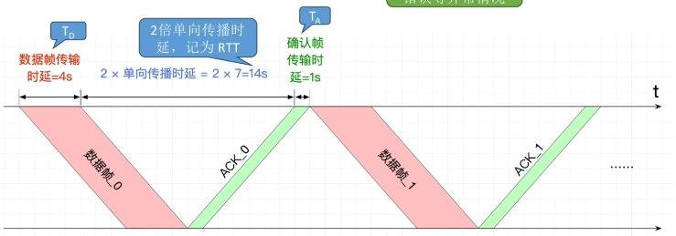
      有时候会说：确认帧传输时延很短，则忽略确认帧T_A
      # GBN（后退n帧协议），SR（选择重传协议）
      计算公式
      $$
U=\frac{NT_D}{T_D+RTT+T_A}
$$
      N：一次性发送的帧数
      PS：如果信道利用率大于1，则取1
      # 术语补充：滑动窗口机制
      在使用术语上：停止-等待协议不属于滑动窗口协议
      滑动窗口协议指：后退n帧协议，选择重重传协议
      |  | 停止等待协议 | 后退n帧协议 | 选择重传协议 |
      | --- | --- | --- | --- |
      | ARQ协议（自动重传） | ✓ | ✓ | ✓ |
      | 连续ARQ（自动重传多个帧） | X | ✓ | ✓ |
      | 滑动窗口协议 | X | ✓ | ✓ |
  3.5介质访问控制

    3.5.1介质访问控制-信道划分
      **介质访问控制**：多节点共享总线，广播信道时，避免可能的信号冲突（研究介质的复用）
      # 信道划分介质访问控制（同介质复用技术）
      ## 时分复用（TDM）
        将时间分为等长的“TDM帧” ，每个“TDM帧”又分为等长的m个“时隙”， 将m个时隙分配给m对用户（节点）使用
        缺点：
        - 某节点不通信时，给其分配的时隙也不会收回，浪费带宽
        - 每节点最多只能分到1/m的带宽，速度慢
      ## 统计时分复用（STDM）
        在时分复用的基础上增加动态统计，动态分配时隙
        优点：解决了上述TDM的两个问题
      ## 频分复用（FDM）
        将信道的总频带划分为多个子频带，每个子频带作为一个子信道，每对用户使用一个子信道进行通信
        优点：各节点可同时发送信号，充分利用带宽
        缺点：只能用于模拟信号
      ## 波分复用（WDM）
        与频分复用一样，只不过这个是光信号，那个是电信号
      ## 码分复用（CDM）
        各发送方发送数字信号，接收方再将不同的数字信号从混合信号中分离
        ### 1. 给各节点分配专属“码片序列”（向量）
        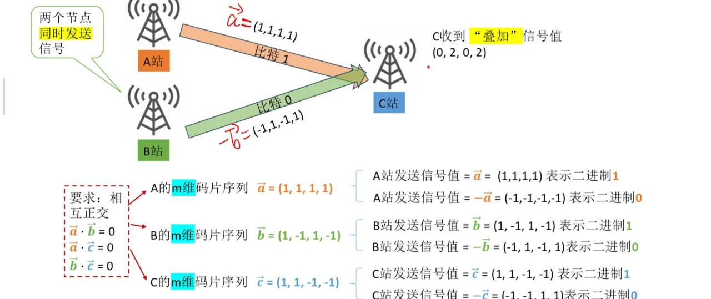
        码片序列”包含m个码片(信号值），可看作“m维向量” （m维向量的分量通常取1或-1）
        PS：
        相互通信的各节点知道彼此的码片序列
        各节点的码片序列必须相互正交（向量相乘为0）
        ### 2.发送方如何发送数据
        节点发出m个信号值与“码片序列”相同，表示比特1
        节点发出m个信号值与“码片序列”相反，表示比特0
        ### 3.信号会在传输中叠加
        当多个发送方同时发送数据时，信号在传输过程中“叠加”
         (注：本质是多个m维向量的加法) 
        ### 4.接收方如何接收数据
        叠加信号与发送方的码片序列作“规格化内积” 
        结果为1，表示比特1
        结果为-1，表示比特0
        **规格化内积：**
        $$
\frac{1}{m}·码片序列·叠加信号
$$
    3.5.2介质访问控制-随机访问
      介质访问控制随机访问：研究信道的复用
      # ALOHA协议（随机接入协议）
        ### 纯ALOHA协议
        原理：
        **数据帧准备好立刻发送到信道上**，引入ack协议（停止等待协议）如果**传输失败，随机等一段时间后重传**
        缺点：
        同时发送会冲突
        

        ### 时隙ALOHA协议
        原理：
        使用固定大小的时隙，数据准备好了，在最近一个时隙开始发送，冲突了随机等一段时间，引入ack协议
        - 时隙大小=传输一个帧最长时间
        - 只能在时隙开始时发送
        优点：
        降低了ALOHA的冲突概率
        缺点：
        仍然会冲突
        
      # csma协议（载波监听多路访问协议）
        原理：
        **在ALOHA协议上改进，发送数据前监听信道是否空闲，空闲才会发送（其他与ALOHA一样）**
        有以下几种csma协议
        ### 1-坚持CSMA协议
        要点：**帧准备好后如果信道不空闲，则持续监听（其他与csma一样）**
        优点：信道利用率高
        缺点：多节点准备完成后同时监听，一旦空闲多节点同时发送，易冲突
        
        ### 非坚持CSMA协议
        要点：是1-坚持csma的改进，**帧准备好后如果信道不空闲，则随机推迟一段时间后监听**
        优点：冲突概率更低
        缺点：信道空闲后可能不会立刻被使用，利用率较低
        

        ### p-坚持CSMA协议
        要点：非坚持csma的改进，帧准备好后如果**信道不空闲，则持续监听**，如果**空闲，则有p的概率立即发送，有1-p的概率推迟一段时间发送**
        优点：结合了1-坚持csma和非坚持csma的优点
        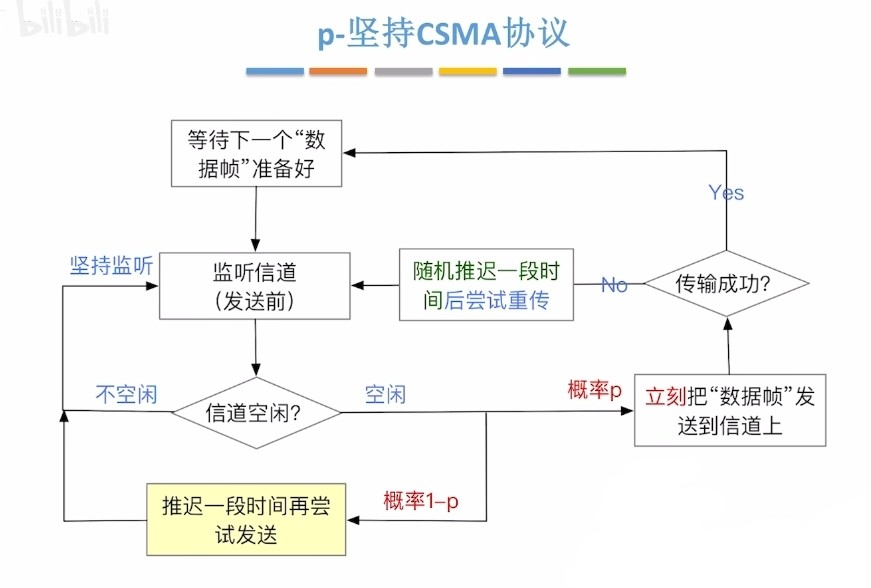
      # CSMA/CD协议（冲突检测）
        本协议被用于早期的有线以太网
        早期以太网↓
        总线型（争用介质）
        使用集线器（信号会广播给所有设备）
        
        ### 协议要点
        **先听后发，边听边发，冲突停发，随机重发**
        ### 发送方原理
        发前监听是否空闲，空闲立即发送，发送中检测到冲突立即停发，并统计冲突次数，冲突次数K=16，传输失败，并报告网络层
        ### 随机等待时间（二进制指数退避算法）
        随机等待时间=r倍争用期
        - r：随机数
        - 如果k≤10，r在[0，2^k-1]中取
        - 如果k＞10，r在[0，2^{10}-1]中取
        - 争用期=2x最大单向传播时延
        - 最大单向传播时延：信道上最远的两个节点的传播时延
        ### 最短帧长
        最短帧长=2x最大单向传播时延x信道带宽
        短于最短帧长的帧会被视为无效帧（防止发送后才检测到冲突）
        ### 最长帧长
        防止某些节点一直占用信道
        ### 接收方原理
        收到帧→是否小于最短帧长→是不是发给自己的→crc校验→交给网络层
        任意一步不过都会直接丢弃该帧
        ### 注意
        csma/cd协议中没有ack协议，发送中没检查到冲突默认成功
        以太网规定：最短帧长=64B，最长帧长=1518B
      # CSMA/CA协议（冲突避免）
        这个是无线网络协议，比较复杂，只讲重点
        协议背景：
        - 无线信号难以实现边听边发（会干扰）
        - 因距离限制，部分设备不能接收到全部设备的信号（隐蔽站）
        ### 协议要点
        发送方：
        - 先听后发，忙则退避
        - 若信道空闲，间隔DIFS后，发送帧
        - 不空闲，随机退避
        退避原理：
        - 用二进制指数退避算法确定随机退避时间（倒计时）
        - 发送方保持监听，空闲后才开始扣除倒计时，倒计时结束立即发送
        接收方：
        停止等待协议，间隔SIFS后，发送ack，发送方超时未收到ack，则进行随机退避
        PS：
        - DIFS：固定的时间，防止信道释放后多设备立马同时发送造成冲突
        - SIFS：固定的时间，用于等待设备差错控制和CRC校验
        信道预约机制：（可选开启）
        - 预约机制解决了隐藏站问题
        - RTS控制帧：预约请求，包含源地址，目标地址，持续时间
        - CTS控制帧：允许发送广播，包含源地址，目标地址，持续时间
        - 其他设备接收到AP的CTS广播后会静默指定的时间
        - 设备发送的RTS预约有超时机制，超时未收到CTS广播说明预约失败
    轮询访问-令牌传递协议
      特点：环形拓扑，各节点轮询访问，不存在冲突
      # 协议要点
      ### 令牌帧
      - 需指明当前获得令牌的节点编号
      - 只有获得令牌才能发送数据帧
      - 如果获得令牌的节点没有数据发送，就将令牌传给下一个节点
      ### 数据帧
      - 需指明源地址，目的地址，是否被接收，获得令牌的节点编号
      - 数据帧从源节点发出，传递一圈后回到源节点
      - 数据传递到目的节点后会被复制一份，并标记为已接收
      - 数据帧回到源节点后如有异常，尝试重发
      ### 其他
      - 无论是令牌还是数据帧，只能单向传输
      - 获得令牌的节点，只能发一帧，发完释放令牌
      - 需要专用设备MAU集中控制
      - 令牌环网适合负载高的网络（不冲突）
  3.6局域网

    以太网和IEEE802
      ## IEEE802委员会下辖4个工作组：
      ~~802.8工作组（FDDI光纤分布数字接口）~~
      ~~802.5工作组（令牌环网）~~
      802.3工作组（以太网）（有线网络）
      802.11工作组（无线网络）
      PS：划线代表工作组已解散
      ## 802.11
      802.11b：WiFi1（2.4GHz，11Mbps）
      802.11a：WiFi2（5GHz，54Mbps）
      802.11g：WiFi3（2.4GHz，54Mbps，向后兼容b）
      802.11n：WiFi4（2.4/5GHz，MIMO，最高600Mbps）
      802.11ac：WiFi5（5GHz，MU-MIMO，最高数Gbps）
      802.11ax：WiFi6/6E（OFDMA，BSS Coloring；6E增加6GHz频段）
      802.11be：WiFi7（更宽信道与更高并发，进一步提升吞吐与时延表现）

      ## 802层次划分
      
    3.6.1局域网的体系结构
      # 特点
      1. 覆盖范围较小
      1. 较低时延和误码率
      1. 局域网内各节点以帧传输
      1. 支持单播（一对一），广播（一对全部），多播（一对多）
      # 有线局域网
        ## ~~同轴电缆以太网~~（已淘汰）
          - 总线型
          - 使用同轴电缆
          - 使用csma/cd协议
        ## 双绞线以太网
          ### ~~用集线器连接（已淘汰）~~
          - 物理上是星型网络，逻辑上仍是总线型
          - 使用双绞线+集线器
          - 使用csma/cd协议
          ### 用交换机连接
          - 星型网络
          - 使用双绞线+交换机
          - 使用csma/cd协议（半双工）或不进行介质访问控制（全双工）
        ## 光纤以太网
          - 用于中间节点间通信，不直接连接终端
          - 使用光纤传输
          - 不进行介质访问控制（使用两根光纤实现全双工）
      # 无线局域网
        - 星型网络（1AP+n设备）
        - 电磁波传输
        - 使用CSMA/CA协议
      # 硬件架构
        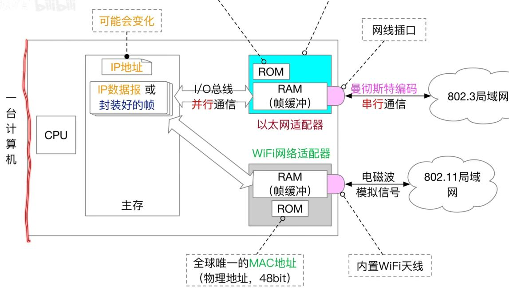
        - 网卡负责帧的收发
        - 网卡需要支持帧缓冲（存待放收发的帧）
        - 需要完成串并行转换（网线串行，主机内并行）
    3.6.3 VLAN虚拟局域网基本原理
      ## 虚拟局域网（VLAN）
      - 一个大型局域网可划分成多个VLAN
      - 每个VLAN是独立的广播域
      - 每个VLAN对应一个VID
      ## 划分VLAN好处
      - 防止设备过多导致广播包占用过多网络资源
      - 安全
      # VLAN划分方式
        ### 1. 基于接口
        设备连接固定的接口，交换机将广播帧广播到对应接口上就行了
        缺点：设备不能改变接口
        ### 2. 基于mac地址
        设备随便连接接口，交换机将广播帧转发到固定的mac地址的设备上
        缺点：设备不能开随机mac
        ### 3. 基于ip地址
        设备随便连接接口，交换机将广播帧转发到固定的IP地址的设备上
        缺点：需要网络层支持
      # 802.1Q帧
        - 主机之间，主机与交换机之间使用标准以太网帧
        - 交换机之间，使用802.1Q帧
        区别：802.1Q帧在以太网帧的基础上增加了4位VID信息（VLAN编号）
        
    3.6.2以太网和802.3（有线网）
      # 物理层标准
      ### 命名
      速率+Base+介质信息
      前面物理层笔记说过，不重复了
      ### PS：
      - 一个网段工作在半双工下，才需要csma/cd协议
      - 同轴线：只支持半双工
      - 双绞线：连集线器支持半双工，连交换机支持全双工
      - 物理层使用曼彻斯特编码
      # mac层标准
      ### v2标准（主流）
      口诀：**662n4（收发协数验）**
      解释：
      
      ### IEEE802.3标准
      口诀：662n4（收发长数验）
      解释：
      
    3.6.4 IEEE802.11无线网
      ## portal（门户）
      门户是将802.3（有线网）和802.11（无线网）连接成一个局域网的设备
      ## 802.11基本概念
      - 802.11是星星拓扑，中心是AP（接入点）或叫wap
      - 基本服务集BBS：一个基站（AP）+多个移动站（终端）
      - 服务集标识符SSID（WiFi名字）：不能超过32字节
      - 基本服务区BSA：WiFi物理覆盖范围
      - 扩展服务集：就是子路由（工作在AP模式）
      - 漫游：从一个基本服务集连到另一个基本服务集（自动切换AP）
      ## 802.11帧分类
      1. 数据帧
      1. 控制帧：ack（确认帧），rts（预约帧），cts（同意预约帧）
      1. 管理帧：信标帧（AP周期性广播），探测响应（AP回应探测），探测请求（终端主动探测AP，针对AP隐藏ssid）
      ## 802.11数据帧格式
      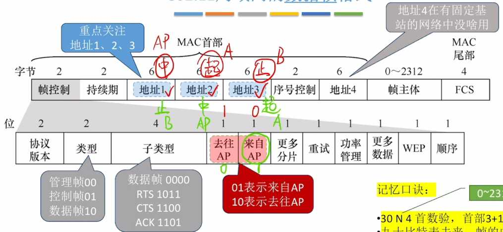

      口诀：
      1. **30 n 4首数验**
      （前30位是mac首部，n位数据，4位校验）
      1. **九十比特表去来，帧的中转靠AP**
      （mac首部第9，10位表示帧去往AP还是来自AP）
      1. **去往AP中起止，来自AP止中起**
      （去往AP的帧的地址1，2，3分别表示中转，起点，目的mac，同样，来自AP的代表地址1，2，3是目的，中转，起点）

      PS：
      在802.11中终端间不能直接通信（要AP转发）
      数据部分字节大小范围n：0~2312
  3.7 广域网
    3.7.1 广域网基本概念
      局域网：家庭网，校园网，企业内网
      广域网：ISP间的网络
      （对，就是覆盖范围区别）
      PS：广域网交换机功能更多，更像路由器
    3.7.2 ppp协议（点对点协议）
      链路层除了802.11，802.3还有ppp协议
      ppp协议常用于宽带拨号，路由器间直联（ppp原生支持认证，而且不需要mac地址那些东西，协议简单）
      # ppp协议帧格式
      
      # 如何透明传输
      人话：当数据部分出现帧定界符如何处理？
      ### 方案a：字节填充（转义）
      - 用于异步传输（没有时钟信号）
      - 方案：将0x7E（帧定界符）转义为0x7D
      ### 方案b：零比特填充
      - 用于同步传输（有时钟信号）
      - 方案：防止数据部分出现01111110（帧定界符），给连续5个1后插一个0

      # ppp协议特点
      - ppp是链路层协议
      - ppp只支持全双工
      - ppp不是可靠连接（没有ack），但保证无差错（crc校验）
      - ppp支持多种网络层协议（ipv4/6，AppleTalk）
      - ppp帧是字节的整数倍（8的倍数）（规定）
    3.7.2-2ppp协议工作流程
      ppp协议有两个子协议lcp和ncp
      ## 链路控制协议lcp
      作用：ppp协议不会建立逻辑连接，lcp协议是用来建立逻辑连接的（建立连接+认证）
      ## 网络控制协议ncp
      作用：NCP负责兼容网络层的各种协议
      如：给IP协议分配IP地址，给AppleTalk协议（不基于IP地址）分配网络号和区域信息
      # ppp工作流程
      1. 建立物理连接
      1. 由ppp协议承载，建立lcp连接（ppp协议是无连接协议）
      1. 鉴权（通过lcp协议认证）
      1. NCP协议给网络层分配资源
      # 注意
      ppp协议后来演变成了PPPoE协议（802.3/11里套了个ppp协议）
  3.8以太网交换机
    交换机=多端口网桥
    以太网=局域网
    # 自学习功能
    - 交换维护一个交换表（记录mac+端口）
    - 交换表初始为空
    - 每收到一个帧就将发送方mac地址记录到交换表
    - 如果交换机不知道接收方端口，就把帧广播到除入口外的其他端口
    - 如果知道接收方端口，就转发到对应端口
    - 交换表中每个项都有“有效时间”，过期作废（防止端口改变导致错误）
    # 两种交换方式
    ### 直通交换
    检查帧的目的地址后，直接转发给目标
    优点：时延低
    缺点：不适用需要速率匹配，协议转换，差错检查的线路
    ### 存储转发交换
    交换机先将帧接收到内部的缓存中，进行差错检查后，再发给对应端口
    优点：适用于需要速率匹配，协议转换，差错检查的线路
    缺点：时延高

  明确一些概念
    - 以太网=局域网
    - 链路层传输的是mac帧，以太网交换机工作在这层
    - ARP是路由表，在网络层
    - 每台电脑都会存储ARP表，但不会存储mac表
    - mac表由交换机维护
    - 交换机通过识别mac来工作
    - 电脑通过子网掩码+ip判断目标是否处于同一网络
    - 目标不在同一网络，主机会将接收方mac填为网关mac
    - 当接收方mac不在mac表中，交换机会“洪泛”查询（PS：就是王道说的在局域网内广播，他的说法不太标准）
[4.网络层](4网络层/index.md)

  4.1网络层功能
    # 异构网络互联
    每个网络物理层，链路层实现不同，网络层负责屏蔽这些差异，让各种网络实现互联
    设备：路由器
    注：在TCP/IP文献中，路由器也叫网关gateway
    # 路由与转发
    ### 路由
    路由器通过路由协议，规划IP数据报的最佳转发路径
    PS：各路由器运行路由协议，生成各自的路由表
    ### 转发
    路由器根据自己的转发表，将IP数据报转发到对应的接口
    PS：转发表是路由表的精简
    # 拥塞控制
    ### 开环控制（静态）
    在部署网络时预设的缓解拥塞的方法，部署完成不再修改
    ### 闭环控制（动态）
    动态监视网络状态，发现拥塞后将拥塞信息传递给对应路由器（ICMP协议）
    路由器会自动调整路由表和策略缓解拥塞
    # 注意⚠️
    网络层的IP协议不提供可靠传输
    可靠传输靠链路层的TCP协议或其他协议
  4.2.1 IPv4分组
    IP分组就是IP数据报
    
    PS：链路层数据帧能承载的最大数据量称为最大传送单元MTU，它限制了网络层的IP数据报的长度（这东西不固定）
    # 区域划分
    IP数据报分两个部分：数据部分，首部
    数据部分分两个部分：固定部分，可变部分
    # 字段解释：
    **基础信息↓**
    - 版本：标识IP数据报版本（v4/v6）
    - 首部长度：IP数据报分首部和数据部分，标识首部长度
    - 总长度：IP数据报总长

    **分片相关↓**
    - 标识：一个IP数据报在传输时可能被分片，标识用来指示分片属于哪个源IP数据报
    - 标志：标记是否允许分片，后面还有没有分片
    MF=1 后面还有分片
    MF=0后面没有分片
    DF=1不允许分片
    DF=0允许分片
    - 片偏移：表示该片的有效数据距离源IP数据报的有效数据偏移了多少（8字节）（标记当前是第几个分片）
    
**其他↓**
    - 生存时间：就是TTL，代表最大数据包的最大跳数
    - 协议：如果是TCP协议设为6，如果是UDP协议设为17
    - 首部校验和：每个路由器仅校验首部,而不校验数据部分。如果该字段设为全0,表示不用校验

    注意⚠️
    - IP数据报的“分片”可能在源主机、 或任何一个路由器中发生
    - 只有目的主机才会对分片进行“重组”
    - 各分片有可能乱序到达目的主机
    - 由于首部的“片偏移”字段是以X8B为单位，因此，除了最后一个分片外，其他每个分片的数据部分必须是8B的整数倍
    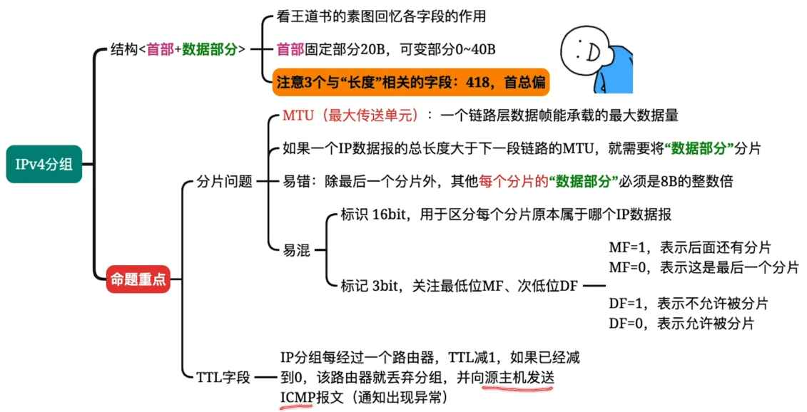
  4.2.2 IP地址
    # 最初的IP地址分类方案
    ICANN将IP地址划分为ABCDE五类
    其中ABC类是单播地址
    D类是多播地址
    E类暂时保留
    ### IP结构
    ICANN将IP分为两个部分：
    `<网络号><主机号>`
    网络号不定长，通过前几个比特判断是几类地址
    ### PS
    - 路由器和路由器连接可以不分配IP地址
    - 同一个网络下的设备网络号要相同
    - 电脑新接入时要分配IP地址和默认网关
    ### 特殊IP地址
    | 网络号 | 主机号 | 做源地址 | 做目的地址 | 含义 |
    | --- | --- | --- | --- | --- |
    | Y | 全0 | x | x | 表示整个网络本身（只能用于路由表，转发表） |
    | Y | 全1 | x | ✓ | 在网络号为Y的网络中广播 |
    | 全0 | Y | ✓ | x | 表示本网络中的Y主机 |
    | 全0 | 全0 | ✓ | x | 表示本网络是的本主机（DHCP中用） |
    | 全1 | 全1 | x | ✓ | 向本网络广播 |
    | 127 | 非全0 | ✓ | ✓ | 本地环回，用于测试 |
    注意⚠️：以上特殊地址不能分配给主机
    重要结论：一个网络中主机号占N bit，最多支持2^N-2台设备
  4.2.3子网划分
    子网划分可以将一个网络划分成多个子网
    # 子网划分
    原理：将IP地址的主机号（二进制）前n bit借走作为子网号，剩余部分做主机号
    - 最多可划分2^n个子网
    ### IP地址结构（二进制）
    ```plain text
<网络号，子网号，主机号>
    ```
    ### PS：
    - 需要给主机配置默认网关和子网掩码
    - 子网号：从主机号借的n bit
    - IP地址和子网掩码做与运算可得到子网地址
    - 需要给路由器各接口配置子网掩码
    注意⚠️：有的教程会混淆子网号和子网地址，这俩不是一个意思
    # 子网掩码
    - IP地址和子网掩码做与运算可得到子网地址
    - 子网掩码（二进制）1的个数代表网络前缀的长度（二进制）
    - 网络前缀：网络号+子网号（CIDR表示法：`IP地址/n` n代表网络前缀有多少位）
    - 网络前缀/子网地址相同的IP属于同一个网络
    - 转发逻辑：匹配相同网络前缀/子网地址的网络
    ### 路由表
    支持子网划分的路由器转发表是这样的
    ```plain text
<网络号，子网掩码，转发接口>
    ```
    ### Q&A
    Q：网络前缀和子网地址都可以用来判断是否同一网络，那实际用哪个？
    A：实际转发根据子网掩码1的个数，得出网络前缀长度，对比网络前缀即可。子网地址只用于教学演示
    Q：如果目的地址和源地址属于同一网络，怎么处理？
    A：将数据封装成帧，并在帧中标注目的mac（别问我怎么知道mac，ARP相关还没学）
    Q：如果目的地址和源地址不属于同一网络，怎么处理？
    A：将数据封装成帧，并在帧中标注网关地址
    # 默认子网掩码
    没进行子网划分的默认子网掩码
    | IP类别 | 默认子网掩码 | 前缀长度 |
    | --- | --- | --- |
    | A类 | 255.0.0.0 | /8 |
    | B类 | 255.255.0.0 | /16 |
    | C类 | 255.255.255.0 | /24 |
    # 默认路由
    默认路由的IP：0.0.0.0/0
    行为：转发给上层路由（什么？你问我顶层怎么办？丢包！）
    # 主机发送IP数据报过程
    1. 判断是否属于同一个网络：（与运算或对比网络前缀）
    1. 将IP数据报封装成mac帧发送（帧内部标注目的/路由的mac）（通过ARP协议查找mac）
    # 路由器转发过程
    1. 接收IP数据报
    1. 对IP数据报进行首部校验，找到目的IP
    1. 查转发表（与运算或对比网络前缀）
    1. 转发到对应端口（来源和目的相同的直接丢包）
    # 算子网掩码
    别听教程的，用这个方法
    （二进制）网络部分全写1，主机部分全写0→然后二进制化十进制就行了
    # 掩码含义
    掩码只表示网络部分长度
  4.2.4无分类编址CIDR
    # 无分类编址CIDR
    CIDR不再按 A/B/C 类固定分网络，而是用“任意长度的网络前缀”来划分网络
    用`IP地址/n`来表示，其中n表示网络前缀位数（二进制）
    # 定长子网划分
    每个子网的IP地址数量一样多
    # 变长子网划分
    每个子网的IP地址数量可随意规定
    
    CIDR地址块的子网划分技巧：
    - 可以利用类似于二叉树的方法划分
    - 原始CIDR地址作为根节点
    - 每个分支必须同时拥有左右孩子
    - 每个叶子节点对应一个子网
    - 整颗树不超过h-1层（h：可分配的位数）（最少要保留2bit做主机号）
  4.2.5路由聚合
    # 路由聚合/构成超网
    对于转发接口相同，部分网络前缀也相同的多条路由表项，可以合并成一条
    - 路由聚合可以加快路由表查找
    - 路由聚合可能引入一些无效地址（但不影响工作）
    # 最长前缀匹配原则
    当有多条路由都能匹配目的地址时，谁的子网掩码最长（/xx 数字最大），就优先选谁。
    原因：掩码越长，匹配得越“精确”，优先级越高。
  4.2.6网络地址转换NAT
    # 传输层“端口号”概念
    同一个IP地址可以对应多个端口（软件层面），`IP+端口`可以实现发送到指定进程
    # NAT技术
    核心：利用`IP+端口号`实现公网IP和局域网IP的转换
    ### 私有IP地址
    互联网技术工作组规定以下IP段是局域网IP↓（不能用于公网）
    10.0.0.0～10.255.255.255
    172.16.0.0～172.31.255.255
    192.168.0.0～192.168.255.255
    - 私有IP在局域网内可随意分配
    - 私有IP可复用
    ### 全球IP（公网IP）
    - 全球唯一
    - 局域网与外界使用公网IP通讯
    

    ### NAT路由器
    - 作用：转发IP数据报时，进行内网IP，外网IP的相互转换
    - NAT表：记录`内网IP+端口`与`公网IP+端口`的映射关系
    - 一个IP数据报从内网发到公网会更改源IP地址和端口号
    - 一个IP数据报从外网发到内网会更改目的IP地址和端口号
    - NAT路由器包含传输层的功能（端口是传输层概念）
  4.2.7地址解析协议ARP
    ARP协议和IP协议上同级别的，它们都会交给链路层，通过修改以太网mac帧的类型字段来做区分（0x0806代表数据部分是ARP分组）（0下0800代表数据部分是IP数据报）
    # 回顾
    - mac地址出厂自带，全球唯一
    - 一台主机至少有一个mac
    - 一个路由器一个端口有一个mac
    # ARP协议
    ## **作用：**
    ARP协议用来查询IP和mac的对应关系
    ## **ARP表：**（ARP缓存）
    - 记录mac和IP的映射关系
    - 每台主机/路由器都有自己的ARP表
    - 需要定期更新ARP表
    ## ARP请求
    内容：源IP，源mac，目的IP
    发送方式：将ARP请求封装进mac帧，帧目的地址设为全1（广播帧）
    ## ARP响应
    内容：源IP，源mac
    发送方式：将ARP请求封装进mac帧，单播发送
    ## 拓展（ARP结构）
    
  4.2.8动态主机配置DHCP（应用层）
    DHCP是应用层的，但它为网络层提供配置，所以放在这里讲
    
    # 步骤
    从DHCP服务器获取配置要发送4个报文，分别是：discover（发现报文），offer（提供报文），request（请求报文），acknowledge（确认报文）
    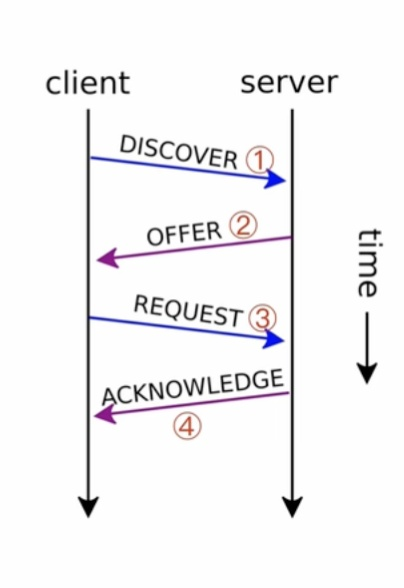
    ### 发现报文（广播自身mac）
    携带信息：客户机mac地址
    链路层：广播帧
    网络层：广播数据报
    
    ### 提供报文（分配IP）
    携带信息：给分配的IP，租期，子网掩码，默认网关
    链路层：单播帧
    网络层：广播数据报
    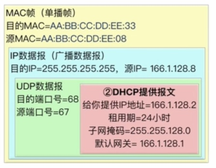
    ### 请求报文（广播自己的IP）
    由于同一局域网允许有多台DHCP服务器，他们会同时给新设备分配IP，为了确认新设备选用了哪个IP，设备需要广播发送请求报文
    携带信息：客户机被分到的IP
    链路层：广播帧
    网络层：广播IP数据报
    
    ### 确认报文（确认使用某个IP）
    为了防止在DHCP通信期间IP地址池发生改变，导致原有IP被占用，DHCP服务器需要发送确认报文，认定IP有效
    携带信息：给分配的IP，租期，子网掩码，默认网关
    链路层：单播帧
    网络层：广播数据报
    
    ### PS：
    - 客户端在收到DHCP确认报文前，都不能使用被分配的IP
    - IP有租期，客户端可以续租
    - 局域网允许有多个DHCP服务器
    - 可以发现，链路层通信靠mac地址，网络层通信靠IP地址
  4.2.9ICMP网际控制报文协议
    和ARP协议不同，ICMP协议不是直接封装在mac帧中，而是封装在IP数据报中，虽然但是，它仍属于网络层
    典型应用：
    路由追踪↓
    IP数据报有一个TTL计数，每经过一次路由就会减1，当减到0时，路由器会将其丢弃，并返回ICMP报文
    # ICMP报文与IP数据报的关系
    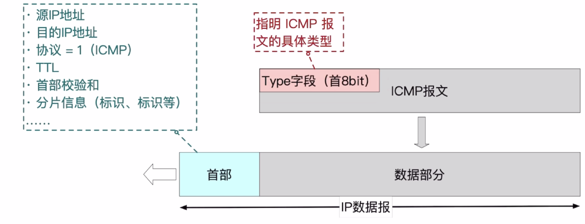
    # ICMP报文常见类型
    ### 差错报告报文
    - 终点不可达：目的IP不可达/目的端口不存在
    - 超时：TTL=0（路程太远）/丢包
    - 参数问题：参数不合法/首部校验出错
    - 改变路由：网络层重定向（让源主机下次换条路线）
    ### 询问报文
    - 回送请求：探测目标主机（ping）
    - 回送回答：回应探测请求
    - 时间戳请求：请求当前时间
    - 时间戳回答：回应当前时间
    ### 不必反馈ICMP差错报文的情况
    - ICMP差错报文本身出错
    - IP数据报被分片，分片出错，只返回一次ICMP
    - 目的地址是多播地址
    - 源地址是特殊地址
  4.3.1IPv6
    # IPv6地址的冒号十六进制记法
    IPv6总共128bit，16bit为一段，记为16进制，以冒号隔开
    # IPv6的压缩记法
    1. 省去前导0
    1. 用双冒号表示多个连续的0（连续但不在一个段里也行）
    PS：不允许出现1个以上的双冒号
    # IPv6地址的分配
    和IPv4类似分：网络地址前缀，和接口标识符
    运营商可以分配标识符给用户
    - IPv6支持即插即用（支持用户给自己分配IP地址而不经过DHCP服务器）
    - IPv6可以不用DHCP服务器分配，也可以使用DHCP服务器分配
    # IPv6的分类
    | 地址类型 | 二进制 | 含义 |
    | --- | --- | --- |
    | 未指明地址 | 全0，记做
::/128 | 无地址，类型IPv4的0.0.0.0 |
    | 环回地址 | 全0，最后一位1,记作
::1/128 | 类似IPv4的127.0.0.1
（和自己通信） |
    | 多播地址 | 前八位全1，记做
FF00::/8 | 数据同时发送到多个主机 |
    | 本地链路单播地址 | 1111111010（10位），记做
FE80::/10 | 局域网内通信，不会被路由器转发 |
    | 全球单播地址 | 除了上面4种的其他地址 |  |
    ### IPv6数据报的目的地址类型：
    - 单播：点对点通信
    - 多播：一对多
    - 任播：IPv6特有，任播终点是一组计算机，但数据报只交给其中一台计算机，通常是距离最近的
  4.4.1路由算法
    # 路由算法分类
    - 静态路由算法：管理员手动配置
    - 动态路由算法：路由器根据网络负载动态调节路由表
    

    # 距离-向量路由算法（RIP协议基于此）
    用c（x，v）表示直连路由器的各路径
    其中x代表距离（不同协议定义不同）
    v代表路由器的邻居
    核心思想：
    > 每个路由器只知道自己到各个目的网络的距离，以及下一跳是谁，并定期把这些信息告诉邻居。
    
    ### 距离：
    通常表示到目标网络的代价
可以是：
跳数
延迟
带宽代价
综合权值

    ### 向量（Vector）：
    指的是一个路由器保存的一张"距离表"，记录到各网络的距离，每条记录就是一个向量
    # 链路状态路由算法（OSPF协议基于此）
    核心：
    > 每个路由器先获取整个网络的拓扑结构，然后在本地计算从自己到所有目的地的最短路径。
    # 小结
    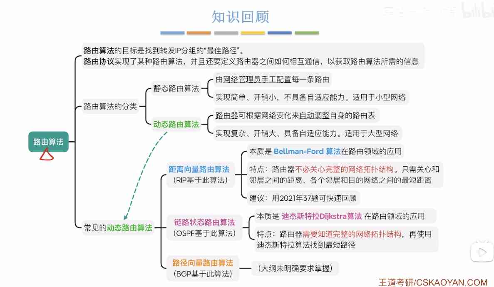
  4.4.2分层路由协议
    # 存在的问题
    - RIP路由协议缺点：基于距离-向量路由算法，连接全世界，需要的距离向量过多（存不下）
    - OSPF协议缺点：基于链路状态路由算法，连接全世界，需要的网络拓扑巨大（不现实）
    # 解决方案
    - 将全世界的网络分成多个独立的自治系统AS
    - AS可以决定在其网络中使用什么路由协议
    - 每个AS通过至少一个自治系统边界路由器与其他自治系统连接
    - 边界路由器间使用统一的协议：BGP协议
    - 自治系统内的路由选择称为域内路由选择
    - 自治系统间的路由选择称为域间路由选择 
    ### PS：
    - 自治系统间是平级关系，不存在包含
    - 每个自治系统都有唯一AS编号
    - 每个自治系统内有一个或多个CIDR地址块
    ### 互联网把路由协议分两大类：
    1. 内部网关协议IGP：RIP，OSPF
    1. 外部网关协议EGP：BGP
  4.4.3RIP协议概念
    # RIP协议在协议栈的位置
      RIP属于应用层协议，它使用UDP传输数据
      ### RIP的两种报文
      - Request报文：请求邻居发生路由表
      - Response报文：响应请求，携带部分或完整路由表
    # RIP规定
      ### RIP如何定义路径长度
      1. RIP使用跳数衡量路径长度
      1. 跳数最少的路径最好
      1. RIP规定最大路径长度不能>15（只适用于小型自治系统）
      ### RIP如何定义路由表格式
      1. 每个路由器都要维护自己的路由表，路由表有三个字段↓
      ```plain text
<目的网络N，距离d，下一跳路由器地址X>
      ```
      1. 每个路由器都会维护距离向量（从路由器到每个目的网络的距离记录）
    # RIP如何在路由器间交换信息
    - 和谁：只和邻居交换信息
    - 什么信息：自己的全部路由表
    - 什么时候：通常按固定时间交换，也可以引入触发更新机制（立即交换）
  4.3.3RIP工作过程
    刚开始各路由器只知道与自己相邻的网络距离为1。若干次交换后，所有路由器都会知道自治系统内的到所有网络的最短距离和下一跳，称为收敛
    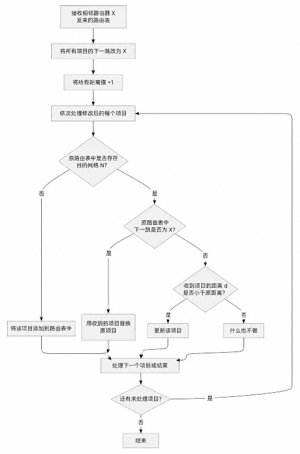

    PS：
    - 先修改收到的RIP报文
    - 只记录更短路径
    - 如果180秒还没有收到相邻路由器的更新路由表，则将此路由器设备不可达，把距离设为16
    # 缺点
    - 限制了网络规模，最大可使用距离为15
    - 交换完整路由表，网络规模越大，开销越大
    - **慢收敛**：有节点故障，需要反复多次交换信息才能完成收敛
    （某些节点损坏会导致一些路由器环路，直到15跳后才会丢包）
    （由于每个节点只关心到各网络的跳数和下一跳，某些节点损坏导致某些网络不可达时，路由器无法直接得知，而是需要多轮交换）
    ### Q&A：
    Q：为什么需要多轮交换，一轮不行吗？
    A：由于RIP不关心网络拓扑，某一网络离线后路由器还会误以为该网络可通过其他路由器访问，直到多轮交换路由表后，该网络的距离变为16
    # 优点
    - 快收敛：新节点入网，收敛快
    - 实现简单开销小
  4.4.4 OSPF开放最短路径优先协议
    # 在协议栈中的位置
    - ospf属于网络层
    - ospf使用IP协议封装，IP首部字段=89
    ### OSPF的5种分组
    1. 问候分组
    1. 数据库描述分组
    1. 链路状态请求分组
    1. 链路状态更新分组
    1. 链路状态确认分组
    # 大致原理
    每台路由器都会探测与自己直连的节点
    ### what说什么：
    与自己直连的所有链路状态
    ### How怎么说：
    用洪泛法转发探测的信息给邻居
    - 下级会将上一级的洪泛信息传递给再下一级
    - 洪泛信息不能发回给信源
    - 如果收到重复的链路信息不用重复转发
    ### when什么时候说：
    - 探测到与自己直连的链路变化时，立即洪泛最新链路信息

    # OSPF其他特点
    1. ospf允许对每条路由设置不同的代价（不同业务可以计算出不同路由）（默认以带宽为代价）
    1. 一段链路的两个方向可能权值不同
    1. 直连网络→路由器：方向上的权值通常是0（规定）
    1. ospf会选择代价最低的线路转发
    1. 存在代价相同的两条线路，两条线路都会用于转发（负载均衡）
    1. ospf分组具有鉴别功能，确保只在可信路由器间交换信息
    1. ospf支持可变长子网划分和无类编址CIDR
    1. 每个链路状态都会带上一个32位的序号，用于标记链路状态新旧
  4.4.4OSPF基本工作原理
    LSDB（链路状态数据库）：路由器中用临接表存储相邻节点，存储在路由器中所有的临接表就是链路状态数据库
    # 根据Dijkstra算法结果，构造路由表
    - 虽然Dijkstra算法能算出完整最优路径，但路由表不会存储完整路径，只存储下一跳
    - 网络拓扑发生变化，立即引起洪泛，触发各路由器的lsdb改变
    # OSPF的区域划分
    由于OSPF需要发送洪泛信息和存储LSDB链路状态数据库，如果网络很大，那洪泛信息会花费许多开销，LSDB也巨大
    因此
    - OSPF支持将一个自治系统再划分为若干区域
    - 划分区域后，洪泛信息只会在各区域内传递，而不是整个AS
    - 用“主干区域”将各区域相连
    # 主干区域，非主干区域
    一个OSPF自治系统中，只有一个主干区域（骨干区域）
    - 主干区域用于联通其他区域（非主干区域只能与主干区域直连）
    - 主干区域的标识符Area ID=0
    - 主干区域内至少有一个“`自治系统边界路由器`”与其他自治系统连接
    每个非主干区域至少有一台“`区域边界路由器`”与主干区域相连

    `区域内部路由器`也叫非边界路由器，在各区域内部
    PS：区域边界路由器需要知道区域内和主干区域的拓扑
  4.4.4 OSPF分组类型
    # Hello Packet 问候分组
    建立或维持邻居关系
    - 每隔10秒发一次
    - 40秒超时
    # DD分组（数据库描述分组）
    - 两台路由器建立邻居关系时，通过数据库描述分组，互相给出LSDB摘要（LSA头信息）

    # LSR分组（链路状态请求分组）
    - 通过LSR分组，向邻居请求确实的LSA（头信息）
    # LSU分组（链路状态更新分组）
    - 路由器通过LSU分组，向邻居传输具体LSA（可能引发全网洪泛）
    注：即使重复收到LSU分组也要返回LSAcK

    # LSAcK分组（链路状态确认分组）
    - 路由器收到了邻居发来的LSU后，返回LSAcK分组，确认收到了哪些LSA

    # 新路由器入网流程
    
  4.4.5BGP协议（边界路由协议）
    # BGP特点
    - BGP只求找到AS较好的路由（不求最好）
    - BGP协议用于各AS间通信
    - BGP需要考虑政治/经济问题（如：C国不希望数据转发经过A国）
    - BGP采用路径向量路由算法（路由器之间通报bgp路由信息时，不仅告知目的地，还告知完整路径）
    - BGP是应用层协议
    # 哪些路由器要运行BGP协议
    各AS边界路由器
    部分核心路由器
    # BGP会话
    运行BGP的路由器间会建立BGP会话
    其中
    - 两AS的边界路由器间使用直连线路，建立eBGP会话
    - AS内部的各BGP路由器间要建立全连通的iBGP会话（不一定直连）
  4.5.5BGP路由信息/原理
    # BGP路由信息
    ### CIDR前缀
    指向目的网络
    ### BGP属性
    AS-PATH（自治系统路径）：描述到达目的网络需要经过哪些自治系统
    NEXT-HOP（下一跳）
    - 对eBGP：下一跳，是eBGP发送方路由器自己的IP（给隔壁发自己的IP）
    - 对iBGP：默认不修改下一跳（隔壁AS的IP）
    # BGP关键规则
    - iBGP学到的路由不能再通过iBGP传播给其他邻居（边界路由器只会直接发给各BGP路由器，各路由器不会二次转发）
    - 由于各路由器不会二次转发，所以需要在逻辑上确保所有路由器全联通
    
  4.4.5BGP路由选择
    # 选择本地偏好值最高的路径
    - 本地偏好由系统管理员设置，相当于优先级
    - 通常考虑安全，成本
    # 选择AS跳数最少的路线
    如果本地偏好级别一致则需要使用该方法
    AS跳数少不一定路由跳数少
    # 使用热土豆路由算法
    如果多条线路AS跳数一致则需要使用热土豆算法
    理念：数据在本AS内是烫手的土豆，要尽快丢出去
    - 根据内部网关协议（RIP/OSPF），找到最快离开本AS的路径
    - RIP以跳数为代价，OSPF以路径总长度为代价
    # 选择BGP标识最小的路由
    如果各路径跳数/代价也一致，则用该方法
    - 每台BGP路由器都有唯一标识符
    - 选择标识符小的路由器发送
  4.4.5BGP的四种报文
    # Open打开报文
    用来与相邻的另一个BGP对等方建立BGP会话，初始化通信
    # Update更新报文
    用来通知某路由信息，列出要新增/撤销的路由
    # Keepalive保活报文
    周期性通知BGP对等方“我还在线”
    # Notification通知报文
    用来发送检查到的错误，并立即关闭BGP会话
  4.5IP多播
    # 多播概念
    ### IP多播（组播）
    最早将IP地址分为ABCDE类，其中D类就是多播地址，ABC是单播地址
    - 各设备只需加入某个多播地址就可以实现组播
    - 源主机发送一个IP多播分组（仅目的IP与单播分组不同），再由路由器多口转发
    ### 多播路由器
    需要支持
    - IGMP协议
    - 多播路由协议
    ### IGMP协议
    管理主机和路由器间的多播（控制加入/离开）
    IGMP基于网络层，使用IP协议，IP首部字段=2
    ### 多播路由协议
    用来在路由器间通报哪些接口有多播组成员
    # 多播地址
    范围224.0.0.0～239.255.255.255（即二进制前四位是1110）
    # 特点
    - 多播IP数据报不提供可靠传输（IP协议就不提供可靠传输）
    - **多播只能作为目的地址不能作为源地址（你可以主动访问多播，多播不能主动访问你）**
    - 多播数据报出错不返回ICMP差错控制报文
  4.6移动IP
    手机等设备移动到异地可能造成子网改变，如何处理这种改变
    4/5G不适用
    # 通信过程
      ## 移动站在本地网络
        和正常有线通信一样
      ## 移动站在外地网络
        - 移动站要向外地代理登记，获得临时的转交地址
        - 外地代理向本地代理登记该主机的转交地址
        移动站接收IP分组
        ```plain text
发送方
↓
本地代理
↓
外地代理
↓
移动站
        ```
        本地代理收到IP数据报后，会再套一层IP封装，目的地址写转交地址，发给外地代理
        移动站发送IP分组
        ```plain text
移动站
↓
外地代理
↓
直接转发到目的网络
        ```
    # 注意⚠️
    这节指的是传统移动IP的原理：
    对于漫游设备，接收的数据要先回归属地，再由归属地转发，发送的数据可以直接发送
    后来引入了改进：
    如果收发同城，即使漫游数据也不用回归属地
    移动IP难以和nat兼容
  4.7网络层设备
    # 路由器的组成
    ### 控制层面（路由选择）
    见下图
    ### 数据层面（分组转发）
    见下图
    
    转发表是路由表的精简，如果不特殊说明则认为他们等价
    另外的看图吧
    
  明确一些概念
    - 网络ID：就是ip和掩码按位与的结果（一般不常用这个）（一般是这个网段的第一个ip）
    - 子网掩码：表示网络号长度（将十进制转换成2进制，1的个数就是网络号位数）（只允许连续的1，有间隔的0则掩码不合法）
[协议栈](协议栈/index.md)
  
  PDU：协议数据单元，广义概念，是IP数据报，帧，tcp数据报等的统称

  搜索优化词（无意义）：HTTP，FTP，DNS，DHCP，SMTP，POP3，TCP，UDP，IP，ARP，ICMP，IGMP，CSMA/CD，CSMA/CA，令牌传递协议
[5.传输层](5传输层/index.md)

  5.1传输层提供的服务
    # 端口的作用
    - 通过“端口号”标识本主机的一个特定进程。
    - 可以通过 Socket 套接字（IP 地址 + 端口号）避免程序员手动构造tcp/udp协议头
    **注意⚠️**：TCP、UDP 两种协议的端口号是相互独立的；每台主机的端口号是相互独立的。
    ### 端口号的分类
    服务器使用的端口号
    - 熟知端口号：0~1023 —— 用于被熟知的重要应用程序（如 HTTP 用 80、HTTPS 用 443 ）
    - 登记端口号：1024~49151 —— 供用户自行登记的普通应用程序使用
    客户端使用的端口号
    - 短暂端口号：49152~65535 —— 客户端发起通信时临时分配的端口号，通信结束后释放。
    

    # 功能
    ### 实现端到端（进程到进程）的通信
    ### 复用和分用
    - 复用（从上到下）：发送时，多个进程共享一个传输层协议
    - 分用（从下到上）：接收时，传输层可以把数据正确交付到不同进程
    ### 差错检测
    - TCP：检测出差错后丢弃数据，并通知发送方重传（保障可靠性）。
    - UDP：检测出差错后直接丢弃数据，且不通知发送方（不保障可靠性）。
    ### 向应用层提供两种服务
    - 有连接、可靠传输（TCP）
    - 无连接、不可靠传输（UDP）
  5.2.1UDP数据报
    - UDP首部很小，只有8b
    - UDP不支持报文拆分
    - UDP无连接，不可靠，不支持拥塞控制
    - UDP支持一对一（封装到单播IP数据报）和多对一（封装到多播IP数据报）
    # UDP数据报格式
    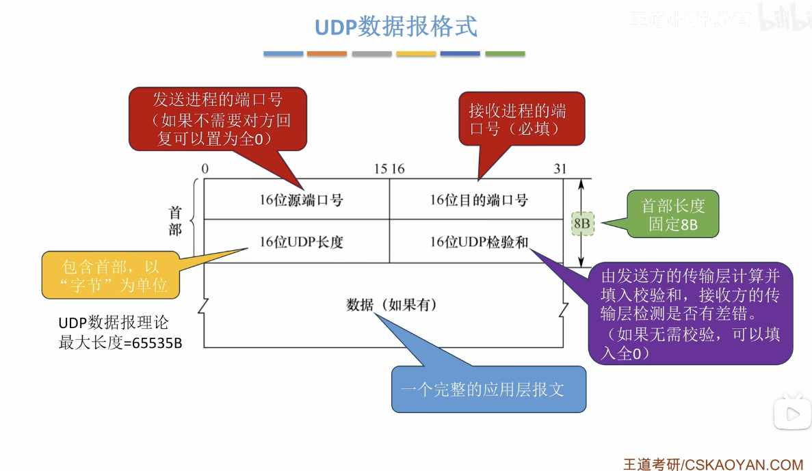
  5.2.2UDP校验
    # 发送方
    1. 添加伪首部：在计算检验和之前，先在 UDP 数据报前临时添加 12 字节的伪首部。
    1. 分组：将伪首部、UDP 首部和数据部分按 16 bit（2 字节）为一组进行划分。如果数据长度为奇数，需在末尾补一个字节的 0。
    1. **二进制求和：对所有 16 bit 组二进制相加。注意：最高位产生的进位需要回卷加到最低位（加到最低位）**
    1. **取反：将最终的加法结果逐位取反，得到 16 bit 的检验和。**
    1. 填入首部：将计算出的检验和填入 UDP 首部的“检验和”字段。
    1. 去除伪首部：去掉临时添加的伪首部，将完整的 UDP 数据报交给网络层封装成 IP 数据报进行发送。
    # 接收方
    1. 接收UDP报文，添加伪首部
    1. 把UDP首部，伪首部，数据，以16bit一组，进行二进制加法（最高位进位要回卷）
    1. 如果结果全为1，则无差错，否则有差错
  5.3.1TCP协议框架
    - TCP首部较大，24b
    - TCP支持报文拆分
    - TCP有连接，可靠传输，支持拥塞控制
    - TCP只支持一对一，不支持多对一
    # TCP协议的三大阶段
    ### 建立连接（三次握手）
    发送三个TCP报文段
    ### 数据传输
    全双工通信
    ### 释放连接（四次挥手）
    前两次挥手断开一方连接
    后两次挥手断开另一方连接
  5.3.2TCP报文段
    
    - 序号（seq）：标记数据部分的第一个字节在字节流中的位置（TCP只关心字节流顺序，不关心这是第几个数据报）
    - 确认号（ack/ack_seq）：会写一串数字，表示该字节前的所有字节以正确接收
    - ACK：为0时，ack_seq无效；为1时，ack_seq有效（只有第一个握手包的ACK=0）
    - 数据偏移：4bit，表示tcp首部长度
    - 保留：暂时没用
    - URG：紧急位，为1表示紧急指针有效，为0无效
    - 紧急指针：标记需要紧急发送的数据的字节流位置
    - PSH：为1表示希望尽快收到回复
    - RST：为1时强制释放TCP连接
    - SYN：同步位，只有第1，2次握手的值为1（标志连接请求/响应报文）
    - FIN：终止位，只有第1，3次挥手的值为1
    - 窗口（rwnd，rcvwnd）：协商接收窗口（接收缓冲区），表示当前本机的接收缓冲区还有多少（流量控制）
    - 校验和：和UDP校验一模一样
    - 选项：协商MSS（最大段长，决定单个tcp报文大小）
    PS：
    TCP首部不记录tcp数据部分长度和总长度，实际是通过IP首部-TCP首部算出来的
  5.3.3TCP连接管理（建立连接）
    前提：我们将主动发起连接的叫客户端，被动响应的叫服务器
    # 三次握手（标记值）
    握手1：客户端→服务器（客户端发起连接）
    SYN=1；ACK=0；FIN=0；seq=xx(客户端自定义的值)；ack=无效

    握手2：服务器→客户端（服务器确认并回应）
    SYN=1；ACK=1；FIN=0；seq=xx(服务器自定义的值)；ack=客户端发来的seq+1

    握手3：客户端→服务器（客户端确认）
    SYN=0；ACK=1；FIN=0；seq=不变/+n；ack=服务器seq+1
    注意⚠️
    - 只有握手1，2的SYN=1
    - 只有握手1的ACK=0
    - 握手1，2不能携带数据，但仍要消耗一个序号（seq+1）
    - 握手3可以带数据（带几个字节，消耗几个序号），也可以不带数据（不消耗序号）
    # 三次握手（状态转换）
    ### 客户端
    ```plain text
连接关闭CLOSED
↓（发送握手1）
同步已发送SYS-SENT
↓（收到握手2&发出握手3）
已建立连接ESTABLISHED
    ```
    ### 服务器
    ```plain text
连接关闭CLOSED&监听LISTEN
↓（收到握手1&发出握手2）
同步已收到SYS-RCVD
↓（收到握手3）
已建立连接ESTABLISHED
    ```
    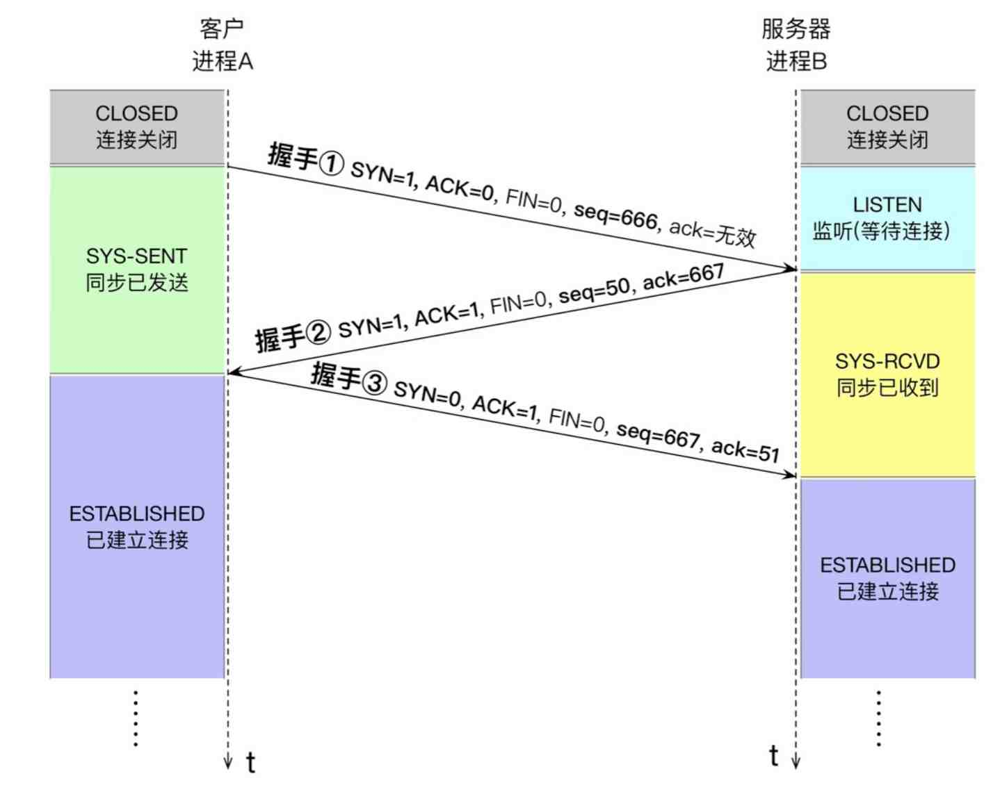
    # 建立连接耗时分析
    用（RTT：往返时延）计算
    不用死记
  5.3.3 TCP连接管理（释放连接）
    前提：仍把主动发起关闭的一方叫客户端，被动响应的一方叫服务器（双方都可能发起关闭）
    # 四次挥手（标记值）
    挥手1：客户端→服务器（客户端申请关闭）
    FIN=1；ACK=1；SYN=0；seq=xx(客户端当前序号)；ack=服务器当前seq+1（若之前已收数据则为期望的下一个序号）

    挥手2：服务器→客户端（服务器确认）
    FIN=0；ACK=1；SYN=0；seq=xx(服务器当前序号)；ack=客户端seq+1

    挥手3：服务器→客户端（服务器准备好关闭并发起关闭）
    FIN=1；ACK=1；SYN=0；seq=xx(服务器当前序号)；ack=客户端seq+1（客户端后续若有数据则相应变化）

    挥手4：客户端→服务器（客户端确认关闭）
    FIN=0；ACK=1；SYN=0；seq=客户端seq+1（若挥手1只发FIN则+1；若中间还发了数据则累计增加）；ack=服务器seq+1
    注意⚠️
    - 只有挥手1，3的FIN=1
    - 挥手1，3的FIN 即使不携带数据也会消耗一个序号（seq+1）
    - 挥手2可以携带数据，挥手4不能携带数据

    # 四次挥手（状态转换）
    ### 客户端
    ```plain text
已建立连接ESTABLISHED
↓（发送挥手1 FIN）
终止等待1FIN-WAIT-1
↓（收到挥手2 ACK）
终止等待2FIN-WAIT-2
↓（收到挥手3 FIN）
时间等待TIME-WAIT
↓（等待2MSL后）
连接关闭CLOSED
    ```
    ### 服务器
    ```plain text
已建立连接ESTABLISHED
↓（收到挥手1 FIN，发送挥手2 ACK）
关闭等待CLOSE-WAIT
↓（发送挥手3 FIN）
最后确认LAST-ACK
↓（收到挥手4 ACK）
连接关闭CLOSED
    ```
    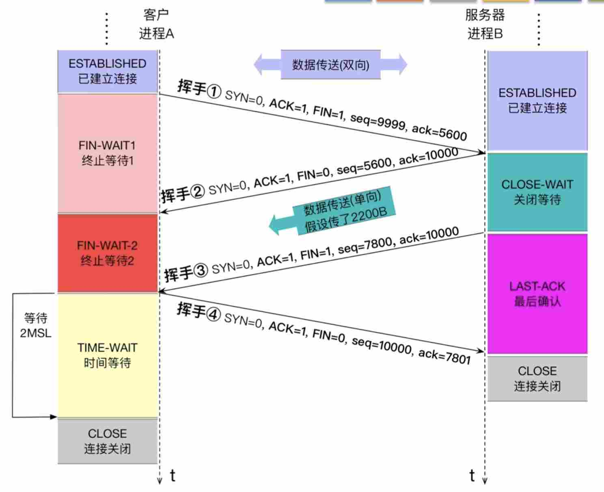

    # TIME-WAIT（为什么要等2MSL）
    - **保证挥手4的ACK可靠到达**：若ACK丢失，服务器会重传挥手3（FIN），客户端仍在TIME-WAIT才能再次发送ACK
    - **防止旧连接报文干扰新连接**：等待足够时间让网络中属于旧连接的报文都消失（2MSL）
    - 经验记忆：TIME-WAIT 在 **主动关闭方** 出现，时间为 **2MSL**
    # 释放连接耗时分析
    用（RTT：往返时延）计算
    通常至少需要：挥手1→挥手2（1RTT） + 挥手3→挥手4（1RTT） + 2MSL（TIME-WAIT）
    不用死记
    - 客户端收到挥手3后，至少要到计时2SML才能关闭
    - 服务器可以连续发出挥手2，3（这算1RTT）
    - MSL（最大报文段寿命）是TCP协议规定的固定时间
  5.3.4TCP可靠传输，流量控制
    # 可靠传输
      可靠传输基于tcp首部的序号seq实现
      - 通过TCP头部的ack来确定接收到了多少字节（收到的序号数）
      - 通过TCP头部的seq序号标记当前数据部分第一个字节在字节流中的位置
      ## 确认机制
        累积确认
        收到多个连续报文段，只需要返回一个ACK（只需要返回最大的ack值）
        推迟确认
        收到tcp报文不立即确认，而是等待多个报文一起确认
        - 最长等待0.5秒
        - 如果当前有要发送的数据则不会等待
        - 连续收到两个最大长度的报文要立即确认
        捎带确认
        在返回ACK时可以捎带数据
      ## 重传机制
        超时重传
        在tcp报文发出后会启动超时计时器，超时未收到ack会重发报文
        快重传
        使用立即确认的方式，当发送方收到4个相同的ACK（3个冗余ack）时，说明该数据报大概率丢失了，则立即重传该数据报，而不是等计时器超时（和推迟确认冲突）（不会全部重传）
        PS：为什么是3个，怎么不是2个：3个是经验值，数据报失序也会导致多个ack，因此不能太少
    # 流量控制（滑动窗口）
    通过在TCP数据报头部携带rwnd来报告自己当前接收窗口大小
    发送方根据接收方的rwnd信息和ack信息动态调整发送窗口（发送窗口不能大于接收窗口大小）
    PS：这里的发送/接收窗口不是链路层的那个，是在传输层实现的

    # 注意⚠️
    - TCP一个端口可以同时与多个设备通信（IP不同）
    - 接收缓冲区是边接收边交付（只要数据按序就可以交付）
    - **tcp的接收/发送窗口限制的是一次性能发几个tcp数据报，MSS限制的是tcp单个数据报大小，别搞混了**
  5.3.6拥塞控制
    流量控制：管端到端间收发控制
    拥塞控制：管整个网络的收发控制
    因此，引入了一个拥塞窗口cwnd来限制同时发送tcp数据报的数量
    规定
    拥塞窗口＜发送窗口＜接收窗口
    当网络发生拥塞时，拥塞窗口就会减小，从而限制各设备收发能力
    ### 判断网络拥塞的方法
    - 不拥塞：每个报文都能正常接收到ack
    - 一般拥塞：收到冗余ack，触发快重传
    - 严重拥塞：大量报文段都不能按时收到ack，触发超时重传
    

    # 慢开始算法
    前提：拥塞窗口cwnd<慢开始门限ssthresh（拥塞控制阈值）
    方法：发送方每收到一个ack就会将拥塞窗口+1（发送方每RTT cwnd翻倍）
    # 拥塞避免算法
    前提：拥塞窗口cwnd≥慢开始门限ssthresh（拥塞控制阈值）且没发生超时重传
    方法：发送方即使收到多个ack，cwnd+1（发送方每RTT cwnd+1）
    当发生超时重传时会大幅降低cwnd，并将ssthresh设为cwdn÷2
    # 快恢复算法
    前提：发生快重传（一般拥塞），还没发生ack超时
    方法：将cwnd，阈值，都设为当前cwnd的一半，让其切换回拥塞避免算法
    目的：避免拥塞窗口大幅缩小，导致落回慢开始算法
    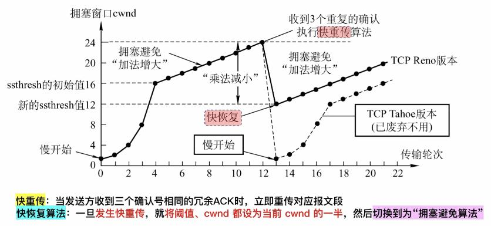
    PS：图中TCP Tahoe版本就是未加入快恢复算法的早期版本，TCP Reno是现代版本
[6.应用层](6应用层/index.md)
  6.1网络应用模型
    # 客户/服务器模型（C/S模型）
    ### 工作流程：
    1. 服务器长期运行
    1. 客户端主动向服务器发出请求
    1. 服务器被动处理请求
    ### 特点：
    - 客户进程间不直接通信
    - 客户服务器地位不平等，服务器处于中心
    优点：
    便于集中管理
    缺点：
    服务器故障影响全局
    服务器负载大
    # P2P模型
    ### 特点：
    去中心化，主机间地位平等
    主机间直接通信
    优点：
    单节点损坏不影响全局
    各结点可以分摊负载
    缺点：
    主机负载大
    可能导致网络拥塞
  6.2 DNS概述
    网址=域名
    ### 域名结构
    ```plain text
www.w3.com
www：三级域
w3：二级域
com：顶级域
    ```
    ### DNS作用
    保存各域名IP信息，将域名转换为IP
    ### DNS基本特点
    - DNS采用C/S（客户端/服务器）工作方式
    - DNS是应用层协议，通常基于UDP（53端口）
    - DNS是分布式系统，即使单个计算机出来故障，也不会妨碍整个DNS运行
  6.2DNS层次域名空间
    ### 域名书写规则
    - 低级域名在左，高级域名在右
    - 域名由标号组成，标号间用“.”分隔
    - 标号：主要由英文（不区分大小写）、数字组成；允许用连字符“-”（其他标点不行）
    - 单标号≤63字符，全域名总长（含点）≤255字符
    ### 域名层次结构
    
    ### 顶级域的分类
    - 国家顶级域名
    - 通用顶级域名
    - 基础结构域名（.arpa）（反向域名解析：将IP转换为域名）
  6.2DNS域名服务器，域名解析
    # 四类域名服务器
    根域名服务器：保存了所有的顶级域名服务器的IP
    顶级域名服务器：保存了所有二级域名服务器的IP
    权限域名服务器：保存了所有三级域名服务器IP
    本地域名服务器：用于加速
    - 通过：根→顶级→权限逐层查询
    - 全世界有13组根域名服务器，每组分配至少1个IP，提升稳定性
    - 每组根域名服务器并非单台主机，而是世界各地分散部署，支持任播，可就近访问，他们共用一个IP
    # 本地域名服务器
    各ISP和某些企业会在本地部署域名服务器
    本地域名服务器会缓存DNS查询记录，下次直接从本地返回IP
    用户主机和某些浏览器会实现一个DNS解析器，用于解析DNS报文，解析器也会缓存DNS信息
    # 域名解析过程
    ### 递归查询
    > DNS 客户端向 DNS 服务器发起查询，并要求该服务器代表客户端完成名称解析过程，返回最终结果（或明确的错误）。
    ### 迭代查询
    > DNS 服务器在无法直接回答时，不代替查询者继续查询，而是返回自己已知的最佳信息（通常是下一步应查询的 DNS 服务器）。
    无论是迭代还是递归，用户主机只和本地域名服务器请求一次（迭代/递归都是由本地域名服务器代为完成的）
  6.3FTP文件传输协议
    # ftp协议功能
    1. 提供不同类型主机系统间文件传输
    1. 以用户权限管理的方式提供远程FTP服务器上的文件管理能力
    1. 以匿名FTP的方式共享文件
    # FTP工作原理
    - ftp是应用层协议，采用C/S模型，基于TCP建立可靠传输
    - 控制连接：持久连接，FTP会话期间，保持TCP连接
    - 数据连接：非持久连接，文件传输时建立连接，结束关闭连接
    - 有一个主进程和多个从属进程，从属进程包括控制进程，数据传送进程
    

    # 数据传输
    ### 主动模式
    服务器端的数据传送进程主动向客户端发起数据连接。适用于客户端有公网IP且防火墙允许入站连接的场景。
    ### 被动模式
    服务器端被动等待客户端发起数据连接。更适用于客户端位于NAT或防火墙后、无法被外部直接访问的情况。
    ### PS
    在数据传输前，客户端需要发送port/pasv指令指定模式
    # FTP特性
    - ftp文件修改效率低，需要整体下载再上传
    - ftp分离控制与数据，控制不会因数据传输阻塞（带外传输）
    - 客户端可通过“控制连接”请求服务器返回文件列表，服务器通过“数据连接”传输文件列表
    - 主动模式无法穿透NAT
  6.4电子邮件
    # 电子邮件系统的组成
    由三大部分组成：用户代理，邮件服务器，电子邮件协议
    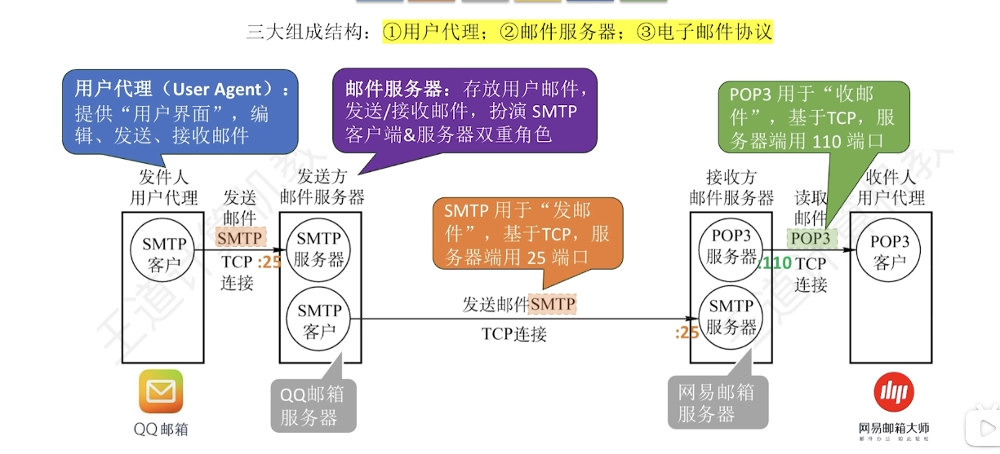

    # 电子邮件格式和MIME
    - 邮件=信封+内容
    - 内容=首部+主体
    - 首部由To（收件人），From（发件人），Subject（主体）组成，其中to，from必填
    - 信封是给SMTP协议准备的数据结构，由首部自动生成
    SMTP的局限性：只支持传输7bitASCII码（只支持纯英文）

    ### MIME
    

    mime不是协议，只是格式规范，它让邮件可以在SMTP的基础上可以发送更多格式
    mime规定了以下三部分：
    - 定义了5个新的邮件首部字段（如mime版本）
    - 定义了许多邮件主体格式（如文本，图片）
    - 定义了传送编码（如base64）
    # SMTP与POP3
    

    - HELO：相当于打招呼
    - MAIL FROM：指明“谁发的”
    - RCPT TO：指明“发给谁”，服务器会检查收件人是否存在，并给出回应
    - DATA：相当于告诉服务器“接下来要开始发邮件内容了”
    - QUIT：相当于告诉服务器“邮件发完了”
    PS：
    SMTP为push推通信方式（负责发邮件）
    POP3为pull拉通信方式（负载收邮件）
  6.4万维网
    # 浏览器访问一个网页的过程
    1. 用户输入网址
    1. 浏览器通过DNS服务器查询IP
    1. 浏览器与<Web服务器IP地址:80端口>建立TCP连接
    1. 浏览器在握手③中携带HTTP请求报文（指明要访问哪个html网页）
    1. 服务器返回HTTP响应报文（携带html文件）
    1. 如果html用了其他n个元素，还需要n组HTTP请求&响应（持续、非持续工作方式有所区别）
    # http的工作方式
    ## 持续连接
    ### 非流水线
    一个TCP连接可以处理多个HTTP请求-响应对（一次连接），但必须等待前一个请求的响应返回后，才能发送下一个请求（不能并发）
    ### 流水线
    一个TCP连接可以处理多个HTTP请求-响应对（一次连接），允许同时发送多个请求（无需等待前一个响应），服务器按顺序返回响应（可以并发）
    ## 非持续连接
    每个TCP连接仅处理一个HTTP请求-响应对，请求完成后立即关闭连接（因此访问一个网页需要多次tcp连接和释放）
    但可以通过并发多个连接来提速
    # 统一资源定位符URL
    格式：
    ```plain text
<协议>://<主机>:<端口>/<路径>
    ```
    PS：
    - URL指向万维网上的某个特定资源
    - 端口，路径可省略（有默认值）
    # http协议
    是应用层协议，基于tcp，定义了http请求报文&http响应报文两种数据结构
  6.5http协议
    # http请求
    
    ### 常见请求方法
    - get：请求读取URL标识的信息
    - head：请求读取URL标识的信息的首部
    - post：请求给服务器发送信息
    - connect：用于代理服务器
    # http响应
    
    ### 状态码
    - 1xx：信息
    - 2xx：成功
    - 3xx：重定向
    - 4xx：客户端错误
    - 5xx：服务端错误
    # cookie字段
    cookie由服务器分配给客户端，相当于临时身份证，用于识别客户端
    # connection字段
    用于标记使用何种连接方式
    - close：非持续连接
    - keep-alive：持续连接
