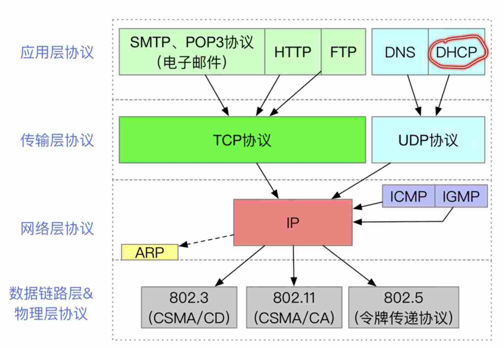

---
{
  "id": "37c5a2dd-8276-804d-ae68-ef1c93609711",
  "url": "https://app.notion.com/p/37c5a2dd8276804dae68ef1c93609711",
  "created_time": "2026-06-11T01:42:00.000Z",
  "last_edited_time": "2026-06-20T10:19:00.000Z"
}
---

#  协议栈

PDU：协议数据单元，广义概念，是IP数据报，帧，tcp数据报等的统称

搜索优化词（无意义）：HTTP，FTP，DNS，DHCP，SMTP，POP3，TCP，UDP，IP，ARP，ICMP，IGMP，CSMA/CD，CSMA/CA，令牌传递协议
